# 🚌 RideWise — Complete Platform Plan

> **From personal ride tracker → Multi-organization transportation management + live vehicle tracking platform**

---

## 1. Platform Vision

RideWise evolves from a personal solo/group ride navigator into a **three-tier transportation platform** where:

- **Normal Users** enjoy personal rides (existing) AND can search & track organization vehicles
- **Drivers** operate organization buses through session-based ride assignments with live GPS
- **Organization Admins** manage fleets, drivers, and monitor everything from a live dashboard

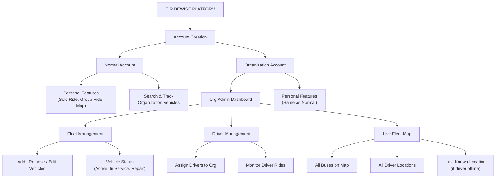

---

## 2. What Already Exists (Current RideWise)

> [!NOTE]
> All core personal features **and** the multi-tenant organization & fleet platform below are **built and live in production**. Every user can ride solo/in groups, drive for an organization, manage fleets, and track vehicles from one unified account.

| Feature | Status | Details |
|---|---|---|
| **User Auth & Sessions** | ✅ Built | Email/password, BCrypt hashing, 30-day persistent `SESSION` cookie backed by `spring-session-jdbc` in PostgreSQL (survives Render sleep/wake cycles) |
| **Solo Navigation** | ✅ Built | OSRM routing with alternatives, pure segment-projected `navigation.js` engine (accuracy-scaled hysteresis), spoken voice guidance, Screen Wake Lock, 6 map styles, 4 UI themes |
| **Group Riding & Rejoin** | ✅ Built | Real-time `/ws/rides` WebSocket (25 s heartbeat), opt-in location sharing, live **Off route** status, and purple rejoin path ahead on the main route |
| **Multi-Tenant Organizations** | ✅ Built | Public discovery & private access-code unlock (`OrgAccess`), per-organization RBAC (`OWNER`, `ADMIN`, `DRIVER`, `VIEWER`) enforced server-side via `OrgGuard` |
| **Fleet & DB-Locked Trips** | ✅ Built | Nullable unique columns (`active_vehicle_key`, `active_driver_key`) prevent double-booking atomically; 5 s throttled DB persistence; 4,000-point thinned GPS replay & CSV export |
| **Driver Mode** | ✅ Built | 3-tap trip start, app-wide background `DriverTripContext`, server-checked speed alerts, crowd level reporting (`Seats free`, `Filling up`, `Full`), one-tap **SOS** |
| **Passenger & Customer Tracking** | ✅ Built | Continuous tracking across shifts (`/ws/fleet` with 25 s heartbeat), browser-side stop-by-stop ETAs, server-evaluated **"Tell me when it's near"** proximity alerts, org announcements |
| **Org Admin Suite (9 Tabs)** | ✅ Built | **Overview**, **Live map**, **Vehicles** (`Active`/`Servicing`/`Repair`/`Retired`), **Routes**, **People**, **Trips**, **Announce**, **Statistics**, **Settings**, plus audit log |
| **Riders Community** | ✅ Built | Search by username, 50 km nearby riders (privacy-masked), connections |
| **Platform Admin & Hygiene** | ✅ Built | Platform dashboard, user/ride management, org verification/suspension, feedback with optional Gmail SMTP forwarding, 6-hour automated `DataCleanupService` |
| **Onboarding, Search & Account** | ✅ Built | Onboarding flow, universal header search (`All`, `Rides`, `Riders`, `Orgs`, `Go`), Add to Home Screen (`manifest.webmanifest`), accessibility controls, JSON account export & deletion |

**Tech Stack:** React 19 + Vite 8 + Tailwind CSS 3 + Leaflet + MapLibre (frontend) | Spring Boot 3.4 + Java 21 + PostgreSQL 15+ + Spring Session JDBC + Raw WebSockets (backend)

---

## 3. What Will Be Built (Uncompleted / Future Features)

All multi-organization, driver, passenger, and fleet tracking capabilities from the original plan are now **completed** (see Section 2 and the [Addendum](#addendum--how-this-plan-was-built-and-what-was-corrected)). Only the following uncompleted items remain for future releases:

| Planned Feature | Current State | What Remains to Build |
|---|---|---|
| **Scheduled Timetables & Stop-Order Optimization** | Routes have ordered stops and live ETAs | Add scheduled departure/arrival timetables (*"expected at 7:40 AM"*), driver shift schedules, and automated stop-order optimization |
| **Free-Form / Polygon Geofencing** | Per-vehicle *"Tell me when it's near"* stop alerts exist | Draw custom polygon zones on the map and trigger enter/leave geofence alerts for fleet admins and passengers |
| **Web Push Notifications & Offline Cache** | In-app notification bell + `manifest.webmanifest` | Add a Service Worker for offline asset caching and Web Push (`VAPID`) so alerts wake a closed browser |
| **Native Mobile Wrapper (Background GPS)** | Screen Wake Lock keeps GPS active while screen is on | Package a native wrapper (Capacitor / React Native) so drivers can stream GPS fixes reliably even when the phone screen is locked |
| **Multi-Instance Scaling (Redis Pub/Sub)** | In-memory `FleetBroadcaster` & `RideLocationBroadcaster` | Back broadcasters with Redis Pub/Sub to scale horizontally across multiple Spring Boot instances |
| **Organization Logo Upload** | Initials tile generated from org name | Attach object storage (Cloudflare R2 / S3) for custom organization logos and vehicle photos |

---

### Reference Archive: Original Feature Specifications

*(The detailed design sections below are preserved as historical architecture notes; see the [Addendum](#addendum--how-this-plan-was-built-and-what-was-corrected) at the bottom for where the implemented codebase improved on the original draft.)*

### 3.1 Account Type System

At signup, the user chooses their account type. Both types get ALL existing personal features.

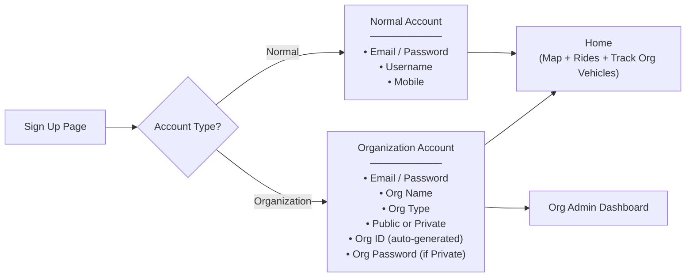

#### Account Fields

**Normal Account** (same as current):
```
email, password, username, mobile, address, lat, lng
role = "USER"
```

**Organization Account** (new):
```
email, password, username, mobile, address
role = "ORG_ADMIN"
+ Creates an Organization record:
  - org_name, org_type, visibility (PUBLIC/PRIVATE)
  - org_id (auto-generated unique ID like "RW-ORG-7A3F")
  - org_password (only if PRIVATE)
  - description, logo_url, address, lat, lng
```

---

### 3.2 Organization System — Complete Design

#### 3.2.1 Public vs Private Organizations

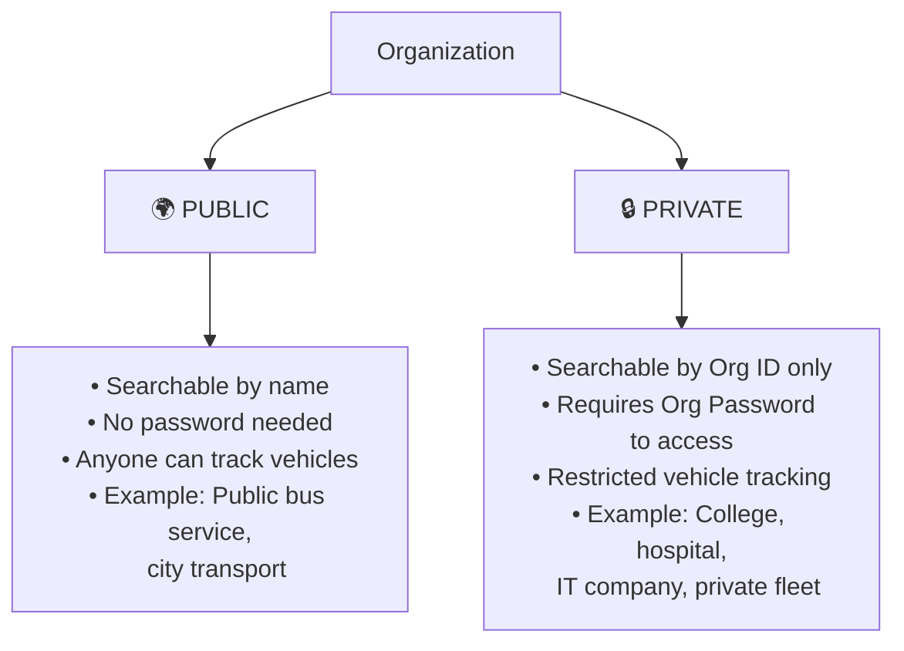

**Use cases:**
| Type | Example | How Users Access |
|------|---------|-----------------|
| **Public** | "Chennai City Bus", "Airport Shuttle" | Search by name → instant access to track |
| **Private** | "Ramco Engineering College", "Apollo Hospital" | Need Org ID + Password → then track |

#### 3.2.2 Organization Entity

```
Organization
├── id (PK, auto)
├── org_code (unique, "RW-ORG-XXXX")
├── name ("Ramco Engineering College")
├── org_type (COLLEGE / HOSPITAL / COMPANY / TRANSPORT / OTHER)
├── visibility (PUBLIC / PRIVATE)
├── org_password (BCrypt, NULL if PUBLIC)
├── description
├── logo_url
├── address
├── lat, lng (org headquarters location)
├── owner_user_id (FK → users.id, the admin who created it)
├── created_at
└── updated_at
```

#### 3.2.3 Organization Admin Capabilities

```mermaid
flowchart TD
    ADMIN["Org Admin Dashboard"]
    
    ADMIN --> FLEET["🚌 Fleet Management"]
    ADMIN --> DRVMGMT["👤 Driver Management"]
    ADMIN --> LIVEMAP["🗺️ Live Fleet Map"]
    ADMIN --> ORGSETTINGS["⚙️ Org Settings"]
    ADMIN --> ANALYTICS["📊 Analytics"]
    
    FLEET --> F1["Add Vehicle"]
    FLEET --> F2["Remove Vehicle"]
    FLEET --> F3["Edit Vehicle Details"]
    FLEET --> F4["Set Vehicle Status<br/>(ACTIVE / IN_SERVICE / REPAIR / RETIRED)"]
    
    DRVMGMT --> D1["Invite Driver<br/>(by email or username)"]
    DRVMGMT --> D2["Remove Driver from Org"]
    DRVMGMT --> D3["View Driver Status"]
    DRVMGMT --> D4["View Driver Ride History"]
    
    LIVEMAP --> L1["See ALL vehicles on map"]
    LIVEMAP --> L2["See ALL driver locations"]
    LIVEMAP --> L3["Last known location<br/>if driver offline"]
    LIVEMAP --> L4["Click vehicle → details panel"]
    
    ORGSETTINGS --> S1["Edit Org Name/Description"]
    ORGSETTINGS --> S2["Change Visibility<br/>(Public ↔ Private)"]
    ORGSETTINGS --> S3["Reset Org Password"]
    ORGSETTINGS --> S4["Upload Org Logo"]
    
    ANALYTICS --> A1["Total Rides Today"]
    ANALYTICS --> A2["Active Vehicles"]
    ANALYTICS --> A3["Driver Performance"]
    ANALYTICS --> A4["Route History"]
```

---

### 3.3 Vehicle (Bus) System — Complete Design

#### 3.3.1 Vehicle Entity

```
Vehicle
├── id (PK, auto)
├── org_id (FK → organizations.id)
├── vehicle_code ("BUS-01", editable by admin)
├── vehicle_type (BUS / VAN / AMBULANCE / CAR / OTHER)
├── registration_number ("TN-72-AB-1234")
├── capacity (seats count)
├── description / notes
├── status (ACTIVE / IN_SERVICE / REPAIR / RETIRED)
├── created_at
└── updated_at
```

#### 3.3.2 Vehicle Status Flow

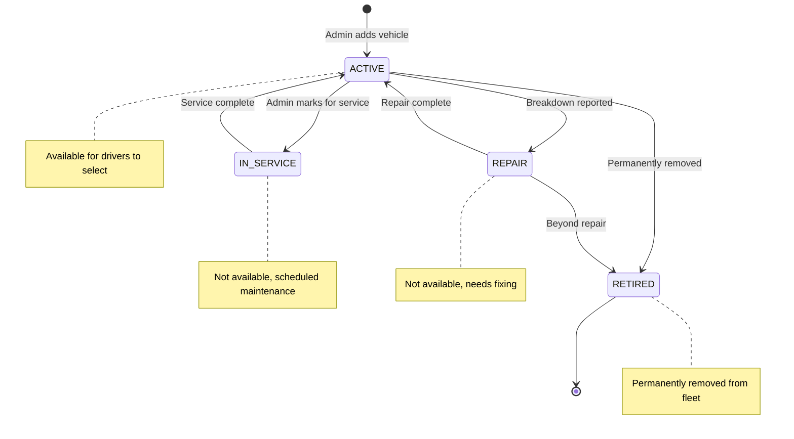

> [!IMPORTANT]
> Only vehicles with status `ACTIVE` appear in the driver's bus selection list.

---

### 3.4 Driver System — Complete Design

#### 3.4.1 How Drivers Join an Organization

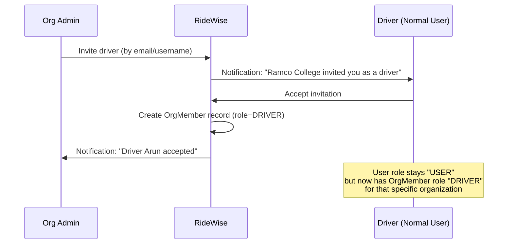

#### 3.4.2 Organization Membership Entity

```
OrgMember
├── id (PK, auto)
├── org_id (FK → organizations.id)
├── user_id (FK → users.id)
├── org_role (DRIVER / ORG_ADMIN / VIEWER)
├── status (PENDING / ACTIVE / SUSPENDED / REMOVED)
├── invited_by (FK → users.id)
├── joined_at
└── updated_at
```

> [!TIP]
> A single user can be a driver for **multiple** organizations. Their `User.role` stays `USER` — the `OrgMember.org_role` determines what they can do **within** each org.

#### 3.4.3 Driver Ride Session (Bus Locking Mechanism)

This is **the core logic** — temporary assignment of a driver to a vehicle.

```
VehicleSession
├── id (PK, auto)
├── vehicle_id (FK → vehicles.id)
├── driver_user_id (FK → users.id)
├── org_id (FK → organizations.id)
├── status (ACTIVE / COMPLETED / CANCELLED)
├── from_name, from_lat, from_lng
├── destination_name, destination_lat, destination_lng
├── route_coordinates (TEXT, for the planned route)
├── started_at
├── ended_at
├── last_lat, last_lng (driver's last known position)
├── last_location_at (timestamp of last GPS update)
└── created_at
```

#### 3.4.4 Bus Locking Logic

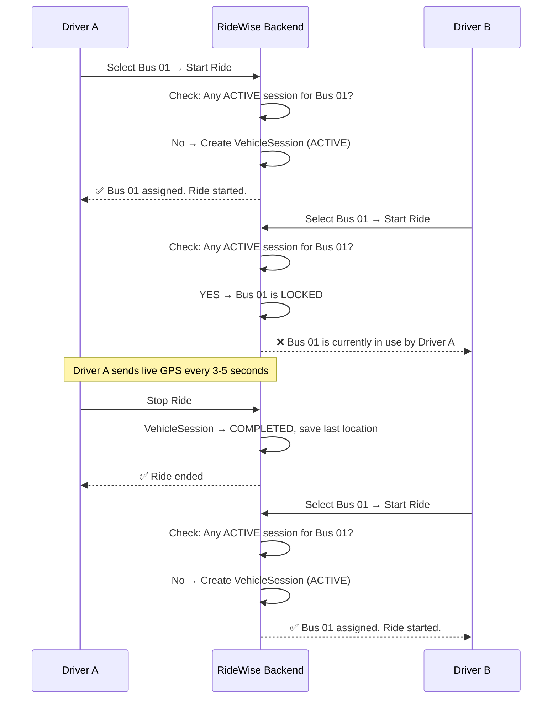

**The locking rules:**
1. One vehicle → one active session at a time
2. One driver → one active session at a time (can't drive two buses)
3. When ride ends → session marked COMPLETED → vehicle unlocked
4. Stale session sweeper (already exists in your codebase as `StaleRideSweeper`) will also clean up abandoned driver sessions

#### 3.4.5 Driver Flow (Frontend)

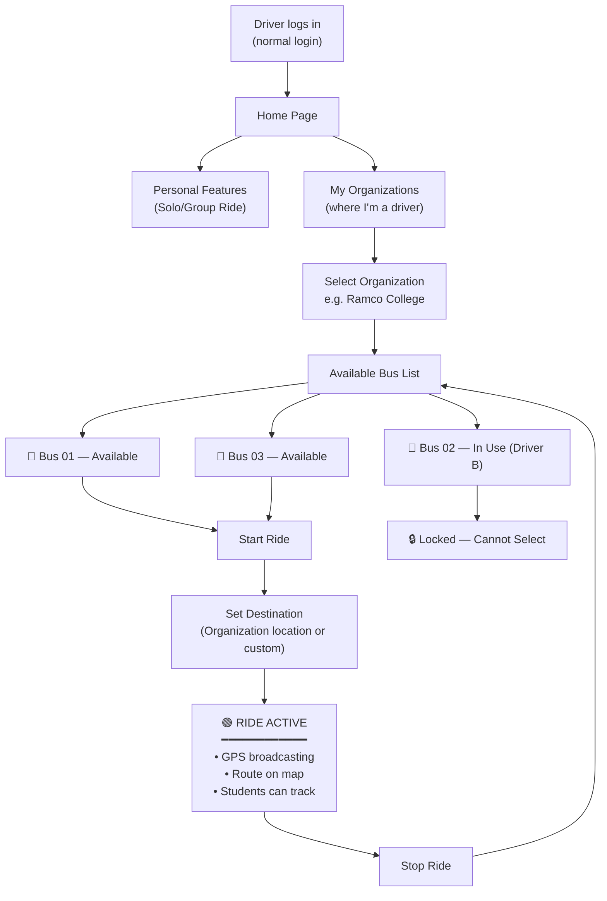

---

### 3.5 Student / Customer (Normal User) — Organization Tracking

This is how normal users find and track organization vehicles.

#### 3.5.1 Search & Access Flow

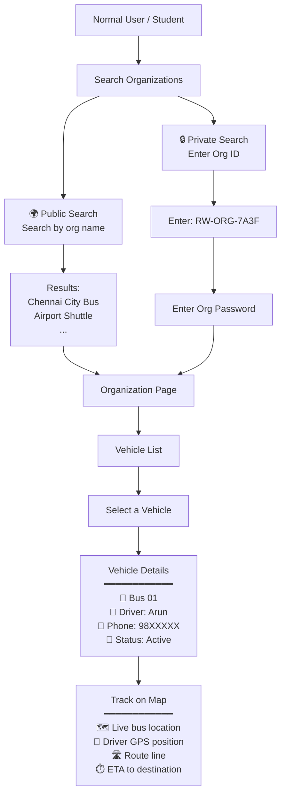

> [!IMPORTANT]
> A student/customer can only view and track **one bus at a time**. They must go back to the list to select a different bus. This keeps the interface simple and focused.

#### 3.5.2 What the Student Sees

For each active bus:
| Field | Source |
|-------|--------|
| Bus Code | `vehicle.vehicle_code` |
| Bus Type | `vehicle.vehicle_type` |
| Registration | `vehicle.registration_number` |
| Driver Name | `user.username` (from session) |
| Driver Phone | `user.mobile` (from session) |
| Live Location | WebSocket GPS stream |
| Route | `vehicle_session.route_coordinates` |
| Status | ACTIVE / IDLE / OFFLINE |
| ETA | Calculated from GPS position → destination |

For inactive buses (no current session):
- Show bus details
- Status: "Not currently active"
- Last known location (from last completed session)

#### 3.5.3 Private Org Access — Saved Access

Once a user successfully enters the Org ID + Password for a private organization, the system **saves their access** so they don't need to re-enter it every time.

```
OrgAccess
├── id (PK, auto)
├── user_id (FK → users.id)
├── org_id (FK → organizations.id)
├── granted_at
└── last_accessed_at
```

The user can see their saved organizations in a "My Organizations" section.

---

### 3.6 Live Location System — Enhanced for Vehicle Tracking

#### 3.6.1 Current WebSocket System (Stays)

Your existing `RideLocationSocketHandler` + `RideLocationBroadcaster` already handles:
- Driver connects to WebSocket with ride ID
- Sends GPS coordinates every few seconds
- All ride participants receive the broadcast

#### 3.6.2 New: Vehicle Session WebSocket Channel

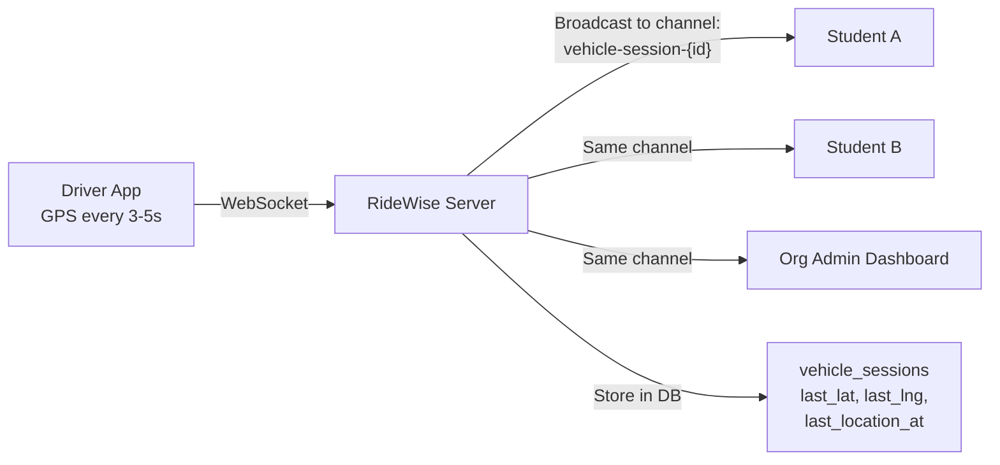

**The flow:**
1. Driver starts a vehicle session → WebSocket channel created: `vehicle-session-{sessionId}`
2. Driver's GPS updates go to this channel
3. Any student tracking this bus subscribes to the channel
4. Org admin dashboard subscribes to ALL active session channels for their org
5. Every GPS update also writes to `vehicle_sessions.last_lat, last_lng` for last-known fallback

#### 3.6.3 Last Known Location Logic

```
When loading a vehicle that has NO active session:
  1. Find the most recent COMPLETED VehicleSession for this vehicle
  2. Use its last_lat, last_lng, last_location_at
  3. Display on map with "Last seen: 2 hours ago" label
  4. Grey out the marker to indicate it's not live
```

---

## 4. Complete Data Model (New Entities)

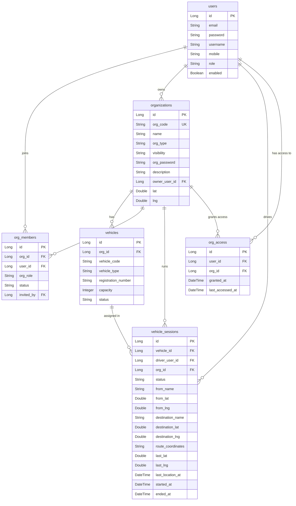

---

## 5. Complete API Design

### 5.1 Organization APIs

| Method | Endpoint | Who | Description |
|--------|----------|-----|-------------|
| `POST` | `/api/organizations` | Any user | Create a new organization |
| `GET` | `/api/organizations/mine` | Org admin | Get orgs I own |
| `GET` | `/api/organizations/{id}` | Members / Authorized | Get org details |
| `PUT` | `/api/organizations/{id}` | Org admin | Update org details |
| `DELETE` | `/api/organizations/{id}` | Org admin | Delete org (soft delete) |
| `GET` | `/api/organizations/search?q=name` | Any user | Search public orgs by name |
| `POST` | `/api/organizations/access` | Any user | Access private org with ID + password |
| `GET` | `/api/organizations/my-access` | Any user | Get orgs I have saved access to |

### 5.2 Vehicle APIs

| Method | Endpoint | Who | Description |
|--------|----------|-----|-------------|
| `POST` | `/api/organizations/{orgId}/vehicles` | Org admin | Add vehicle |
| `GET` | `/api/organizations/{orgId}/vehicles` | Members / Authorized | List all vehicles |
| `PUT` | `/api/organizations/{orgId}/vehicles/{id}` | Org admin | Edit vehicle |
| `DELETE` | `/api/organizations/{orgId}/vehicles/{id}` | Org admin | Remove vehicle |
| `PATCH` | `/api/organizations/{orgId}/vehicles/{id}/status` | Org admin | Change vehicle status |

### 5.3 Organization Member APIs

| Method | Endpoint | Who | Description |
|--------|----------|-----|-------------|
| `POST` | `/api/organizations/{orgId}/members/invite` | Org admin | Invite a driver |
| `GET` | `/api/organizations/{orgId}/members` | Org admin | List all members |
| `POST` | `/api/organizations/{orgId}/members/{id}/accept` | Invited user | Accept invitation |
| `POST` | `/api/organizations/{orgId}/members/{id}/reject` | Invited user | Reject invitation |
| `DELETE` | `/api/organizations/{orgId}/members/{id}` | Org admin | Remove member |
| `GET` | `/api/organizations/my-memberships` | Any user | Orgs where I'm a member |

### 5.4 Vehicle Session (Driver Ride) APIs

| Method | Endpoint | Who | Description |
|--------|----------|-----|-------------|
| `POST` | `/api/vehicle-sessions/start` | Driver | Start a ride (select bus + destination) |
| `POST` | `/api/vehicle-sessions/{id}/stop` | Driver | Stop the ride |
| `GET` | `/api/vehicle-sessions/active?orgId=X` | Anyone authorized | Get all active sessions for an org |
| `GET` | `/api/vehicle-sessions/{id}` | Anyone authorized | Get session details |
| `GET` | `/api/vehicle-sessions/vehicle/{vehicleId}/latest` | Anyone authorized | Get latest session for a vehicle |
| `GET` | `/api/vehicle-sessions/history?orgId=X` | Org admin | Session history with filters |

### 5.5 WebSocket Channels (New)

| Channel | Purpose |
|---------|---------|
| `/ws/vehicle-session/{sessionId}` | Live GPS stream for a specific vehicle session |
| `/ws/org-fleet/{orgId}` | Aggregated live stream of ALL active vehicles in an org |

---

## 6. Frontend Architecture — New Pages & Components

### 6.1 New Routes

```javascript
// ─── EXISTING ROUTES (unchanged) ───
/                    → Login
/onboarding          → Onboarding
/home                → Home (Map + Rides)
/riders              → Riders
/account             → Account
/settings            → Settings
/admin               → Platform Admin Dashboard
/admin/users         → Platform Admin Users
/admin/rides         → Platform Admin Rides

// ─── NEW ROUTES ───
/organizations/search          → Search & browse organizations
/organizations/:orgId          → Organization public page (vehicles list)
/organizations/:orgId/track/:vehicleId → Track specific vehicle on map
/organizations/my-access       → My saved organization access list

/driver/organizations          → Driver's organization list
/driver/org/:orgId             → Driver's vehicle selection for an org
/driver/session                → Active driver session (map + controls)

/org-admin/dashboard           → Org admin dashboard
/org-admin/vehicles            → Fleet management
/org-admin/drivers             → Driver management
/org-admin/map                 → Live fleet map
/org-admin/settings            → Organization settings
/org-admin/analytics           → Organization analytics

/create-organization           → Create new organization flow
```

### 6.2 New Component Tree

```
src/
├── pages/
│   ├── (existing pages unchanged)
│   │
│   ├── organizations/
│   │   ├── OrgSearch.jsx            ← Search public/private orgs
│   │   ├── OrgPage.jsx              ← Org details + vehicle list
│   │   ├── VehicleTracker.jsx       ← Track one vehicle on map
│   │   └── MyOrganizations.jsx      ← Saved org access list
│   │
│   ├── driver/
│   │   ├── DriverOrganizations.jsx  ← Orgs where I'm a driver
│   │   ├── DriverVehicleSelect.jsx  ← Select bus from org fleet
│   │   └── DriverSession.jsx        ← Active ride session (map + stop)
│   │
│   └── org-admin/
│       ├── OrgAdminDashboard.jsx    ← Overview: stats + quick actions
│       ├── OrgAdminVehicles.jsx     ← CRUD vehicles
│       ├── OrgAdminDrivers.jsx      ← Invite/manage drivers
│       ├── OrgAdminFleetMap.jsx     ← Live map with all vehicles
│       ├── OrgAdminSettings.jsx     ← Edit org details
│       └── OrgAdminAnalytics.jsx    ← Charts + reports
│
├── components/
│   ├── org/
│   │   ├── OrgCard.jsx              ← Org card in search results
│   │   ├── OrgAccessModal.jsx       ← Enter Org ID + Password modal
│   │   ├── VehicleCard.jsx          ← Vehicle card with status badge
│   │   ├── VehicleStatusBadge.jsx   ← Active/Repair/In Service badge
│   │   ├── DriverStatusBadge.jsx    ← Online/Offline/Riding badge
│   │   ├── FleetMapView.jsx         ← Full fleet map component
│   │   └── VehicleTrackMap.jsx      ← Single vehicle tracking map
│   │
│   └── shared/
│       ├── OrgProtectedRoute.jsx    ← Route guard for org admin pages
│       └── DriverProtectedRoute.jsx ← Route guard for driver pages
│
├── services/
│   ├── orgApi.js                    ← Organization API calls
│   ├── vehicleApi.js                ← Vehicle API calls
│   ├── orgMemberApi.js              ← Member management API calls
│   ├── vehicleSessionApi.js         ← Vehicle session API calls
│   └── vehicleSessionSocket.js      ← WebSocket for vehicle tracking
│
└── context/
    └── OrgContext.jsx               ← Current org context for admin/driver
```

---

## 7. Key Business Logic — Detailed Rules

### 7.1 Bus Locking Rules

```
RULE 1: One vehicle → max one ACTIVE session
  IF vehicle has ACTIVE session → reject new session for that vehicle
  ERROR: "This vehicle is currently in use by {driverName}"

RULE 2: One driver → max one ACTIVE session
  IF driver has ACTIVE session anywhere → reject new session
  ERROR: "You already have an active ride on {vehicleCode}"

RULE 3: Only ACTIVE vehicles can be selected
  IF vehicle.status != ACTIVE → hide from driver's selection list

RULE 4: Only ACTIVE org members with role DRIVER can start sessions
  IF orgMember.status != ACTIVE || orgMember.org_role != DRIVER → reject

RULE 5: Stale session auto-cleanup
  IF session is ACTIVE but no GPS update for >30 minutes → auto-complete
  Save last known location before completing
```

### 7.2 Organization Access Rules

```
PUBLIC ORG:
  - Searchable by name
  - Anyone can view vehicle list
  - Anyone can track active vehicles
  - No password needed

PRIVATE ORG:
  - Searchable by org_code only
  - Requires org_password to access
  - Once authenticated, access saved in org_access table
  - User can track vehicles until admin revokes access
  - Admin can reset org_password (doesn't revoke existing access)
  - Admin can revoke individual user access
```

### 7.3 Driver Invitation Rules

```
INVITE:
  - Only org admin can invite
  - Invite by email or username
  - Creates OrgMember with status=PENDING
  - Sends notification to the user
  - User must already have a RideWise account

ACCEPT:
  - User accepts → status changes to ACTIVE
  - User can now see org's vehicle list
  - User can start vehicle sessions

REJECT:
  - User rejects → OrgMember record deleted
  - Admin notified

REMOVE:
  - Admin removes driver → status changes to REMOVED
  - If driver has ACTIVE session → force-complete it first
  - Driver loses access immediately
```

### 7.4 GPS Broadcasting Logic

```
DRIVER SIDE:
  1. Driver starts vehicle session
  2. Frontend starts GPS watch (navigator.geolocation.watchPosition)
  3. Every 3-5 seconds, send to WebSocket: { lat, lng, speed, heading, timestamp }
  4. Backend writes to vehicle_sessions.last_lat/last_lng/last_location_at
  5. Backend broadcasts to channel: vehicle-session-{sessionId}

STUDENT SIDE:
  1. Student opens vehicle tracking page
  2. Frontend connects to WebSocket: vehicle-session-{sessionId}
  3. Receives live { lat, lng, speed, heading } updates
  4. Updates marker position on map with smooth animation
  5. Calculates and displays ETA using routing API

ORG ADMIN SIDE:
  1. Admin opens fleet map
  2. Frontend connects to WebSocket: org-fleet-{orgId}
  3. Receives aggregated updates from ALL active sessions
  4. Shows all vehicles as markers on the map
  5. Click a vehicle → zoom in + show details panel
```

---

## 8. Enhanced Features (Ideas You Might Have Missed)

> [!TIP]
> These are smart additions that make the platform more robust and professional.

### 8.1 Vehicle Route History

```
When an org admin clicks on a vehicle:
  → See route history for that vehicle
  → Visual replay of past routes on map
  → Stats: total km driven, trips today, average trip duration
```

### 8.2 ETA Notifications for Students

```
When a student is tracking a bus:
  → Option to set "Notify me when bus is 5 min away"
  → Backend calculates ETA from driver GPS → student's saved location
  → Push notification / in-app alert when ETA < threshold
```

### 8.3 Driver Schedule (Future)

```
Admin can set a schedule:
  Bus 01 → Driver A → Mon/Wed/Fri → 8:00 AM - 5:00 PM
  Bus 02 → Driver B → Daily → 7:00 AM - 6:00 PM
  
  System auto-suggests bus when driver logs in based on schedule
```

### 8.4 Geofence Alerts

```
Admin defines geofence zones:
  → "College Campus" (lat/lng + radius)
  → "City Depot" (lat/lng + radius)
  
When a vehicle enters/exits a geofence:
  → Notification to admin
  → Auto-update status (e.g., "Bus 01 arrived at campus")
```

### 8.5 Emergency Stop / SOS

```
Driver can trigger SOS:
  → Sends alert to org admin
  → Marks vehicle position on admin's map with red alert
  → Sends notification to all students tracking that bus
```

### 8.6 Organization Announcements

```
Admin can post announcements:
  → "Bus 03 cancelled today due to maintenance"
  → Shows on org page for all students/users
  → Push notification to users who have this org saved
```

### 8.7 Multi-Admin Support

```
Org owner can promote other org members to ORG_ADMIN:
  → Multiple admins can manage the same org
  → Owner retains special privileges (delete org, transfer ownership)
```

### 8.8 Org Member Role: VIEWER

```
For organizations that want to give read-only access:
  → Students can be invited as VIEWER (not just anonymous access)
  → Viewers get notifications, announcements
  → Useful for private orgs that want a member list
```

---

## 9. Navigation & UI Layout

### 9.1 Updated Sidebar/Navigation

```
┌─────────────────────────────┐
│  RIDEWISE                   │
├─────────────────────────────┤
│  🏠 Home (Map + Rides)      │  ← existing
│  👥 Riders                  │  ← existing
│  🔔 Notifications           │  ← existing
├─────────────────────────────┤
│  🏢 ORGANIZATIONS           │  ← NEW section
│  ├── 🔍 Search / Browse     │
│  ├── 📋 My Organizations    │
│  └── 🚌 Track Vehicles      │
├─────────────────────────────┤
│  🚗 DRIVER PANEL            │  ← NEW (only if user is a driver)
│  ├── 🏢 My Orgs (as driver) │
│  └── 🟢 Active Session      │
├─────────────────────────────┤
│  📊 ORG ADMIN               │  ← NEW (only if user is org admin)
│  ├── 📈 Dashboard            │
│  ├── 🚌 Vehicles             │
│  ├── 👤 Drivers              │
│  ├── 🗺️ Fleet Map           │
│  └── ⚙️ Settings            │
├─────────────────────────────┤
│  👤 Account                 │  ← existing
│  ⚙️ Settings                │  ← existing
│  🔑 Platform Admin          │  ← existing (if ADMIN role)
└─────────────────────────────┘
```

### 9.2 Home Page Changes

The Home page remains the **same** but with one addition:

```
┌──────────────────────────────────┐
│          HOME PAGE               │
├──────────────────────────────────┤
│                                  │
│  ┌────────────────────────────┐  │
│  │         MAP                │  │  ← existing
│  │    (Solo/Group Rides)      │  │
│  └────────────────────────────┘  │
│                                  │
│  ┌────────────────────────────┐  │
│  │ 🏢 Quick Access            │  │  ← NEW widget
│  │ ┌──────┐ ┌──────┐ ┌──────┐│  │
│  │ │Ramco │ │Apollo│ │City  ││  │
│  │ │ 🚌 3  │ │ 🚑 2  │ │ 🚌 12 ││  │
│  │ └──────┘ └──────┘ └──────┘│  │
│  └────────────────────────────┘  │
│                                  │
└──────────────────────────────────┘
```

A small widget showing the user's saved organizations with active vehicle counts, for quick access.

---

## 10. Implementation Phases

> [!IMPORTANT]
> Build in phases so the platform stays stable at each stage.

### Phase 1: Foundation — Organization & Vehicle System
**Estimated effort: High**

```
Backend:
  ☐ Organization entity + repository + service + controller
  ☐ Vehicle entity + repository + service + controller
  ☐ OrgMember entity + repository + service + controller
  ☐ OrgAccess entity + repository + service
  ☐ Organization search (public by name, private by code)
  ☐ Private org password authentication
  ☐ API security: org-level authorization checks

Frontend:
  ☐ Account type selection on signup (Normal / Organization)
  ☐ Create organization flow
  ☐ Organization search page
  ☐ Organization page (details + vehicle list)
  ☐ Private org access modal (enter ID + password)
  ☐ My Organizations page (saved access)
  ☐ OrgContext provider
```

### Phase 2: Org Admin Dashboard
**Estimated effort: High**

```
Backend:
  ☐ Org admin role verification middleware
  ☐ Vehicle CRUD with status management
  ☐ Driver invitation system (invite/accept/reject/remove)
  ☐ Org settings update APIs
  ☐ Org analytics queries

Frontend:
  ☐ Org Admin layout + sidebar
  ☐ Dashboard page (stats cards + charts)
  ☐ Vehicle management page (add/edit/remove/status)
  ☐ Driver management page (invite/manage)
  ☐ Organization settings page
  ☐ OrgProtectedRoute guard
```

### Phase 3: Driver System + Bus Locking
**Estimated effort: High (core feature)**

```
Backend:
  ☐ VehicleSession entity + repository + service + controller
  ☐ Bus locking logic (one vehicle = one active session)
  ☐ Driver locking logic (one driver = one active session)
  ☐ Start/stop vehicle session APIs
  ☐ Stale vehicle session sweeper (extend existing StaleRideSweeper)
  ☐ Vehicle session GPS update endpoint

Frontend:
  ☐ Driver organizations page
  ☐ Driver vehicle selection page (with lock indicators)
  ☐ Driver active session page (map + stop button + GPS broadcast)
  ☐ DriverProtectedRoute guard
```

### Phase 4: Live Tracking — Student & Admin
**Estimated effort: High (real-time)**

```
Backend:
  ☐ Vehicle session WebSocket handler (like existing RideLocationSocketHandler)
  ☐ Org fleet WebSocket channel (aggregated feed)
  ☐ Last known location fallback logic
  ☐ Session-based GPS storage (last_lat, last_lng)

Frontend:
  ☐ Student vehicle tracking page (single bus on map)
  ☐ Live GPS marker with smooth animation
  ☐ ETA calculation and display
  ☐ Org admin fleet map (all vehicles)
  ☐ Vehicle detail panel on fleet map
  ☐ Last known location display (greyed out marker)
  ☐ Quick access widget on Home page
```

### Phase 5: Polish & Enhanced Features
**Estimated effort: Medium**

```
  ☐ ETA notifications for students
  ☐ Organization announcements
  ☐ Multi-admin support
  ☐ Vehicle route history + replay
  ☐ Org analytics charts (rides per day, active hours, etc.)
  ☐ Mobile-responsive org admin dashboard
  ☐ Emergency SOS button for drivers
  ☐ Geofence alerts (future)
  ☐ Driver schedules (future)
```

---

## 11. Summary — The Complete Platform at a Glance

```mermaid
flowchart TD
    PLATFORM["🚌 RIDEWISE PLATFORM"]
    
    PLATFORM --> LAYER1["LAYER 1: Personal<br/>(EXISTING — All Users)"]
    PLATFORM --> LAYER2["LAYER 2: Organization Tracking<br/>(NEW — All Users)"]
    PLATFORM --> LAYER3["LAYER 3: Driver Operations<br/>(NEW — Drivers)"]
    PLATFORM --> LAYER4["LAYER 4: Fleet Management<br/>(NEW — Org Admins)"]
    
    LAYER1 --> L1A["Solo Ride"]
    LAYER1 --> L1B["Group Ride"]
    LAYER1 --> L1C["Riders / Connections"]
    LAYER1 --> L1D["Ride History"]
    
    LAYER2 --> L2A["Search Organizations"]
    LAYER2 --> L2B["Access Private Orgs"]
    LAYER2 --> L2C["View Vehicle List"]
    LAYER2 --> L2D["Track Live Bus"]
    LAYER2 --> L2E["ETA + Notifications"]
    
    LAYER3 --> L3A["Select Organization"]
    LAYER3 --> L3B["Select Available Bus"]
    LAYER3 --> L3C["Start Ride Session"]
    LAYER3 --> L3D["Broadcast Live GPS"]
    LAYER3 --> L3E["Stop Ride Session"]
    
    LAYER4 --> L4A["Add/Edit/Remove Vehicles"]
    LAYER4 --> L4B["Invite/Manage Drivers"]
    LAYER4 --> L4C["Live Fleet Map"]
    LAYER4 --> L4D["Analytics & Reports"]
    LAYER4 --> L4E["Org Settings"]

    style LAYER1 fill:#22c55e,color:#000
    style LAYER2 fill:#3b82f6,color:#fff
    style LAYER3 fill:#f59e0b,color:#000
    style LAYER4 fill:#ef4444,color:#fff
```

> **RideWise = Personal ride tracker + Multi-org fleet management + Live vehicle tracking**
>
> Every user gets the personal features. Organizations add fleet management on top. Drivers operate the fleet. Students track the fleet. Everything connects through a real-time GPS system built on the existing WebSocket infrastructure.

---

*This plan preserves everything that already exists and builds new features on top as independent, modular layers. No existing code needs to be rewritten — only extended.*

---

## Addendum — how this plan was built, and what was corrected

*Added when the plan was implemented. Everything above is the plan as written; this section records
where the built platform deliberately differs, and why. Where the two disagree, the code and the
README follow this section.*

### Corrections to the plan's logic

| # | The plan said | What was built instead | Why |
|---|---|---|---|
| 1 | A global `ORG_ADMIN` role on the user, chosen as an "account type" at sign-up | No new global role. `OrgMember.role` — **OWNER / ADMIN / DRIVER / VIEWER** — per organization. Sign-up only asks "for myself / for an organization", which decides where the first steps lead | One person can own one organization, drive for a second and follow a third. A global role cannot express that, and an "organization account" could never simply ride |
| 2 | Live tracking subscribes to a trip (`/ws/vehicle-sessions/{sessionId}`) | One socket, `/ws/fleet`; a client watches a **vehicle** or an **organization** | A trip ends and the next begins. Someone following "Bus 01" would be left on a dead channel — now the same screen goes live again by itself |
| 3 | "Check whether the bus has an active session", then insert | The check stays (for the friendly message), but the guarantee is two **unique** columns on the trip row, set only while it runs | Two drivers tapping *Start* in the same instant both pass a check-then-insert. The database cannot be raced |
| 4 | Only the vehicle was locked | The **driver** is locked too: one running trip per driver | One phone cannot be in two buses |
| 5 | The driver's phone number is shown to everyone tracking | Shown to the organization's admins; to followers only if the organization switches it on | A public bus service should not publish its drivers' numbers by accident |
| 6 | A private organization is looked up by code, then asks for the password | Code and password are sent together; a wrong code and a wrong password give the same answer; attempts are rate-limited; a private organization never appears in search, not even by its code | Otherwise codes can be enumerated and passwords guessed without limit |
| 7 | "Access" exists only for private organizations | The same record doubles as "on my list" for public ones | It gives public followers a shortcut — and gives announcements an audience |
| 8 | Positions broadcast and stored on every GPS fix; ETA from the server | Broadcast from memory on every fix, **stored every 5 seconds**; ETA computed in the browser by the existing navigation engine | The database load no longer grows with the number of fixes or watchers, and no routing request is needed per watcher |
| 9 | Distance and speed as reported by the driver's app | **Measured by the server** from the accepted fixes (with GPS-jump and accuracy filters) | A modified app cannot report a nicer trip |
| 10 | A trip ends when the driver presses Stop | Also: ended by an admin, **automatically** after 30 silent minutes, and immediately when the driver is removed or suspended (in the organization, or their account on the platform) or the organization is suspended or deleted | A dead phone must not keep a bus "in use" all day |
| 11 | Removing a vehicle deletes it | A vehicle with trip history is **retired** instead; a vehicle on a trip cannot be removed or sent to repair | History must keep the vehicle it belongs to |
| 12 | `/org-admin/dashboard` | `/org-admin/:orgId/dashboard` | One person can manage several organizations |
| 13 | A trip = a vehicle and a destination | Organizations save **routes with stops**; the road is planned *through* the stops; a trip keeps its own copy, so editing a route never changes history. A free destination is still possible | That is what makes a bus — and what "arrives at my stop in 6 minutes" needs |
| 14 | Owners and admins only administer | They may also drive | In a small organization they often do |

### Added beyond the plan

Seat availability set by the driver · speed limit per organization, counted by the server and shown to
the driver · emergency (SOS) with instant admin notification · "tell me when it's near" alerts that work
with the app closed · announcements · trip replay and CSV export · statistics per day, driver and
vehicle in the viewer's own time zone · an activity log · ownership transfer · VIEWER role · platform
verification and suspension of organizations · the trip tracked app-wide (the position keeps flowing
whatever page the driver opens) · admin screens downloaded only when opened.

### Not built yet (said plainly)

- **Free-form geofences** (enter / leave a drawn zone) — the per-vehicle "near this place" alert covers the common case
- **Driver schedules / timetables**
- **Organization logo upload** — there is no file storage on the current hosting; an initials tile is used
- **Web push** — notifications appear inside the app (the bell); they do not wake a closed browser
- **Running several backend servers** — live state is in one server's memory; more than one instance needs a shared message bus
- **GPS with the screen off** — a browser stops delivering positions when the phone locks. The app keeps the screen awake while a trip runs; a native app is the real answer
