<div align="center">
  
</div>

<h1 align="center">RideWise</h1>

<p align="center">
  <b>Turn-by-turn GPS navigation, live group riding, and multi-tenant fleet tracking — all in one open-source app.</b><br/>
  <i>Built for solo riders, group rides, college buses, travel operators, and city fleets.<br/>
  Runs on open map infrastructure with zero paid API keys.</i>
</p>

<p align="center">
  <a href="https://ride-wise.pages.dev">
    
  </a>
  <a href="docs/video/ridewise-promo.mp4">
    
  </a>
  <a href="LICENSE">
    
  </a>
  <a href="CONTRIBUTING.md">
    
  </a>
</p>

<p align="center">
  
  
  
  
  
  
  
  
</p>

<div align="center">

[**Why RideWise**](#why-i-built-ridewise) · [**Demo**](#watch-the-demo) · [**Feature Tour**](#feature-tour) ·
[**Map Providers**](#maps-geocoding-and-routing) · [**Free-Tier Limits & Economics**](#live-hosting-limits-and-economics) ·
[**Architecture**](#architecture) · [**Quick Start**](#quick-start) · [**Contributing**](#contributing) · [**License**](#license-and-fair-use)

</div>

---

## Why I Built RideWise

Most GPS apps only solve one narrow piece of the puzzle. Consumer navigation apps get *you* from A to B, while fleet tracking tools live behind sales calls, proprietary hardware, and per-vehicle monthly fees. Almost nothing handles both solo/group riding and real multi-organization fleet operations—and almost nothing does it without locking you into paid map and routing API keys.

I built RideWise so one account can cover both sides of the road:

| Capability | Consumer navigation apps | Traditional fleet software | **RideWise** |
|---|:---:|:---:|:---:|
| Turn-by-turn voice navigation | ✅ | — | ✅ |
| Live group rides on one shared map | Limited | — | ✅ |
| Multi-tenant organizations & RBAC | — | ✅ | ✅ |
| Live bus / cab tracking for passengers | — | Paid add-on | ✅ |
| Paid map or routing API keys needed | Usually | Usually | **None** |
| Self-hostable | — | Rarely | ✅ |
| Cost to get started | Ads / subscription | Per-vehicle quote | **Free (AGPL-3.0)** |

Permissions in RideWise are scoped **per organization**, not baked into a rigid "account type." The same person can navigate solo in the morning, lead a weekend group ride at noon, drive a college bus on a weekday afternoon, and manage a 20-vehicle transit fleet from their laptop in the evening.

> [!NOTE]
> **Trying the live app at [ride-wise.pages.dev](https://ride-wise.pages.dev)?**
> The live backend runs on Render's free tier, so if nobody has used it for 15 minutes, the very first request takes **~30–60 seconds** to wake up. Once it's awake, everything runs smoothly—and your login session stays alive across sleep/wake cycles.

---

## Watch the Demo

<p align="center">
  <a href="docs/video/ridewise-promo.mp4">
    
  </a>
  <br/>
  <sub><b>▶ Watch the demo video</b> — <a href="docs/video/ridewise-promo.mp4">docs/video/ridewise-promo.mp4</a> (recorded from the live app, with music)</sub>
</p>

Every frame in the demo was captured directly from the running backend and frontend—no Figma mockups or faked UI: solo navigation, a three-rider group ride with live off-route recovery, a college bus fleet, a travel company dispatch desk, and a 20-bus city transit map.

---

## Feature Tour

Here is a quick overview of what each role can do before we walk through the screens:

| Role | What you can do |
|---|---|
| **Solo riders** | Plan routes with alternatives, get turn-by-turn voice guidance, switch across 6 map styles, recover automatically if you miss a turn, keep your screen awake, and review ride history. |
| **Group riders** | Invite friends to a shared ride, stream live positions on one map (with opt-in location sharing), see who drifted off route, and follow a purple rejoin line back to the pack. |
| **Passengers, students & customers** | Browse public organizations or unlock private ones with an org access code, track a live bus or cab with stop-by-stop ETA and crowd level, set **"Tell me when it's near"** alerts, and read announcements. |
| **Drivers** | Start a trip in three taps (pick vehicle → pick saved route or destination → start), get full navigation with app-wide background trip tracking, speed alerts, crowd reporting, and one-tap **SOS**. |
| **Organization admins** | Full 9-tab operations suite: Overview, Live Map, Vehicles, Multi-Stop Routes, Team & Roles, Trip History (GPS replay + CSV export), Announcements, Analytics, and Settings. |
| **Platform admins** | Platform-wide dashboard, user management, active ride monitoring & bulk cleanup, organization verification/suspension, and user feedback with optional Gmail forwarding. |

All screenshots below are real, unedited captures from the running app (plus two multi-device composite frames from the demo).

---

### 1. Home Dashboard, Ride History & Themes

The home screen gives you one-tap access to start a ride, check your history, find nearby riders, or jump straight into your followed organizations' live buses. RideWise also includes universal header search (`All`, `Rides`, `Riders`, `Orgs`, `Go`), automatic ride retention (`Never`, `1d`, `7d`, `30d`, `90d`), installable PWA support, accessibility controls (font scaling, reduced motion, high contrast, voice commands), and four themes (**Dark**, **Light**, **Warm**, **Midnight**).

<table>
  <tr>
    <td align="center" width="33%">
      
    </td>
    <td align="center" width="33%">
      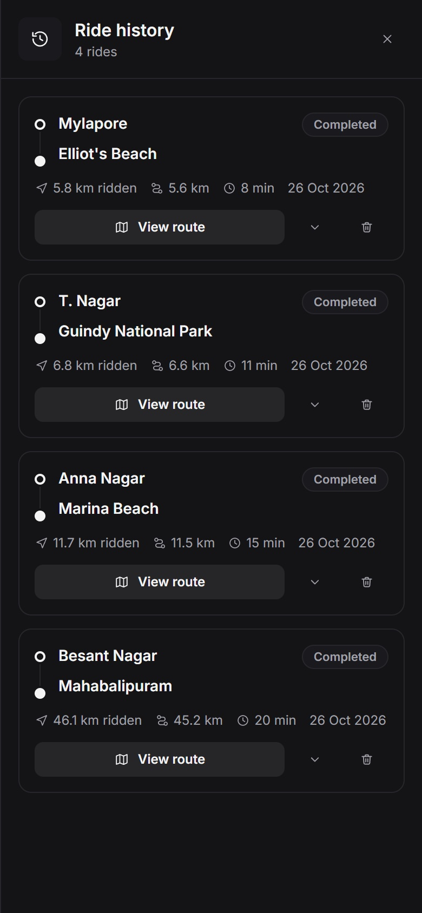
    </td>
    <td align="center" width="33%">
      
    </td>
  </tr>
  <tr>
    <td align="center"><sub><b>Home dashboard</b><br/>Quick actions, voice hint, live bus finder &amp; personal stats</sub></td>
    <td align="center"><sub><b>Ride history</b><br/>Ridden vs. planned distance, duration, date &amp; route view</sub></td>
    <td align="center"><sub><b>Theme switcher</b><br/>Dark, Light, Warm &amp; Midnight themes</sub></td>
  </tr>
</table>

---

### 2. Solo Turn-by-Turn Navigation & Map Styles

All navigation math lives in a single framework-free module, [`frontend/src/services/navigation.js`](frontend/src/services/navigation.js). Rather than doing a naive "distance to nearest route vertex" check (which flickers off-route on long straight roads), it **projects your GPS fix onto the active route segment** with accuracy-scaled hysteresis.

- **Turn-by-turn voice & full maneuver list** — spoken directions plus a scrollable step list showing completed, current, and upcoming turns.
- **Screen Wake Lock & offline recovery** — keeps your phone screen on mid-ride and restores your active ride if your mobile data drops briefly.
- **6 map styles on the fly** — Automatic (matches your UI theme), Standard, Dark, Satellite, Terrain, and Cycling.

<table>
  <tr>
    <td align="center" width="50%">
      
    </td>
    <td align="center" width="50%">
      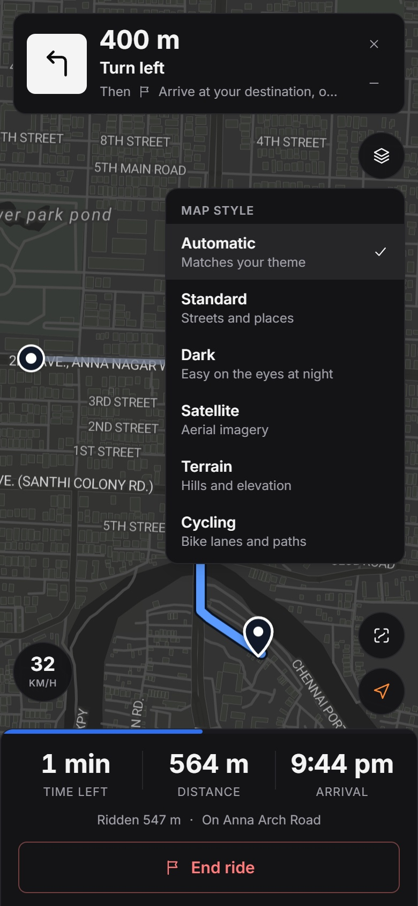
    </td>
  </tr>
  <tr>
    <td align="center"><sub><b>Turn-by-turn navigation</b><br/>Live maneuver card, speed, remaining distance, ETA &amp; voice toggle</sub></td>
    <td align="center"><sub><b>6 map styles</b><br/>Switch between Automatic, Standard, Dark, Satellite, Terrain &amp; Cycling</sub></td>
  </tr>
  <tr>
    <td align="center" width="50%">
      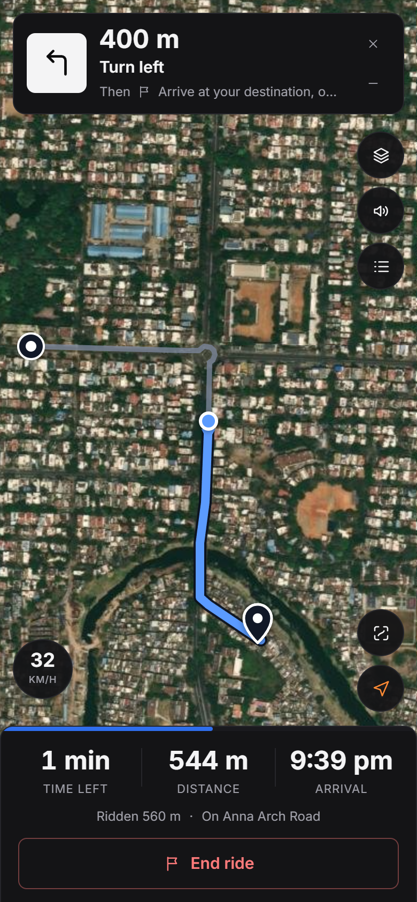
    </td>
    <td align="center" width="50%">
      
    </td>
  </tr>
  <tr>
    <td align="center"><sub><b>Satellite mode</b><br/>Esri World Imagery aerial view mid-navigation</sub></td>
    <td align="center"><sub><b>Full directions preview</b><br/>Checkmarked past turns, highlighted next turn &amp; arrival</sub></td>
  </tr>
</table>

---

### 3. Live Group Riding & Off-Route Purple Rejoin

Group rides stream positions over an authenticated WebSocket (`/ws/rides`) that reuses your existing session cookie and checks group membership on every message.

- **Opt-in privacy** — the ride creator shares location automatically; invited riders can toggle location sharing on or off whenever they want. No fake markers are drawn if a rider's GPS is off.
- **Group-wide off-route visibility** — if someone misses a turn, everyone else sees their pill switch to **Off route** on the live map.
- **Purple rejoin routing** — instead of telling the stray rider to make an awkward U-turn back to where they drifted off, RideWise calculates a **purple rejoin path ahead on the main route** with its own turn instructions so they catch back up to the group cleanly.

<p align="center">
  
  <br/>
  <sub><b>Three phones in sync</b> — Priya, Karthik, and Arjun riding together live over <code>/ws/rides</code></sub>
</p>

<table>
  <tr>
    <td align="center" width="33%">
      
    </td>
    <td align="center" width="33%">
      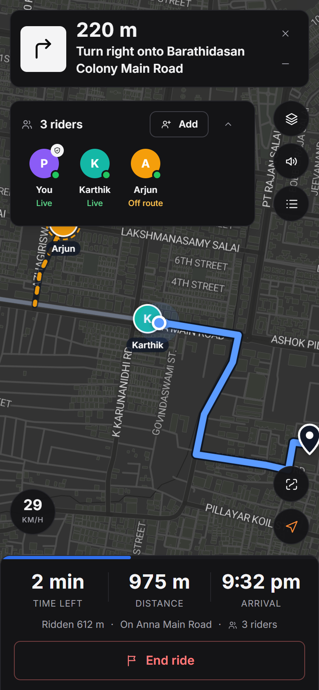
    </td>
    <td align="center" width="33%">
      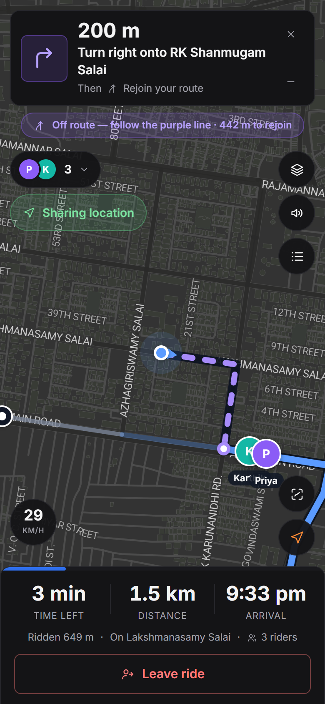
    </td>
  </tr>
  <tr>
    <td align="center"><sub><b>Riding together</b><br/>All three riders moving live along the shared route</sub></td>
    <td align="center"><sub><b>Group off-route alert</b><br/>Expanded rider list flags Arjun as <i>Off route</i> in real time</sub></td>
    <td align="center"><sub><b>Purple rejoin line</b><br/>Stray rider gets a dedicated rejoin path ahead on the route</sub></td>
  </tr>
</table>

---

### 4. Multi-Tenant Organizations & Passenger / Customer Tracking

Any college, school, hospital, company, travel agency, or city operator can create its own isolated organization—either **public** (searchable by anyone) or **private** (unlocked with an organization access code like `RW-ZU5NHC`).

- **Live bus & cab views** — passengers see the vehicle moving in real time, its current speed, crowd level (`Seats free`, `Filling up`, `Full`), and a stop-by-stop ETA drawer calculated right in the browser using the same navigation engine.
- **"Tell me when it's near" proximity alerts** — evaluated server-side and pushed straight to the passenger when the bus approaches their chosen stop.
- **Continuous tracking across trips** — clients subscribe to a *vehicle* or *organization* rather than a single trip ID, so if one shift ends and the next begins, your screen automatically picks up the new trip.

<table>
  <tr>
    <td align="center" width="50%">
      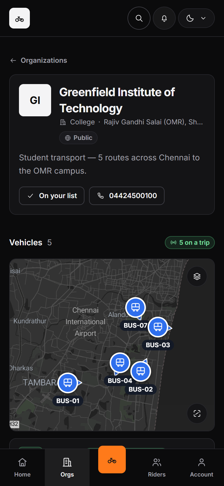
    </td>
    <td align="center" width="50%">
      
    </td>
  </tr>
  <tr>
    <td align="center"><sub><b>Organization hub</b><br/>Public college page, contact info &amp; live 5-bus overview map</sub></td>
    <td align="center"><sub><b>Passenger live view</b><br/>Follow BUS-07 with ETA, next stop &amp; crowd status</sub></td>
  </tr>
  <tr>
    <td align="center" width="50%">
      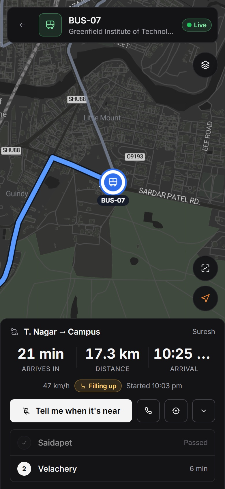
    </td>
    <td align="center" width="50%">
      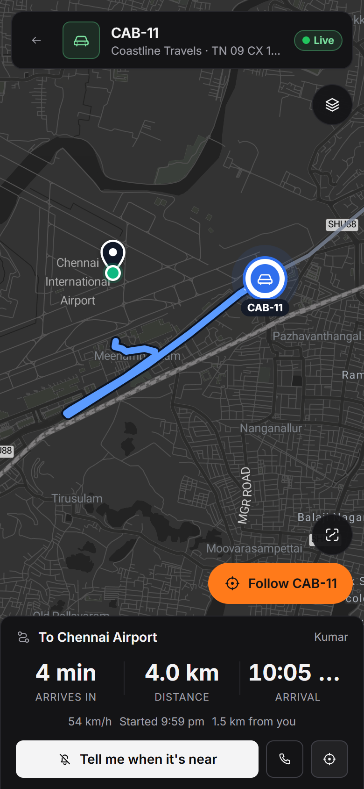
    </td>
  </tr>
  <tr>
    <td align="center"><sub><b>Stop-by-stop ETA &amp; alerts</b><br/>Passed stops, upcoming ETAs, crowd badge &amp; proximity alert</sub></td>
    <td align="center"><sub><b>Customer trip tracking</b><br/>Follow your assigned cab or van straight to drop-off</sub></td>
  </tr>
</table>

<p align="center">
  
  <br/>
  <sub><b>Both sides of a dispatch</b> — Coastline Travels dispatcher on desktop while the passenger tracks <code>CAB-11</code> on mobile</sub>
</p>

---

### 5. Fleet Operations, Live Map & Admin Suite

Organization admins get a 9-tab operations dashboard covering **Overview, Live Map, Vehicles, Multi-Stop Routes, Team & Roles, Trip History, Announcements, Analytics, and Settings**, while drivers get a focused **Driver Mode** with background trip tracking, crowd reporting, speed alerts, and live **SOS** triggers.

- **Impossible to double-book** — active trips use database-level nullable unique keys (`active_vehicle_key`, `active_driver_key`), so even if two drivers tap *Start* on the same bus at the exact same millisecond, PostgreSQL rejects the duplicate atomically.
- **Server-measured analytics** — total distance, top speed, and speeding events are computed on the backend from accepted GPS fixes rather than blindly trusting client numbers.
- **Trip replay & CSV export** — every trip stores a thinned GPS breadcrumb trail (capped at 4,000 points/trip) that admins can replay or export.
- **Vehicle lifecycle & audit trail** — track vehicles through `Active`, `Servicing`, `Repair`, and `Retired`, with an org-scoped activity log and platform-level admin controls for verification and suspension.

<table>
  <tr>
    <td width="50%">
      
    </td>
    <td width="50%">
      
    </td>
  </tr>
  <tr>
    <td align="center"><sub><b>Live map — bus detail</b><br/>Selected vehicle telemetry, driver, active route &amp; stops</sub></td>
    <td align="center"><sub><b>Full campus fleet</b><br/>All 5 buses across the city with live crowd badges</sub></td>
  </tr>
  <tr>
    <td width="50%">
      
    </td>
    <td width="50%">
      
    </td>
  </tr>
  <tr>
    <td align="center"><sub><b>Admin overview</b><br/>Live KPI cards, shareable org access code &amp; recent audit activity</sub></td>
    <td align="center"><sub><b>Travel company dispatch</b><br/>Cabs and vans with live trip details &amp; passenger info</sub></td>
  </tr>
</table>

<p align="center">
  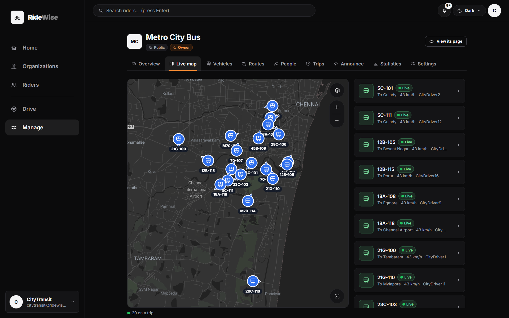
  <br/>
  <sub><b>City-scale view</b> — tracking a 20-bus metro transit network on one live map</sub>
</p>

---

## Maps, Geocoding and Routing

One goal I cared a lot about was building RideWise with **zero paid API keys**. Every map tile, place search, and route request goes **directly from the user's browser to the open geospatial provider**—so **0 bytes** of map or routing traffic ever touch the RideWise backend.

Here is every external provider used in `frontend/src/pages/components/ride/mapStyles.js` and `frontend/src/services/routingApi.js`, along with its real-world usage policy:

| Provider / Layer | Role in RideWise | Automatic Fallback | Official Policy & Free-Tier Limits |
|---|---|---|---|
| **OpenStreetMap Standard** (`tile.openstreetmap.org`, z19) | Default **Standard** map style | — | Community-funded fair use (OSMF Tile Usage Policy); requires `© OpenStreetMap contributors` (ODbL); heavy/commercial traffic or bulk scraping is blocked. |
| **Stadia Maps** (`alidade_smooth_dark` z20 & `stamen_terrain` z18) | Primary **Dark** & **Terrain** styles | Dark → CSS-inverted OSM<br/>Terrain → OpenTopoMap | **200,000 credits/month free**, strictly **non-commercial** (dev/personal/academic). Works keyless on `localhost`; production domains use free domain auth in the Stadia dashboard. Hard cap (HTTP 429, no surprise overage bills). |
| **Esri / ArcGIS World Imagery** (`server.arcgisonline.com`, z19) | **Satellite** style | — | Free for personal, educational, and non-commercial interactive viewing; commercial apps require a paid ArcGIS plan. Attribution (`© Esri, Maxar, Earthstar Geographics`) required; no bulk caching. |
| **OpenTopoMap** (`tile.opentopomap.org`, z17) | Automatic fallback for **Terrain** | — | Community best-effort (CC-BY-SA 3.0), no SLA, no bulk scraping. |
| **CyclOSM** (`tile-cyclosm.openstreetmap.fr`, z18) | **Cycling** style | — | OSM Tile Usage Policy fair use; valid attribution required; heavy/commercial traffic blocked. |
| **Photon by Komoot** (`photon.komoot.io/api/`) | Primary place search / autocomplete | Races with Nominatim after 1.2 s | Public community instance (Apache 2.0 software, OSM data); low-traffic fair use only; heavy automated bursts get throttled or banned. |
| **Nominatim (OSMF)** (`nominatim.openstreetmap.org`) | Search fallback + reverse geocoding | — | **Strict max 1 request/second** across the entire application; no un-throttled autocomplete or bulk geocoding; OSM attribution required. |
| **OSRM Demo + FOSSGIS Germany** (`router.project-osrm.org` → `routing.openstreetmap.de`) | Turn-by-turn road routing & alternatives | Sticky failover between the two servers | Donated public demo servers (no SLA, not for high-volume commercial apps); ~1 req/sec fair use per client; OSM attribution required. |

### Built-In Politeness & Resilience

Because these are shared public servers, RideWise is written to behave like a good citizen:

- **1.1-second client request queues** — `geocodeQueue` and `routeQueue` enforce a `1100 ms` minimum gap between calls so a user typing fast or re-routing never hammers Nominatim or OSRM.
- **Privacy-aware search biasing** — when biasing Photon search near your current location, coordinates are rounded to ~1 km before leaving the browser.
- **Automatic tile fallback** — if a style like Stadia Dark or Stadia Terrain hits 3 failed tile loads (e.g., HTTP 429 or blocked domain) with 0 tiles loaded, RideWise quietly switches that session to its fallback (CSS-inverted OSM Standard for Dark, OpenTopoMap for Terrain) so the map never goes blank.
- **Sticky OSRM failover** — if the primary OSRM demo server times out or errors, RideWise fails over to FOSSGIS Germany and remembers the healthy server for subsequent routes.

---

## Live Hosting Limits and Economics

The live demo at **[ride-wise.pages.dev](https://ride-wise.pages.dev)** runs on a **$0/month** three-tier cloud stack. I want to be completely transparent about what those free tiers give you, how far the live app can actually go, and what happens when you move RideWise onto dedicated servers.

### What Powers the Live App ($0/month)

| Layer | Host & Plan | Free-Tier Limits | How RideWise Works Within Them |
|---|---|---|---|
| **Frontend + Edge Proxy** | **Cloudflare Pages** (Free) | Unlimited static bandwidth · 500 builds/mo · **100,000 Pages Functions req/day** (10 ms CPU/invocation) | React/Vite assets load straight from Cloudflare's edge. Pages Functions proxy `/api/*` and `/ws/*` so session cookies stay first-party. A WebSocket `Upgrade` handshake counts as **1 request**; ongoing WS frames don't consume daily quota. RideWise's **25 s ping** beats Cloudflare's 100 s idle WS timeout. |
| **Backend API & WebSockets** | **Render** (Free Web Service) | **512 MB RAM** · **0.1 vCPU** · 750 hrs/mo · **5 GB/mo** outbound bandwidth · sleeps after **15 min idle** (~30–60 s cold start) | Live fleet updates broadcast directly from memory (`ConcurrentHashMap`), persisting to PostgreSQL only every **5 s**. `spring-session-jdbc` keeps users logged in across sleep/wake cycles. |
| **Database** | **Aiven for PostgreSQL** (Free) | **1 GB storage** · **1 GB RAM** · **1 vCPU** · max **20 connections** · automated backups | HikariCP is capped at **10 connections** (`open-in-view=false`), leaving plenty of headroom. A scheduled 6-hour cleanup job prunes old route JSON (>7 d), replay tracks (>90 d), old notifications, and audit logs (>180 d). |

### How Far Can the Free Live App Actually Go?

Because telemetry fan-out happens in memory and replay points are thinned (`>= 40 m` moved or `>= 30 s` with `>= 5 m` movement, capped at 4,000 points/trip), the free deployment punches well above its weight:

| Workload | Realistic Free-Tier Capacity | Primary Bottleneck |
|---|---|---|
| **Simultaneous live fleet vehicles** (sending GPS) | **~15–30 active vehicles** smoothly | Render 0.1 vCPU (0.2 DB writes/s + 0.67 WS frames/s per vehicle) |
| **Simultaneous group-ride sharers** | **~10–25 active sharers** | Render 0.1 vCPU + HikariCP 10-connection pool (1 upsert row/sharer) |
| **Concurrent live WebSocket viewers** | **~50–150 viewers** comfortably *(ceiling ~200–300)* | Render 512 MB JVM heap & 5 GB/mo egress (**0 extra DB load** per viewer!) |
| **Daily active usage** | **~400–600 active user-hours/day** (~50–100 DAU) | Cloudflare 100,000 Functions req/day (WS frames exempt) |
| **Historical GPS trips in PostgreSQL** | **~7,000–10,000+ hours** of fleet trips (~5–6M thinned points) | Aiven 1 GB storage (auto-maintained by 6-hour cleanup job) |

**What hits limits first under heavy traffic?**
1. **Render's 0.1 vCPU & 512 MB RAM** — latency spikes or GC pauses if >25–30 vehicles and >150 viewers hit it at the exact same time.
2. **Public Nominatim / OSRM / Stadia fair-use rate limits** — simultaneous bursts of route calculations or searches can trigger temporary HTTP 429s on public community servers.
3. **Render's 5 GB/month outbound bandwidth** — streaming dozens of live viewers 24/7 can burn through 5 GB in a few days.
4. **Cloudflare 100k/day & Aiven 1 GB / 20 connections** — usually the *last* things to bottleneck thanks to WS frame exemption, `open-in-view=false`, and automated DB hygiene.

### The Economics of RideWise ($0 & 100% Legal vs. Dedicated Hosting)

I deliberately engineered RideWise to run at **$0 cost and 100% legally**: open-source code, open data with proper attributions, polite client-side rate queues, and zero scraped tiles. That makes it easy for any student, hobbyist, or developer to clone, test, and learn from without pulling out a credit card.

Just keep the legal boundary in mind: the free public map/routing servers (OSM tiles, Nominatim, Photon, OSRM demos, Stadia Free, Esri public World Imagery) are meant for **personal, educational, portfolio, and low-traffic non-commercial use**—not high-volume commercial SaaS.

Here is what unlocks the moment you put RideWise on your own infrastructure:

- **Small Production / Campus / SMB Fleet (~$20–$40/month):** Move Spring Boot + PostgreSQL onto a modest **2 vCPU / 4 GB RAM VPS** (Hetzner, DigitalOcean, AWS Lightsail, or GCP) and run self-hosted regional **OSRM + Photon** containers alongside a commercial tile plan (or self-hosted PMTiles on Cloudflare R2). Cold starts drop to **zero**, routing drops under **50 ms**, rate limits disappear, licensing is clean for commercial use, and a single node comfortably handles **200–500+ live vehicles and 1,000–3,000+ concurrent viewers**.
- **City / Enterprise Scale ($100–$300+/month on GCP or AWS):** Add **Redis Pub/Sub** behind the existing `FleetBroadcaster` / `RideLocationBroadcaster` seam, run multiple Spring Boot instances behind a load balancer with managed PostgreSQL, and host a dedicated routing/tile cluster. That gets you **thousands of vehicles and tens of thousands of daily commuters** without ever paying Google Maps Platform's per-request bills.

---

## Architecture

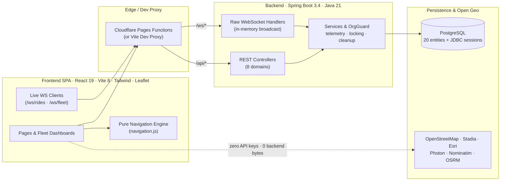

**Four core design rules**

1. Navigation math stays pure and framework-free—shared by solo rides, group rides, fleet ETA, and unit tests.
2. Live WebSocket broadcasts fan out from memory; PostgreSQL only gets throttled state updates and thinned tracks.
3. Every organization endpoint checks permissions through `OrgGuard` on the server—the frontend never decides access.
4. Map tiles, search, and routing run browser-direct with automatic fallbacks and fair-use queues.

### Engineering Highlights

| Problem | How RideWise handles it |
|---|---|
| **Double-booked vehicles or drivers** | Nullable unique columns (`active_vehicle_key`, `active_driver_key`) set only while a trip is active—concurrent starts fail atomically at the DB level. |
| **10 or 1,000 people watching one bus** | Positions broadcast from memory over `/ws/fleet`; DB writes happen at most once every 5 s per active vehicle regardless of viewer count. |
| **Tamper-proof fleet analytics** | Distance, top speed, and speeding events are computed server-side from accepted GPS fixes, never trusted from client reports. |
| **Cheap passenger ETAs** | The browser feeds streamed vehicle fixes through `navigation.js`—zero extra routing API calls per passenger. |
| **Jittery off-route false alarms** | Segment projection with GPS-accuracy hysteresis instead of naive nearest-vertex distance. |
| **Continuous tracking across trips** | Viewers subscribe to a *vehicle* or *organization*, not a trip ID, so tracking continues automatically when the next trip begins. |
| **Sessions surviving free-tier sleep** | Spring Session JDBC persists 30-day sessions in PostgreSQL so Render spin-downs never log users out. |
| **Fast, safe local tests** | Backend tests run on isolated in-memory H2 (`MODE=PostgreSQL`); frontend tests run natively via `node --test`. |

---

## Quick Start

Whether you just want to poke around locally in 60 seconds or run the full PostgreSQL setup on your machine, this section walks you through every step from scratch.

### Step 1: Install Python 3.8+

RideWise ships with a single cross-platform setup script (`setup.py`) that checks and installs everything else for you—including Java 21+ and Node.js 18+. The only thing you need first is **Python 3.8 or newer**:

- **Download Python:** [https://www.python.org/downloads/](https://www.python.org/downloads/)
- **Windows tip:** On the very first screen of the Python installer, **check the box that says `Add python.exe to PATH`** before clicking *Install Now*.
- **macOS / Linux:** Python 3 is usually pre-installed.

Verify it works in a terminal:

```bash
python3 --version     # macOS / Linux
py --version          # Windows
```

### Step 2: Clone the Repo & Run `setup.py`

```bash
git clone https://github.com/sGokulaKumaran/Ride-Wise.git
cd Ride-Wise
python3 setup.py      # Windows: py setup.py
```

`setup.py` automatically:
1. Checks for **Python 3.8+**, **Java 21+**, and **Node.js 18+ / npm**.
2. Offers to install missing Java/Node runtimes via your system package manager (`winget`, `brew`, `apt-get`, `dnf`, `pacman`, or `zypper`).
3. Resolves Maven dependencies in `backend/ridewise`.
4. Runs `npm install` in `frontend`.

<p align="center">
  
  <br/>
  <sub><b>Steps 1 &amp; 2</b> — Install Python 3.8+ (checking <i>Add python.exe to PATH</i> on Windows), clone the repo, and run <code>setup.py</code></sub>
</p>

<details>
<summary><b>Useful <code>setup.py</code> flags</b></summary>

| Command | What it does |
|---|---|
| `python3 setup.py --check` | Check installed tool versions only; install nothing. |
| `python3 setup.py --yes` | Skip prompts and auto-confirm missing tool installs. |
| `python3 setup.py --no-tools` | Never install Java/Node automatically; print instructions instead. |
| `python3 setup.py --backend` | Resolve backend Maven dependencies only. |
| `python3 setup.py --frontend` | Install frontend npm packages only. |

*(`setup.sh` and `setup.ps1` still exist as thin wrappers that simply invoke `setup.py`.)*

</details>

---

### Option A: Quick Try in 1 Minute (No Database Needed — H2 Mode)

Want to test the whole app immediately without installing PostgreSQL? The backend includes an in-memory H2 profile (configured in PostgreSQL compatibility mode):

```bash
# Terminal 1 — start backend on http://localhost:8080 (in-memory H2)
cd backend/ridewise
./mvnw spring-boot:test-run        # Windows: .\mvnw.cmd spring-boot:test-run

# Terminal 2 — start frontend on http://localhost:5173
cd frontend
npm run dev
```

Open **[http://localhost:5173](http://localhost:5173)**. Vite proxies both `/api/*` and `/ws/*` to `http://localhost:8080`, so there is zero CORS config to touch. *(Note: H2 data resets when you stop the backend.)*

---

### Option B: Full Local Setup with PostgreSQL (Step-by-Step)

If you want real, persistent storage (or if this is your first time setting up PostgreSQL), follow these four steps—**you do not need to write or run any SQL migration scripts**.

#### 1. Download & Install PostgreSQL

1. Download the official installer for your OS from **[https://www.postgresql.org/download/](https://www.postgresql.org/download/)** (PostgreSQL 15, 16, or 17 all work great).
2. During installation:
   - Keep **pgAdmin 4** checked (it gives you a clean visual UI to manage databases).
   - Keep the default port **`5432`** and superuser **`postgres`**.
   - **Remember the password** you set for `postgres`—you'll use it as `DB_PASSWORD` in Step 3.

<p align="center">
  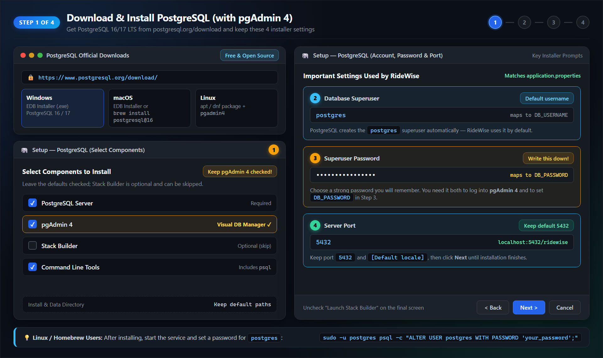
  <br/>
  <sub><b>PostgreSQL Step 1</b> — Install PostgreSQL with pgAdmin 4 checked, Port <code>5432</code>, and note your <code>postgres</code> password</sub>
</p>

#### 2. Log In & Create the `ridewise` Database

- **Using pgAdmin 4 (GUI):** Open **pgAdmin 4** → expand **Servers → PostgreSQL** (enter the password you created in Step 1) → right-click **Databases** → **Create → Database...** → name it **`ridewise`** → click **Save**.
- **Or using the terminal (`psql`) in one line:**
  ```bash
  psql -U postgres -c "CREATE DATABASE ridewise;"
  ```

<p align="center">
  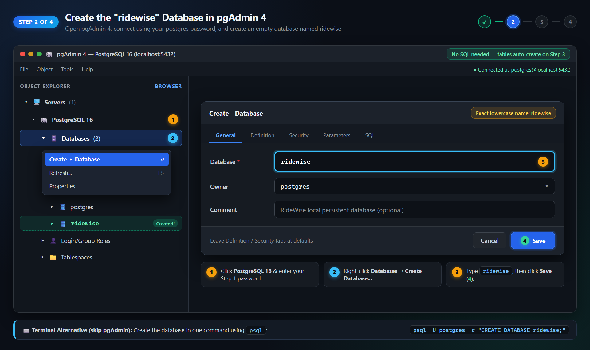
  <br/>
  <sub><b>PostgreSQL Step 2</b> — Create an empty <code>ridewise</code> database via pgAdmin 4 or <code>psql</code></sub>
</p>

#### 3. Set Environment Variables & Start Both Servers

Set your database credentials in Terminal 1 and start Spring Boot (`:8080`), then start Vite (`:5173`) in Terminal 2. Replace `your_postgres_password` with the password you set in Step 1.

**Windows PowerShell (Terminal 1 — Backend):**
```powershell
cd backend\ridewise
$env:DATABASE_URL="jdbc:postgresql://localhost:5432/ridewise"
$env:DB_USERNAME="postgres"
$env:DB_PASSWORD="your_postgres_password"

# Optional — override default initial platform admin (defaults: admin@ridewise.com / Admin@123)
$env:RIDEWISE_ADMIN_EMAIL="admin@ridewise.com"
$env:RIDEWISE_ADMIN_PASSWORD="YourStrongPassword123!"

.\mvnw.cmd spring-boot:run
```

**Windows Command Prompt / CMD (Terminal 1 — Backend):**
```cmd
cd backend\ridewise
set DATABASE_URL=jdbc:postgresql://localhost:5432/ridewise
set DB_USERNAME=postgres
set DB_PASSWORD=your_postgres_password
mvnw.cmd spring-boot:run
```

**macOS / Linux — Bash or Zsh (Terminal 1 — Backend):**
```bash
cd backend/ridewise
export DATABASE_URL="jdbc:postgresql://localhost:5432/ridewise"
export DB_USERNAME="postgres"
export DB_PASSWORD="your_postgres_password"

# Optional — override default initial platform admin
export RIDEWISE_ADMIN_EMAIL="admin@ridewise.com"
export RIDEWISE_ADMIN_PASSWORD="YourStrongPassword123!"

./mvnw spring-boot:run
```

**All Platforms (Terminal 2 — Frontend):**
```bash
cd frontend
npm run dev
```

Now open **[http://localhost:5173](http://localhost:5173)** in your browser!

<p align="center">
  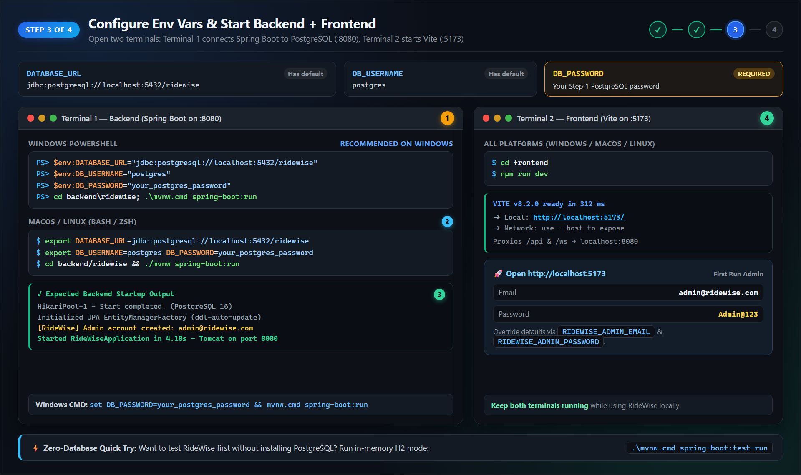
  <br/>
  <sub><b>PostgreSQL Step 3</b> — Export your DB credentials, launch Spring Boot on <code>:8080</code>, and launch Vite on <code>:5173</code></sub>
</p>

> [!TIP]
> On first boot with an empty database, `DataInitializer` automatically seeds an initial platform admin account (`RIDEWISE_ADMIN_EMAIL` / `RIDEWISE_ADMIN_PASSWORD`, defaulting to `admin@ridewise.com` / `Admin@123`). If you expose your server publicly, always set a strong custom password!

#### 4. Verify Auto-Created Tables

You never need to run manual SQL schema scripts. On first startup, Hibernate (`spring.jpa.hibernate.ddl-auto=update`) and Spring Session JDBC (`session-schema.sql`) automatically create all **22 tables** in the `public` schema: **20 JPA entity tables** + **`spring_session`** & **`spring_session_attributes`**.

To confirm, refresh **`ridewise → Schemas → public → Tables`** in pgAdmin 4 (you'll see `Tables (22)`), or run `\dt` in `psql`:

```bash
psql -U postgres -d ridewise -c "\dt"
```

<p align="center">
  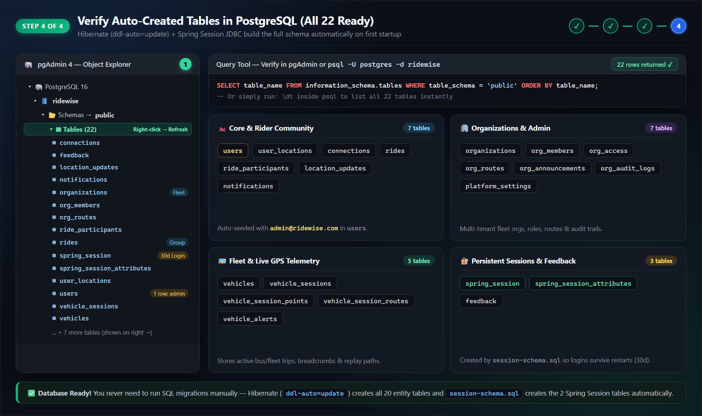
  <br/>
  <sub><b>PostgreSQL Step 4</b> — All 22 tables (20 JPA entities + 2 Spring Session tables) are created automatically on first boot</sub>
</p>

---

### Running the Tests

```bash
# Backend — Spring integration & WebSocket tests on isolated in-memory H2
cd backend/ridewise
./mvnw test            # Windows: .\mvnw.cmd test

# Frontend — pure navigation, places & fleet logic tests + ESLint
cd frontend
npm test
npm run lint
```

---

## Repository Blueprint

```text
RideWise/
├── backend/ridewise/                     # Spring Boot 3.4 · Java 21 REST + WebSocket API
│   └── src/main/java/vehicle/ridewise/
│       ├── config/                       # security, CORS, WebSocket, session & origin rules
│       ├── controller/                   # 8 REST controllers
│       ├── entity/                       # 20 JPA entities
│       ├── service/                      # business logic, OrgGuard RBAC, telemetry & cleanup
│       └── websocket/                    # /ws/rides and /ws/fleet handlers + broadcasters
├── frontend/                             # React 19 · Vite 8 · Tailwind · Leaflet SPA
│   ├── functions/                        # Cloudflare Pages proxy functions (/api/* & /ws/*)
│   ├── src/
│   │   ├── context/                      # AuthContext, OrgContext, DriverTripContext
│   │   ├── services/                     # pure navigation.js, routingApi.js, WS & REST clients
│   │   └── pages/                        # home, ride, riders, settings, admin, organizations
│   └── tests/                            # native node --test suites
├── docs/
│   ├── screenshots/                      # real app screenshots + setup/ PostgreSQL guides
│   └── video/ridewise-promo.mp4          # demo video with music
├── setup.py                              # single cross-platform setup script (Python 3.8+)
├── setup.sh / setup.ps1                  # thin wrappers around setup.py
├── CONTRIBUTING.md                       # contribution guide & PR checklist
├── NOTICE                                # third-party data & library licenses
├── LICENSE                               # GNU AGPL-3.0
└── Full plan for the platform/           # complete product & architecture blueprint
```

---

## API, Database & Environment Reference

<details>
<summary><b>REST and WebSocket endpoints</b></summary>

| Domain | Base path | Highlights |
|---|---|---|
| **Auth & account** | `/api/auth` | Sign up, sign in, sign out other sessions, email/password change, JSON account export & deletion. |
| **Rides** | `/api/rides` | Create, list, and delete rides; bulk-clear finished rides; live location snapshots; group participants. |
| **Live group socket** | `/ws/rides` | `subscribe`, `location`, `stop`, `snapshot`, `participants-changed`, `ride-ended`. |
| **Organizations & fleet** | `/api/organizations` | Public discovery, private access-code unlock, members & roles, vehicles, multi-stop routes, trips, analytics, announcements. |
| **Vehicle trips & alerts** | `/api/vehicle-sessions`, `/api/vehicle-alerts` | DB-locked trip start/stop, GPS ingestion, crowd level, SOS, trip replay, proximity alerts. |
| **Live fleet socket** | `/ws/fleet` | `watch-vehicle`, `watch-org`, `position`, `session-started/ended`, `sos`, `crowd`, `announcement`. |
| **Rider community** | `/api/riders` | Search, nearby riders (50 km radius, privacy-masked), connections. |
| **Platform admin** | `/api/admin` | Platform stats, user editing/deletion, ride force-end & bulk cleanup, org verification/suspension. |
| **Feedback & notifications** | `/api/feedback`, `/api/notifications` | Bug reports & feedback with optional Gmail alerts; real-time unread notifications. |

</details>

<details>
<summary><b>Database tables (22) &amp; environment variables</b></summary>

**Auto-created PostgreSQL tables (`public` schema — 22 total):**
- **20 JPA entities:** `users`, `rides`, `ride_participants`, `user_locations`, `location_updates`, `connections`, `notifications`, `feedback`, `platform_settings`, `organizations`, `org_members`, `org_access`, `vehicles`, `org_routes`, `vehicle_sessions`, `vehicle_session_routes`, `vehicle_session_points`, `vehicle_alerts`, `org_announcements`, `org_audit_logs`
- **2 Spring Session JDBC tables:** `spring_session`, `spring_session_attributes`

| Variable | Component | Purpose |
|---|---|---|
| `DATABASE_URL` | Backend | PostgreSQL JDBC URL (default `jdbc:postgresql://localhost:5432/ridewise`) |
| `DB_USERNAME` | Backend | Database username (default `postgres`) |
| `DB_PASSWORD` | Backend | Database password (**required — no default**) |
| `RIDEWISE_ADMIN_EMAIL` / `RIDEWISE_ADMIN_PASSWORD` | Backend | Initial platform admin bootstrap (defaults: `admin@ridewise.com` / `Admin@123`) |
| `RIDEWISE_ALLOWED_ORIGINS` | Backend | Comma-separated allowed origins for REST & WebSockets |
| `MAIL_HOST` / `MAIL_PORT` / `MAIL_USERNAME` / `MAIL_PASSWORD` / `RIDEWISE_ADMIN_ALERT_EMAIL` | Backend | Optional SMTP / Gmail forwarding for user feedback alerts |
| `ridewise.fleet.session-timeout-minutes` | Backend | Auto-end silent fleet trips (default `30`) |
| `ridewise.rides.auto-end-hours` | Backend | Auto-end idle active rides (default `48`) |
| `VITE_API_URL` / `VITE_WS_URL` | Frontend | Optional remote backend target for the SPA |

</details>

---

## Roadmap

The full design and expansion plan is documented in [`Full plan for the platform/RIDEWISE_COMPLETE_PLATFORM_PLAN.md`](Full%20plan%20for%20the%20platform/RIDEWISE_COMPLETE_PLATFORM_PLAN.md).

| Capability | Status |
|---|---|
| Solo navigation, voice guidance, 6 map styles & off-route rejoin | Built |
| Real-time group rides with live off-route visibility | Built |
| Multi-tenant organizations & contextual RBAC (`OrgGuard`) | Built |
| Live fleet map, DB-locked trips, SOS, crowd levels, replay & CSV | Built |
| Server-measured analytics & server-evaluated proximity alerts | Built |
| Platform admin console, universal search & automatic ride retention | Built |
| Scheduled timetables ("expected at 7:40 AM") & stop-order optimization | Planned |
| Polygon geofencing alerts | Planned |
| Web Push notifications & native mobile wrapper with background GPS | Planned |
| Multi-instance scaling via Redis Pub/Sub for WebSocket state | Planned |

---

## Contributing

Contributions are genuinely welcome—whether it's fixing a typo, adding a test, squashing a bug, or tackling something on the roadmap.

Start with [**CONTRIBUTING.md**](CONTRIBUTING.md), then open an issue or send a pull request:
- Run `./mvnw test` and `npm test && npm run lint` before pushing.
- Keep [`frontend/src/services/navigation.js`](frontend/src/services/navigation.js) pure and framework-free.
- Never commit secrets, passwords, or build artifacts.

---

## License and Fair Use

RideWise is released under the **GNU Affero General Public License v3.0 (AGPL-3.0)**. See [LICENSE](LICENSE) and [NOTICE](NOTICE) for full legal details.

**A quick personal note:** I poured a huge amount of time, care, and late nights into designing and building RideWise, and I made it open source because I genuinely want people to **use it, study how it works, learn from it, self-host it for their campus or community, and contribute back**.

All I ask—both as a fellow developer and legally under AGPL-3.0—is **please don't copy this project or idea, strip out the credit, slap a new logo on it, and republish it as your own work.**

Here is what **GNU AGPL-3.0** requires in plain English:

- **Use, study, modify, and self-host freely** — clone it, run it for your college or group, and build on it.
- **Keep credit and copyright intact** — you must preserve the original copyright notice (`Copyright (C) 2026 Gokula Kumaran S`), link back to this repository, and keep both [`LICENSE`](LICENSE) and [`NOTICE`](NOTICE) intact.
- **Share back if you host a modified version** — AGPL-3.0 closes the "hosted SaaS loophole": if you modify RideWise and run it publicly as a web service or network app, you are legally required to make your modified source code publicly available under AGPL-3.0 as well.
- **Third-party licenses stay separate** — AGPL-3.0 applies to the RideWise codebase in this repository, not to third-party map data, basemap tiles, or open-source dependencies (all credited in [`NOTICE`](NOTICE)).

<sub>Map data © OpenStreetMap contributors (ODbL) · © Stadia Maps · © OpenTopoMap (CC-BY-SA 3.0) · © CyclOSM · Satellite imagery © Esri, Maxar, Earthstar Geographics · Geocoding by Photon (Komoot) &amp; Nominatim · Routing by OSRM.</sub>

---

<p align="center">
  <sub>Built by <b>Gokula Kumaran S</b> · CSBS, Ramco Institute of Technology</sub><br/>
  <sub><a href="https://ride-wise.pages.dev">Live App</a> · <a href="docs/video/ridewise-promo.mp4">Demo Video</a> · <a href="https://github.com/sGokulaKumaran/Ride-Wise">Source Code</a></sub>
</p>
