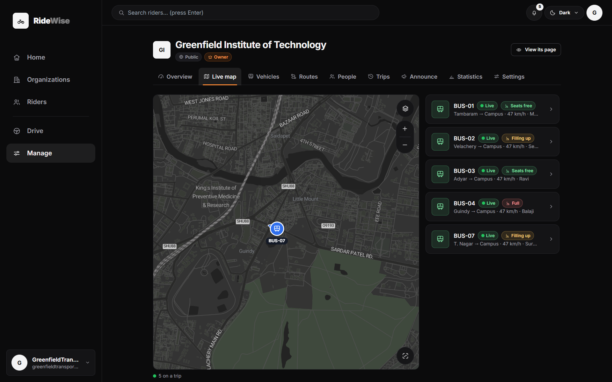
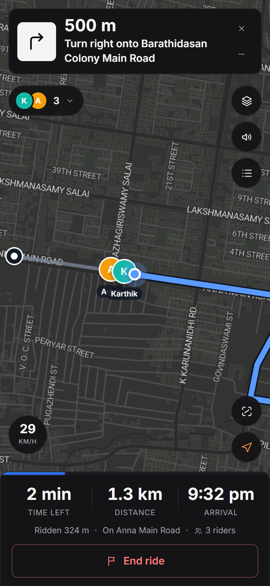
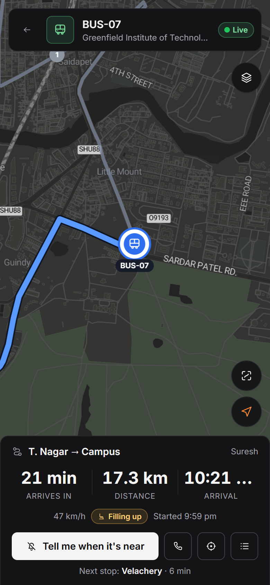
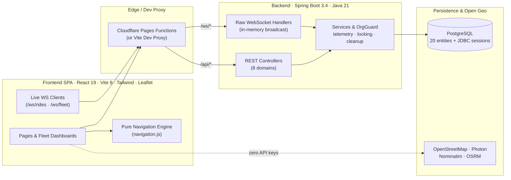

<div align="center">
  
</div>

<h1 align="center">RideWise</h1>

<p align="center">
  <b>Real-time GPS navigation, live group riding &amp; multi-tenant fleet tracking — one platform.</b><br/>
  <i>For solo riders, group rides, college buses, travel companies and city fleets.<br/>
  Built on open geospatial infrastructure — no paid map or routing API keys.</i>
</p>

<p align="center">
  <a href="https://ride-wise.pages.dev">
    
  </a>
  <a href="docs/video/ridewise-promo.mp4">
    
  </a>
  <a href="LICENSE">
    
  </a>
  <a href="CONTRIBUTING.md">
    
  </a>
</p>

<p align="center">
  
  
  
  
  
  
  
  
</p>

<div align="center">

[**Overview**](#why-ridewise) · [**Demo**](#watch-the-demo) · [**Screenshots**](#screenshots) ·
[**Features**](#what-you-can-do) · [**Architecture**](#architecture) ·
[**Quick Start**](#quick-start) · [**Contributing**](#contributing) · [**License**](#license)

</div>

---

## Why RideWise

Most GPS apps solve one narrow problem. Consumer navigation apps help *you* get
somewhere. Fleet software tracks *a company's* vehicles behind a sales call and a
per-vehicle licence. Almost nothing does both, and nothing does both on free,
open map data.

RideWise is one platform for both sides of the road:

| | Consumer navigation | Fleet software | **RideWise** |
|---|:---:|:---:|:---:|
| Turn-by-turn guidance | ✅ | — | ✅ |
| Live group rides on one map | Some | — | ✅ |
| Multi-tenant organizations | — | ✅ | ✅ |
| Live bus / cab tracking for passengers | — | Paid add-on | ✅ |
| Public map & routing API keys needed | Usually | Usually | **None** |
| Self-hostable | — | Rarely | ✅ |
| Cost to start | Ads / subscription | Per-vehicle quote | **Free (AGPL)** |

The same account can ride solo in the morning, lead a group ride at noon, drive a
college bus in the afternoon, and administer a 20-vehicle city fleet in the
evening. Permissions are scoped **per organization**, so no one is locked into a
single "account type".

---

## Watch the demo

<p align="center">
  <a href="docs/video/ridewise-promo.mp4">
    
  </a>
  <br/>
  <sub><b>▶ Watch the short demo</b> — <a href="docs/video/ridewise-promo.mp4">docs/video/ridewise-promo.mp4</a> (with music)</sub>
</p>

Recorded from the real application: solo navigation, a three-rider group ride,
a college bus fleet, a travel company, and a 20-bus city transit network — all
against a live backend, no mock-ups.

> The video is also available in the repo at `docs/video/ridewise-promo.mp4`.
> GitHub plays it directly when you click the preview above.

---

## Screenshots

Every image below is an unedited screenshot of the running app.

<table>
  <tr>
    <td width="50%">
      
    </td>
    <td width="50%">
      
    </td>
  </tr>
  <tr>
    <td align="center"><sub><b>College fleet — live map</b><br/>Every bus, driver, route and speed on one screen</sub></td>
    <td align="center"><sub><b>Travel company — dispatch</b><br/>Cabs and vans with live trip detail and passenger contact</sub></td>
  </tr>
  <tr>
    <td width="50%">
      
    </td>
    <td width="50%">
      
    </td>
  </tr>
  <tr>
    <td align="center"><sub><b>Solo navigation</b><br/>Turn-by-turn cards, ETA, distance and voice guidance</sub></td>
    <td align="center"><sub><b>Group ride</b><br/>Three riders on one live map with shared telemetry</sub></td>
  </tr>
  <tr>
    <td width="50%">
      
    </td>
    <td width="50%">
      
    </td>
  </tr>
  <tr>
    <td align="center"><sub><b>Passenger view</b><br/>Live bus, ETA, next stop, crowd level, proximity alert</sub></td>
    <td align="center"><sub><b>Customer view</b><br/>Follow the vehicle assigned to your trip</sub></td>
  </tr>
</table>

<p align="center">
  
  <br/>
  <sub><b>Built to scale</b> — a 20-bus city transit network on one map</sub>
</p>

---

## What you can do

| Role | Capabilities |
|---|---|
| **Riders** | Plan a route, get turn-by-turn voice navigation, recover automatically when you go off-route, keep screen-awake during a ride, and see your ride history. |
| **Group rides** | Invite riders, share live positions on one map, see who missed a turn, and rejoin the pack with a purple rejoin route. |
| **Passengers / Students / Customers** | Discover public organizations or unlock private ones with an access code · Track a live vehicle with ETA, stop-by-stop timeline and crowd level · Set **"Tell me when it's near"** alerts · Receive announcements. |
| **Drivers** | Start a trip in three taps (vehicle → saved route / destination → start) · Full navigation, app-wide background trip tracking, speed-limit alerts, crowd reporting and **SOS**. |
| **Organization admins** | Nine-tab operations suite: Overview, Live Map, Vehicles, Multi-Stop Routes, Team & Roles, Trip History (GPS replay + CSV), Announcements, Analytics, Settings. |
| **Platform admins** | Platform dashboard, user management, ride monitoring and bulk cleanup, organization verification/suspension, and feedback with optional Gmail alerts. |

---

## Features in depth

### 1. Turn-by-turn navigation that recovers from mistakes

The navigation logic lives in a single framework-free module,
[`frontend/src/services/navigation.js`](frontend/src/services/navigation.js).
It takes raw GPS positions in and returns everything the UI needs:
the current maneuver, distance remaining, ETA, speed and off-route state.

- **Segment projection, not nearest vertex** — your GPS fix is projected onto the
  route *segment*, with accuracy-scaled hysteresis. This removes the false
  "off route" flicker that naive distance checks produce.
- **Purple rejoin routing** — leave the route and RideWise draws a separate rejoin
  path *ahead* on the main route, with its own instructions, so you rejoin the
  correct point instead of backtracking.
- **Full maneuver preview** — see every upcoming step before you reach it.
- **Offline resilience** — Wake Lock keeps the screen on; the active ride is
  restored if the network drops.
- **Dual geocoding + multi-route planning** — Photon with Nominatim fallback,
  and up to three OSRM alternatives with endpoint failover.

### 2. Real-time group rides over WebSockets

- **Authenticated live telemetry** on `/ws/rides`, using the existing session
  cookie. Group membership is verified on every message.
- **Privacy by design** — the ride creator broadcasts automatically; invited
  riders opt in and out of location sharing at will. No fake markers when GPS is
  unavailable.
- **Group-wide off-route awareness** — if one rider misses a turn, everyone sees
  their status change to *Off route* while they are guided back.
- **One row per rider** in `user_locations`, updated in place, so broadcasting
  stays cheap.

### 3. Multi-tenant organizations and live fleets

Organizations are the core of the platform. Any college, hospital, company or
travel operator can create a public or private workspace and manage its own
vehicles, routes, drivers and passengers.

- **Vehicle lifecycle** — `Active`, `Servicing`, `Repair`, `Retired`.
- **DB-locked trips** — nullable unique keys (`active_vehicle_key`,
  `active_driver_key`) make double-booking impossible, even when two drivers tap
  *Start* at the same instant.
- **Server-measured analytics** — distance, top speed and speeding counts are
  computed from accepted GPS fixes, not trusted from the client.
- **Trip replay & CSV export** — stored GPS points replay the exact path.
- **Crowd levels** — `Seats free`, `Filling up`, `Full`.
- **Proximity alerts** — "Tell me when it's near" is evaluated server-side and
  pushed to the passenger.
- **SOS** — a driver can raise an emergency that reaches the admin live.

### 4. Platform polish

- **Universal search** in the header with scopes (`All`, `Rides`, `Riders`,
  `Orgs`, `Go`).
- **Automatic ride retention** — `Never`, `1d`, `7d`, `30d`, `90d`, plus manual
  clear.
- **Four full themes** — `Dark`, `Light`, `Warm`, `Midnight`.
- **Accessibility** — font scaling, reduced motion, high contrast, voice
  commands, and a layout that works down to 320 px.
- **Installable PWA** with offline shell caching.

---

## Architecture



**Design rules**

1. Navigation maths is pure and shared by solo rides, group rides and fleet ETA.
2. WebSocket broadcasts come from memory; the database only stores thinned points.
3. Every organization action passes through `OrgGuard` for role checks.
4. The frontend never decides permissions — the server does.

---

## Engineering highlights

| Challenge | How it is solved |
|---|---|
| **Double-booked vehicles or drivers** | DB-level nullable unique keys, set only while a trip is active. Concurrent starts fail atomically. |
| **10 or 10,000 people watching one bus** | Positions broadcast from memory via `/ws/fleet`; telemetry persists every 5 s. Viewer count does not change database load. |
| **Tamper-proof fleet analytics** | Distance, top speed and speeding counts are recomputed server-side from accepted GPS fixes. |
| **Cheap ETA for passengers** | The browser runs streamed fixes through the same pure navigation engine — no routing call per viewer. |
| **Reliable off-route detection** | Segment projection with accuracy thresholds and hysteresis instead of nearest-node distance. |
| **Continuous tracking across trips** | Clients subscribe to a *vehicle* or *organization*, not a trip ID, so the screen resumes when the next trip starts. |
| **Sessions that survive restarts** | Spring Session JDBC stores sessions in PostgreSQL, so a Render restart or free-tier spin-down does not log everyone out. |
| **Fast, safe local testing** | Backend tests run on isolated H2; frontend logic tests run on native `node --test`. |

---

## Quick start

### One setup file, three platforms

You need **Python 3.8+** to run the setup script (macOS and most Linux systems
already have it; on Windows install it from [python.org](https://python.org)).
The script installs everything else — Java 21 and Node.js 18+ included, using
your system package manager if they are missing.

```bash
git clone https://github.com/sGokulaKumaran/Ride-Wise.git
cd Ride-Wise
python3 setup.py            # Windows: py setup.py
```

That is the only setup command. It:

1. checks Python, Java 21+ and Node.js 18+,
2. offers to install whatever is missing (`winget`, `brew`, `apt`, `dnf`, `pacman`),
3. resolves the Maven backend dependencies,
4. installs the npm frontend dependencies.

Useful flags:

| Command | Effect |
|---|---|
| `python3 setup.py --check` | Check the tools only, install nothing. |
| `python3 setup.py --yes` | Never prompt; auto-confirm tool installs. |
| `python3 setup.py --no-tools` | Never install Java/Node; fail with instructions instead. |
| `python3 setup.py --backend` / `--frontend` | Install one side only. |

`setup.sh` and `setup.ps1` still exist, but they now just call `setup.py`, so
there is only one place where setup logic lives.

### Run it (no PostgreSQL needed)

The backend ships with an in-memory H2 profile, so you can try the whole
platform in about a minute.

```bash
# Terminal 1 — backend on :8080
cd backend/ridewise
./mvnw spring-boot:test-run        # Windows: mvnw.cmd spring-boot:test-run

# Terminal 2 — frontend on :5173
cd frontend
npm run dev
```

Open **<http://localhost:5173>**. Vite proxies both `/api/*` and `/ws/*` to
`http://localhost:8080`, so no CORS setup is needed.

### Run it with PostgreSQL

1. Create the database:
   ```sql
   CREATE DATABASE ridewise;
   ```
2. Export the connection settings:
   ```bash
   export DATABASE_URL=jdbc:postgresql://localhost:5432/ridewise
   export DB_USERNAME=postgres
   export DB_PASSWORD=your_password

   # optional — initial platform admin
   export RIDEWISE_ADMIN_EMAIL=admin@ridewise.com
   export RIDEWISE_ADMIN_PASSWORD=YourSecureAdminPassword
   ```
3. Start both servers:
   ```bash
   # Terminal 1
   cd backend/ridewise
   ./mvnw spring-boot:run

   # Terminal 2
   cd frontend
   npm run dev
   ```

Tables are created/updated automatically from the JPA entities on first start.

### Run the tests

```bash
# Backend — integration + WebSocket tests on an isolated H2 database
cd backend/ridewise
./mvnw test

# Frontend — navigation, places and fleet logic + lint
cd frontend
npm test
npm run lint
```

---

## Repository blueprint

```text
RideWise/
├── backend/ridewise/                     # Spring Boot 3.4 · Java 21 REST + WebSocket API
│   └── src/main/java/vehicle/ridewise/
│       ├── config/                       # security, CORS, WebSocket, session, origin rules
│       ├── controller/                   # 8 REST controllers
│       ├── entity/                       # 20 JPA entities
│       ├── service/                      # business logic, OrgGuard RBAC, telemetry, cleanup
│       └── websocket/                    # /ws/rides and /ws/fleet handlers + broadcaster
├── frontend/                             # React 19 · Vite 8 · Tailwind · Leaflet SPA
│   ├── src/
│   │   ├── context/                      # AuthContext, OrgContext, DriverTripContext
│   │   ├── services/                     # pure navigation engine, routing, WS clients, REST
│   │   ├── pages/                        # ride, riders, settings, admin, organizations
│   │   └── functions/                    # Cloudflare Pages proxy functions
│   └── tests/                            # node --test suites
├── docs/
│   ├── screenshots/                      # real app screenshots used by this README
│   └── video/ridewise-promo.mp4          # short demo with music
├── setup.py                              # ← the single setup file (all platforms)
├── setup.sh / setup.ps1                  # thin wrappers around setup.py
├── CONTRIBUTING.md                       # how to contribute
├── NOTICE                                # third-party data and library licences
├── LICENSE                               # GNU AGPL-3.0
└── Full plan for the platform/           # full product and architecture specification
```

---

## API & WebSocket reference

<details>
<summary><b>REST and WebSocket endpoints</b></summary>

| Domain | Base path | Highlights |
|---|---|---|
| **Rides** | `/api/rides` | Create, list and delete rides; bulk-clear finished rides; live location snapshot; group participants. |
| **Live group socket** | `/ws/rides` | `subscribe`, `location`, `stop`, `snapshot`, `participants-changed`, `ride-ended`. |
| **Organizations & fleet** | `/api/organizations` | Public search, private access-code unlock, members and roles, vehicles, multi-stop routes, trips, analytics, announcements. |
| **Vehicle trips & alerts** | `/api/vehicle-sessions`, `/api/vehicle-alerts` | Locked trip start/stop, GPS ingestion, crowd level, SOS, trip replay, proximity alerts. |
| **Live fleet socket** | `/ws/fleet` | `watch-vehicle`, `watch-org`, `position`, `session-started/ended`, `sos`, `crowd`, `announcement`. |
| **Rider community** | `/api/riders` | Search, nearby riders (50 km radius, privacy-masked), connections. |
| **Platform admin** | `/api/admin` | Platform stats, user editing and deletion, ride force-end and bulk cleanup, organization verification and suspension. |
| **Feedback & notifications** | `/api/feedback`, `/api/notifications` | Feedback and bug reports with optional Gmail forwarding; real-time unread notifications. |

</details>

<details>
<summary><b>Database and environment variables</b></summary>

**Core tables (20 JPA entities):** `users`, `rides`, `ride_participants`,
`user_locations`, `location_updates`, `connections`, `notifications`, `feedback`,
`platform_settings`, `organizations`, `org_members`, `org_access`, `vehicles`,
`org_routes`, `vehicle_sessions`, `vehicle_session_routes`, `vehicle_session_points`,
`vehicle_alerts`, `org_announcements`, `org_audit_logs`, plus the Spring JDBC
session tables.

| Variable | Component | Purpose |
|---|---|---|
| `DATABASE_URL` | Backend | PostgreSQL JDBC URL (default `jdbc:postgresql://localhost:5432/ridewise`) |
| `DB_USERNAME` / `DB_PASSWORD` | Backend | Database credentials |
| `RIDEWISE_ADMIN_EMAIL` / `RIDEWISE_ADMIN_PASSWORD` | Backend | Initial platform admin account |
| `ridewise.allowed-origins` | Backend | Comma-separated allowed origins for REST and WebSockets |
| `ridewise.fleet.session-timeout-minutes` | Backend | Auto-end abandoned fleet trips (default 30) |
| `VITE_API_URL` / `VITE_WS_URL` | Frontend | Point the SPA at a remote backend |

</details>

---

## Roadmap

The full design and expansion blueprint lives in
[`Full plan for the platform/RIDEWISE_COMPLETE_PLATFORM_PLAN.md`](Full%20plan%20for%20the%20platform/RIDEWISE_COMPLETE_PLATFORM_PLAN.md).

| Capability | Status |
|---|---|
| Solo navigation, voice guidance, off-route rejoin | Built |
| Real-time group rides with live off-route visibility | Built |
| Multi-tenant organizations and contextual RBAC | Built |
| Live fleet map, DB-locked trips, SOS, crowd levels, replay + CSV | Built |
| Server-measured analytics and proximity alerts | Built |
| Platform admin console, universal search, ride retention | Built |
| Scheduled timetables ("expected at 7:40 AM") and stop-order optimisation | Planned |
| Polygon geofencing alerts | Planned |
| Web Push and a native mobile wrapper with background GPS | Planned |
| Multi-instance scaling via Redis Pub/Sub for WebSocket state | Planned |

---

## Contributing

Contributions are welcome — docs, tests, bug fixes and features alike.
Start with [**CONTRIBUTING.md**](CONTRIBUTING.md), then open an issue or a PR.

- Run `./mvnw test` and `npm test && npm run lint` before pushing.
- Keep the navigation engine pure and framework-free.
- Never commit secrets or build output.

---

## License

RideWise is released under the **GNU Affero General Public License v3.0
(AGPL-3.0)**. See [LICENSE](LICENSE) and [NOTICE](NOTICE).

In short:

- You may use, study, modify and self-host RideWise freely.
- If you run a modified version as a network service, you must publish the
  modified source under the same licence.
- The AGPL covers this repository's code — **not** the map data or third-party
  libraries, which keep their own licences (listed in [NOTICE](NOTICE)).

<sub>Map data © OpenStreetMap contributors (ODbL) · © Stadia Maps · © OpenTopoMap · © CyclOSM · Satellite imagery © Esri, Maxar, Earthstar Geographics.</sub>

---

<p align="center">
  <sub>Built by <b>Gokula Kumaran S</b> · CSBS, Ramco Institute of Technology</sub><br/>
  <sub><a href="https://ride-wise.pages.dev">Live app</a> · <a href="docs/video/ridewise-promo.mp4">Demo video</a> · <a href="https://github.com/sGokulaKumaran/Ride-Wise">Source</a></sub>
</p>
