<a id="top"></a>

<div align="center">
  <a href="https://ride-wise.pages.dev">
    
  </a>
</div>

<p align="center">
  <b>One open-source navigation &amp; fleet-tracking platform</b> — navigate solo with voice guidance, ride together on a live shared map, drive a college bus, or manage a multi-vehicle city fleet without paid map API keys.
</p>

<p align="center">
  <a href="https://ride-wise.pages.dev">
    
  </a>
  <a href="https://drive.google.com/file/d/1E6lUD8i4y4ZnQ73IWQIi5h3QJdVsaJIH/view?usp=drive_link">
    
  </a>
  <a href="LICENSE">
    
  </a>
  <a href="CONTRIBUTING.md">
    
  </a>
</p>

<p align="center">
  <a href="https://github.com/sGokulaKumaran/Ride-Wise/actions/workflows/ci.yml">
    
  </a>
  <a href="https://github.com/sGokulaKumaran/Ride-Wise/stargazers">
    
  </a>
  <a href="https://github.com/sGokulaKumaran/Ride-Wise/network/members">
    
  </a>
  <a href="https://github.com/sGokulaKumaran/Ride-Wise/issues">
    
  </a>
  <a href="https://github.com/sGokulaKumaran/Ride-Wise/commits">
    
  </a>
</p>

<p align="center">
  
  
  
  
  
  
  
  
</p>

<div align="center">

[**Screenshots & Demo**](#screenshots-and-demo) · [**What RideWise Does**](#what-ridewise-does) · [**How It Works**](#how-ridewise-works) · [**Architecture**](#architecture-summary) ·
[**Quick Start**](#quick-start) · [**Repository Blueprint**](#repository-blueprint) · [**Testing**](#testing-and-production-builds) ·
[**API Reference**](docs/API.md) · [**Roadmap**](docs/ARCHITECTURE.md#roadmap) · [**Contributing**](#contributing) · [**License**](#license-and-fair-use)

</div>

<br/>

<table>
  <tr>
    <td width="33%" valign="top">
      <b>🧭 Solo Navigation</b><br/>
      <sub>Turn-by-turn spoken guidance, route alternatives, pure-JS off-route recovery, 4 UI themes &amp; selectable basemaps.</sub>
    </td>
    <td width="33%" valign="top">
      <b>👥 Live Group Rides</b><br/>
      <sub>Real-time rider sync over <code>/ws/rides</code>, opt-in sharing, instant <b>Off route</b> status &amp; purple rejoin path ahead.</sub>
    </td>
    <td width="33%" valign="top">
      <b>🚌 Campus &amp; City Fleets</b><br/>
      <sub>3-tap driver dispatch, stop-by-stop passenger ETAs, proximity alerts, crowd badges &amp; 9-tab org operations.</sub>
    </td>
  </tr>
</table>

---

## Screenshots and Demo

<div align="center">
  
</div>

<br/>

<p align="center">
  <a href="https://drive.google.com/file/d/1E6lUD8i4y4ZnQ73IWQIi5h3QJdVsaJIH/view?usp=drive_link">
    
  </a>
</p>

<table>
  <tr>
    <td align="center" width="50%">
      
    </td>
    <td align="center" width="50%">
      
    </td>
  </tr>
  <tr>
    <td align="center"><sub><b>Solo turn-by-turn navigation</b><br/>Live maneuver card, speed, remaining distance, ETA &amp; voice toggle</sub></td>
    <td align="center"><sub><b>Group ride purple rejoin</b><br/>Off-route rider gets a dedicated rejoin path ahead on the shared route</sub></td>
  </tr>
  <tr>
    <td align="center" width="50%">
      
    </td>
    <td align="center" width="50%">
      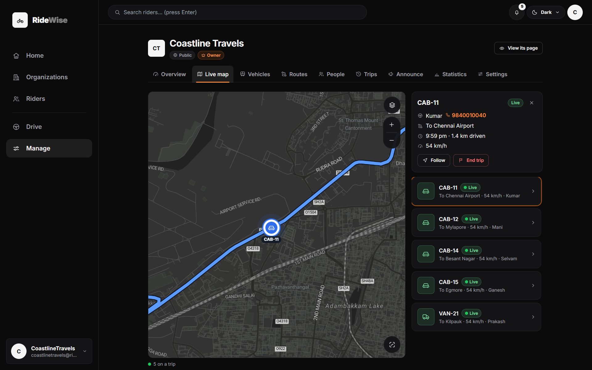
    </td>
  </tr>
  <tr>
    <td align="center"><sub><b>Passenger stop-by-stop ETA</b><br/>Passed stops, upcoming ETAs, crowd badge &amp; proximity alert</sub></td>
    <td align="center"><sub><b>Fleet operations dispatch</b><br/>Live multi-vehicle map, telemetry, active route &amp; passenger info</sub></td>
  </tr>
</table>

<details>
<summary><b>Explore Solo Navigation &amp; Customization (5 screenshots)</b></summary>
<br/>

<table>
  <tr>
    <td align="center" width="50%">
      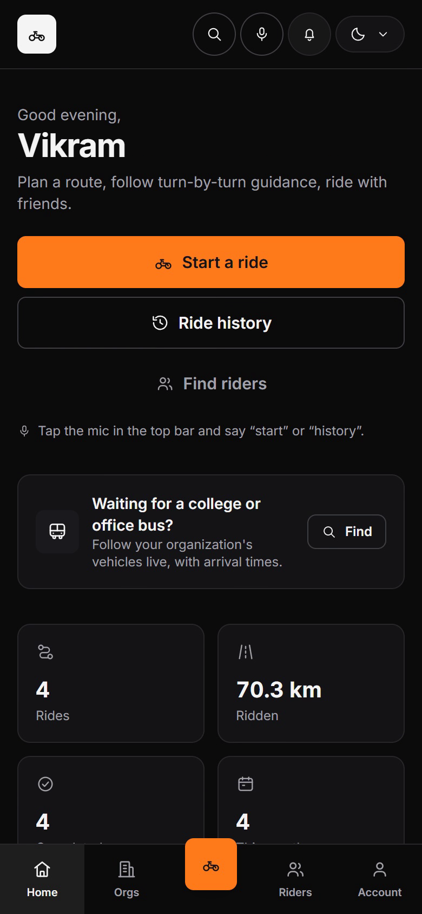
    </td>
    <td align="center" width="50%">
      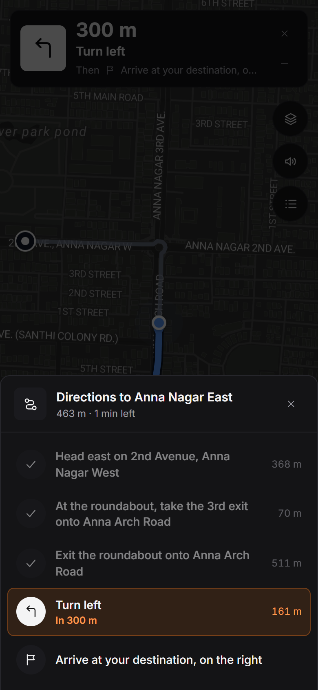
    </td>
  </tr>
  <tr>
    <td align="center"><sub><b>Home dashboard</b><br/>Universal search, quick mode launchers &amp; active session overview</sub></td>
    <td align="center"><sub><b>Route planning &amp; alternatives</b><br/>Turn-by-turn preview, distance, duration &amp; route comparison</sub></td>
  </tr>
  <tr>
    <td align="center" width="50%">
      
    </td>
    <td align="center" width="50%">
      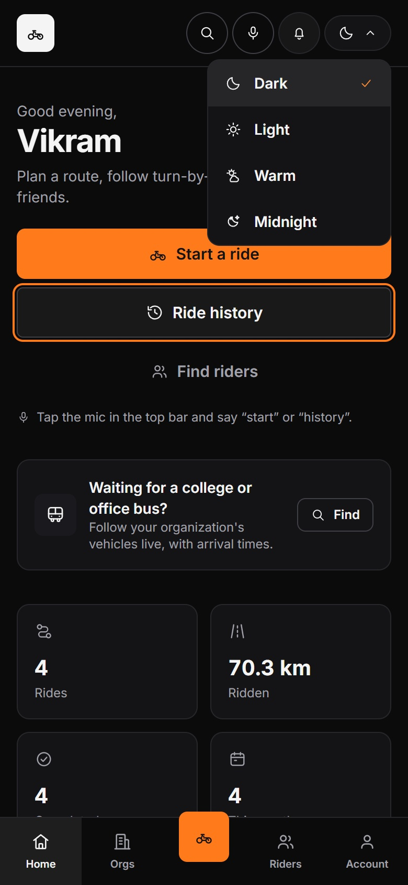
    </td>
  </tr>
  <tr>
    <td align="center"><sub><b>Satellite basemap</b><br/>Switchable Esri World Imagery layer for terrain &amp; landmarks</sub></td>
    <td align="center"><sub><b>UI themes</b><br/>Dark, Light, Warm &amp; Midnight themes for day or night riding</sub></td>
  </tr>
  <tr>
    <td align="center" colspan="2">
      <br/>
      <sub><b>Ride history</b><br/>Past solo &amp; group trips with route stats and replay access</sub>
    </td>
  </tr>
</table>

</details>

<details>
<summary><b>Explore Group Ride Live Sync &amp; Off-Route Recovery (3 screenshots)</b></summary>
<br/>

<table>
  <tr>
    <td align="center" colspan="2">
      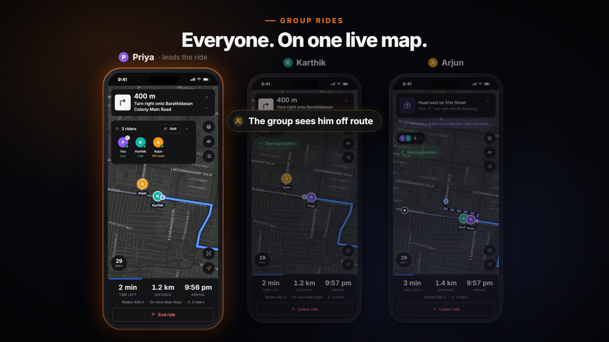<br/>
      <sub><b>Live group coordination</b><br/>Real-time rider positions, route progress &amp; status synced over <code>/ws/rides</code></sub>
    </td>
  </tr>
  <tr>
    <td align="center" width="50%">
      
    </td>
    <td align="center" width="50%">
      
    </td>
  </tr>
  <tr>
    <td align="center"><sub><b>Shared group map</b><br/>Colour-coded rider markers along the active route</sub></td>
    <td align="center"><sub><b>Leader off-route visibility</b><br/>Instant <b>Off route</b> status alert when a rider drifts away</sub></td>
  </tr>
</table>

</details>

<details>
<summary><b>Explore Campus, Travels, City Transit &amp; Admin Suite (7 screenshots)</b></summary>
<br/>

<table>
  <tr>
    <td align="center" width="50%">
      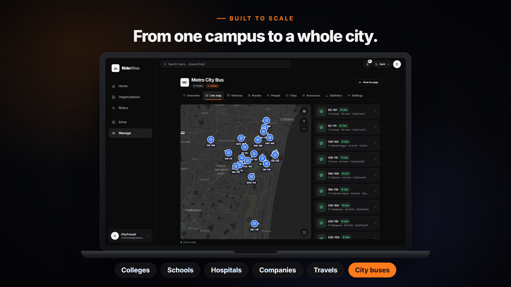
    </td>
    <td align="center" width="50%">
      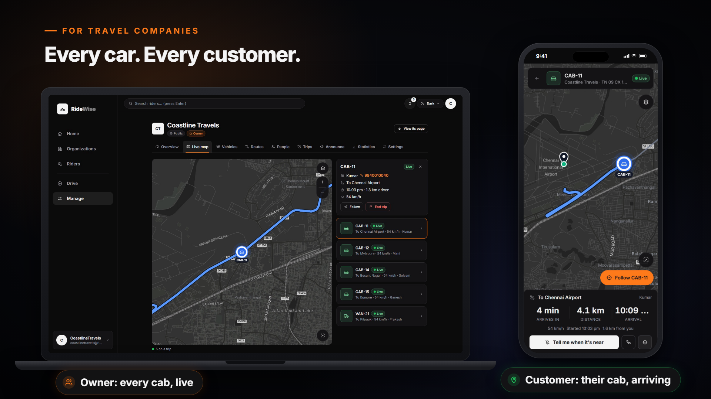
    </td>
  </tr>
  <tr>
    <td align="center"><sub><b>City transit operations</b><br/>Multi-route live fleet monitoring across city corridors</sub></td>
    <td align="center"><sub><b>Dispatch &amp; passenger sync</b><br/>Live vehicle broadcast paired with customer ETA tracking</sub></td>
  </tr>
  <tr>
    <td align="center" width="50%">
      
    </td>
    <td align="center" width="50%">
      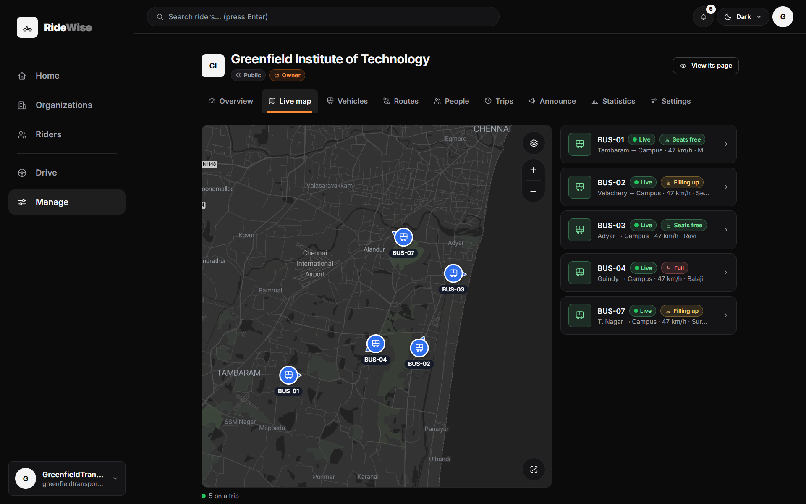
    </td>
  </tr>
  <tr>
    <td align="center"><sub><b>City fleet map</b><br/>Active vehicles, route overlays &amp; live telemetry markers</sub></td>
    <td align="center"><sub><b>Campus shuttle overview</b><br/>All college bus routes and live status in one view</sub></td>
  </tr>
  <tr>
    <td align="center" width="50%">
      
    </td>
    <td align="center" width="50%">
      
    </td>
  </tr>
  <tr>
    <td align="center"><sub><b>Organization portal</b><br/>Public browsing or private access-code unlock (e.g. <code>RW-ZU5NHC</code>)</sub></td>
    <td align="center"><sub><b>Customer tracking</b><br/>Live vehicle pin, upcoming stops &amp; proximity alert controls</sub></td>
  </tr>
  <tr>
    <td align="center" colspan="2">
      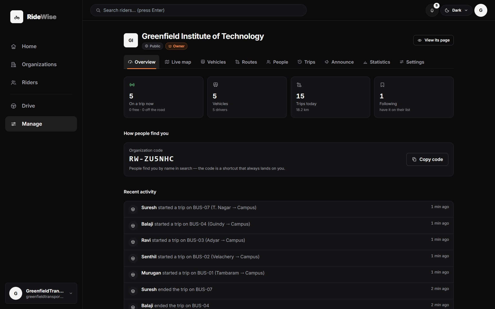<br/>
      <sub><b>Platform &amp; organization admin suite</b><br/>System metrics, user/org controls, GPS trip replays &amp; analytics</sub>
    </td>
  </tr>
</table>

</details>

---

## What RideWise Does

Most GPS apps solve only one slice of the road—consumer turn-by-turn apps ignore fleets, and fleet tools lock you behind sales calls and per-vehicle fees. RideWise combines both behind **per-organization RBAC**: one account can navigate solo in the morning, lead a group ride at noon, drive a college bus in the afternoon, and manage a 20-vehicle transit fleet at night.

| Role | What you can do |
|---|---|
| **Solo riders** | Plan routes with alternatives, spoken turn-by-turn guidance, segment-projected off-route recovery, selectable basemaps (`Standard`, `Satellite`, `Cycling`, plus optional theme-matched layers), 4 UI themes (`Dark`, `Light`, `Warm`, `Midnight`), Screen Wake Lock, Add to Home Screen via web manifest *(no offline service worker cache yet)*, universal header search, and ride history. |
| **Group riders** | Invite friends over `/ws/rides` with opt-in location sharing, live **Off route** rider status, and a **purple rejoin path** ahead on the main route instead of awkward U-turns. |
| **Passengers & customers** | Browse public organizations or unlock private ones with an access code (e.g. `RW-ZU5NHC`), watch live vehicles with stop-by-stop ETAs and crowd badges (`Seats free`, `Filling up`, `Full`), set **"Tell me when it's near"** proximity alerts, and read announcements. |
| **Drivers** | Start trips in 3 taps with app-wide background tracking, speed alerts, crowd updates, and one-tap **SOS**. |
| **Organization admins** | 9-tab operations suite (**Overview**, **Live map**, **Vehicles**, **Routes**, **People**, **Trips** with GPS replay + CSV export, **Announce**, **Statistics**, **Settings**). |
| **Platform admins** | Platform-wide metrics, user management, active ride monitoring & bulk cleanup, org verification/suspension, and feedback with optional Gmail forwarding. |

---

## How RideWise Works

1. **Plan a route** — place search (Photon, with Nominatim fallback) and routing (OSRM, with a FOSSGIS failover) run directly in the browser, so no map or routing traffic passes through the backend.
2. **Navigate** — your phone's GPS feeds the pure `navigation.js` engine, which projects each fix onto the active route, announces maneuvers, and detects off-route drift with accuracy-scaled hysteresis.
3. **Coordinate live** — group riders stream positions over `/ws/rides` and see who is on or off route; fleet drivers stream over `/ws/fleet` while passengers watch a vehicle or organization across trips.
4. **Operate** — organization admins manage vehicles, multi-stop routes, drivers, announcements, analytics, and GPS trip replays from a nine-tab dashboard, while platform admins oversee users, organizations, and feedback.

---

## Architecture Summary

RideWise pairs a **React 19 / Vite 8 / Leaflet** SPA with a **Spring Boot 3.4 / Java 21 / PostgreSQL** API and raw JSON WebSockets (`/ws/rides` and `/ws/fleet`), proxied in production via Cloudflare Pages Functions so `SESSION` cookies remain first-party.

<div align="center">
  
</div>

<br/>

| Layer | Technology |
|---|---|
| **Frontend** | React 19 · Vite 8 · Tailwind CSS 3 · Leaflet |
| **Backend** | Spring Boot 3.4 · Java 21 · raw JSON WebSockets |
| **Database** | PostgreSQL 15+ in production · in-memory H2 for tests |
| **Authentication** | Spring Session JDBC · HttpOnly `SESSION` cookie |
| **Maps** | OpenStreetMap · Esri · CyclOSM *(Stadia Dark/Terrain & OpenTopoMap supported in config)* |
| **Search & routing** | Photon · Nominatim · OSRM (FOSSGIS failover) |
| **Live deployment** | Cloudflare Pages + Render + Aiven (free tier) |

**Four core design rules:**
1. **Pure navigation math** — [`frontend/src/services/navigation.js`](frontend/src/services/navigation.js) has zero React or Leaflet dependencies and powers solo rides, group rides, passenger ETAs, and unit tests.
2. **In-memory fan-out, throttled persistence** — WebSockets broadcast from memory (`FleetBroadcaster`, `RideLocationBroadcaster`); PostgreSQL persists state at most every **5 s** and stores thinned tracks (capped at 4,000 points/trip). Both `/ws/fleet` and `/ws/rides` send a **25 s heartbeat `ping`** to survive proxy idle timeouts.
3. **Server-enforced RBAC & atomic locking** — `OrgGuard` checks every organization call; nullable unique keys (`active_vehicle_key`, `active_driver_key`) make double-booked vehicles or drivers impossible at the database level.
4. **Browser-direct open geospatial stack** — Map tiles, Photon/Nominatim search, and OSRM routing run directly from the browser (`0 bytes` through the backend) with `1100 ms` polite rate queues, ~1 km search rounding, tile fallbacks, and sticky OSRM failover.

→ Deep dive: [**docs/ARCHITECTURE.md**](docs/ARCHITECTURE.md) · [**docs/MAPS_AND_LICENSING.md**](docs/MAPS_AND_LICENSING.md)

---

## Quick Start

> [!TIP]
> **Just exploring?** Jump straight into the [live RideWise app](https://ride-wise.pages.dev) — no local setup required.

Clone the repository and run the cross-platform dependency bootstrapper [`setup.py`](setup.py) (`--check`, `--yes`, `--no-tools` supported):

```bash
git clone https://github.com/sGokulaKumaran/Ride-Wise.git
cd Ride-Wise
python3 setup.py      # Windows: py setup.py
```

<details open>
<summary><b>Option A — 1-Minute H2 Test Configuration (no database setup required)</b></summary>
<br/>

Uses `backend/ridewise/src/test/resources/application.properties` on the test classpath (`MODE=PostgreSQL`):

```bash
# Terminal 1 — backend on :8080
cd backend/ridewise
./mvnw spring-boot:test-run   # Windows: .\mvnw.cmd spring-boot:test-run

# Terminal 2 — frontend on :5173 (proxies /api/* and /ws/* to :8080)
cd frontend
npm run dev
```

</details>

<details>
<summary><b>Option B — Persistent PostgreSQL 15+ Setup</b></summary>
<br/>

Create database `ridewise`, copy variables from [`.env.example`](.env.example), export `DATABASE_URL`, `DB_USERNAME`, `DB_PASSWORD`, and run:

```bash
# Terminal 1 — backend on :8080
cd backend/ridewise
./mvnw spring-boot:run        # Windows: .\mvnw.cmd spring-boot:run

# Terminal 2 — frontend on :5173
cd frontend
npm run dev
```

</details>

<details>
<summary><b>Prerequisites &amp; Recommended Tools</b></summary>
<br/>

| Tool | Required Version | Notes |
|---|---|---|
| **Java 21+ & IDE** | **Java 21+** | Spring Boot 3.4 backend — [**IntelliJ IDEA**](https://www.jetbrains.com/idea/download/) (recommended), [**Eclipse / STS**](https://spring.io/tools), or [**VS Code**](https://code.visualstudio.com/Download) (see [IDE setup in `docs/SETUP.md`](docs/SETUP.md#recommended-ide-setup-for-the-spring-boot-backend)) |
| **Node.js & npm** | **20.19+** or **22.12+** (**22 LTS recommended**) | Required by Vite 8 (`^20.19.0 \|\| >=22.12.0`); Node 21 is not supported |
| **Python** | **3.8+** | For `setup.py` cross-platform bootstrapper |
| **PostgreSQL** | **15+** *(optional)* | Needed only for persistent storage; H2 test configuration works without it |
| **Git** | Any recent version | To clone the repository |

</details>

> [!WARNING]
> **Default admin credentials:** On first boot with an empty database, `DataInitializer` seeds `admin@ridewise.com` with password **`Admin@123`** unless `RIDEWISE_ADMIN_EMAIL` / `RIDEWISE_ADMIN_PASSWORD` are set. **Change this password immediately before exposing your server publicly.**

→ Full step-by-step screenshots, pgAdmin guide & **Troubleshooting** (including why mobile LAN IP testing over HTTP breaks GPS/Wake Lock): [**docs/SETUP.md**](docs/SETUP.md)

---

## Repository Blueprint

<details>
<summary><b>Browse the full repository structure</b></summary>
<br/>

```text
RideWise/
├── backend/ridewise/                     # Spring Boot 3.4 · Java 21 REST + WebSocket API + Dockerfile
│   └── src/main/java/vehicle/ridewise/
│       ├── config/                       # Security, CORS, WebSocket, session & origin rules
│       ├── controller/                   # 8 REST controllers
│       ├── entity/                       # 20 JPA entities
│       ├── service/                      # Business logic, OrgGuard RBAC, telemetry & 6h cleanup
│       └── websocket/                    # /ws/rides and /ws/fleet handlers + broadcasters
├── frontend/                             # React 19 · Vite 8 · Tailwind · Leaflet SPA
│   ├── functions/                        # Cloudflare Pages proxy functions (/api/* & /ws/*)
│   ├── src/
│   │   ├── context/                      # AuthContext, OrgContext, DriverTripContext
│   │   ├── services/                     # Pure navigation.js, routingApi.js, WS & REST clients
│   │   └── pages/                        # Home, Ride, Riders, Settings, Admin, Organizations
│   └── tests/                            # Native node --test suites
├── docs/                                 # Setup, Architecture, Maps, API, Deployment, assets & screenshots
├── .env.example                          # Environment variable template
├── setup.py                              # Cross-platform setup script (Python 3.8+)
├── CONTRIBUTING.md                       # Contribution guide & PR checklist
├── NOTICE / LICENSE                      # Third-party attributions & GNU AGPL-3.0
└── Detailed plan of this platform/       # Complete product & architecture blueprint
```

</details>

---

## Testing and Production Builds

<details>
<summary><b>Run backend tests, frontend tests, lint &amp; production builds</b></summary>
<br/>

```bash
# Backend — Spring integration & WebSocket tests (isolated H2 test configuration)
cd backend/ridewise
./mvnw test        # Windows: .\mvnw.cmd test

# Frontend — pure logic tests (node --test tests/)
cd frontend
npm test

# Frontend — ESLint check (separate from npm test)
cd frontend
npm run lint

# Production builds
cd frontend
npm run build
npm run preview

cd backend/ridewise
./mvnw package
java -jar target/ridewise-0.0.1-SNAPSHOT.jar
```

</details>

Docker support is included via [`backend/ridewise/Dockerfile`](backend/ridewise/Dockerfile) — see [**docs/DEPLOYMENT.md**](docs/DEPLOYMENT.md) for `docker build` / `docker run` and Cloudflare Pages / Render hosting instructions.

---

## Deep-Dive Documentation

| Guide | What's inside |
|---|---|
| [**docs/SETUP.md**](docs/SETUP.md) | Python / Java / Node 22 / PostgreSQL 15+ walkthrough, screenshots, `setup.py` flags, and Troubleshooting |
| [**docs/ARCHITECTURE.md**](docs/ARCHITECTURE.md) | Mermaid system diagram, design rules, engineering highlights, feature deep-dive, and roadmap |
| [**docs/MAPS_AND_LICENSING.md**](docs/MAPS_AND_LICENSING.md) | Map/routing provider table, rate queues, $0/mo live stack limits, and self-hosted scaling economics |
| [**docs/API.md**](docs/API.md) | 8 REST controller domains, `/ws/rides` & `/ws/fleet` messages, 22 DB tables, and env var scopes |
| [**docs/DEPLOYMENT.md**](docs/DEPLOYMENT.md) | Docker commands, JAR & static build steps, Cloudflare Pages Functions setup, and launch checklist |

---

## Contributing

Contributions are warmly welcome—whether fixing a doc typo, adding a test, squashing a bug, or tackling an item on the [roadmap](docs/ARCHITECTURE.md#roadmap). Read [**CONTRIBUTING.md**](CONTRIBUTING.md), run `./mvnw test`, `npm test`, and `npm run lint`, keep [`navigation.js`](frontend/src/services/navigation.js) pure and framework-free, and never commit secrets or build artifacts.

---

## License and Fair Use

RideWise is released under the **GNU Affero General Public License v3.0 (AGPL-3.0)**. See [LICENSE](LICENSE) and [NOTICE](NOTICE) for full legal details.

- **Use, study, modify, and self-host freely** for personal, campus, or community use.
- **Keep credit and copyright intact** (`Copyright (C) 2026 Gokula Kumaran S`), link back to this repository, and keep [`LICENSE`](LICENSE) and [`NOTICE`](NOTICE) intact.
- **Share back if you host a modified version** — AGPL-3.0 requires publishing modified source code if you run a modified version publicly as a network service.
- **Third-party map data & dependencies** follow their own respective licenses (credited in [`NOTICE`](NOTICE)).

<sub>Map data © OpenStreetMap contributors (ODbL) · © Stadia Maps · © OpenTopoMap (CC-BY-SA 3.0) · © CyclOSM · Satellite imagery © Esri, Maxar, Earthstar Geographics · Geocoding by Photon (Komoot) &amp; Nominatim · Routing by OSRM.</sub>

---

<p align="center">
  <b>If RideWise helped you or inspired your project, consider giving the repo a ⭐!</b><br/><br/>
  <sub>Built by <b>Gokula Kumaran S</b> · CSBS, Ramco Institute of Technology</sub><br/>
  <sub><a href="https://ride-wise.pages.dev">Live App</a> · <a href="https://drive.google.com/file/d/1E6lUD8i4y4ZnQ73IWQIi5h3QJdVsaJIH/view?usp=drive_link">Demo Video</a> · <a href="https://github.com/sGokulaKumaran/Ride-Wise">Source Code</a> · <a href="#top">⬆ Back to top</a></sub>
</p>
