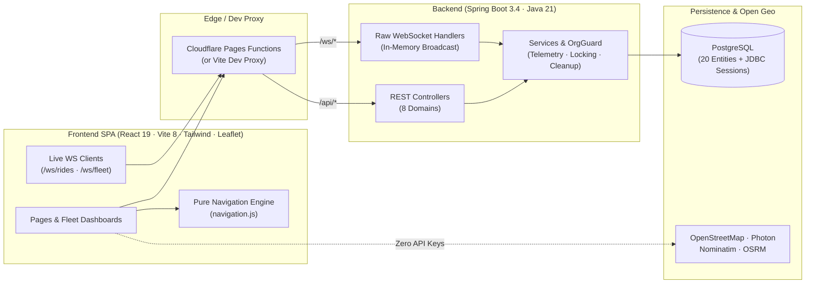

<p align="center">
  
</p>

<h1 align="center">RideWise</h1>

<p align="center">
  <b>Universal Real-Time GPS Navigation, Live Group Riding &amp; Multi-Tenant Fleet Tracking Platform</b><br/>
  <i>One platform for solo riders, group rides, college buses, travel companies, and city fleets — built with zero third-party API keys.</i>
</p>

<p align="center">
  <a href="https://ride-wise.pages.dev" target="_blank">
    
  </a>
  <a href="promo/out/ridewise-promo.mp4">
    
  </a>
  <a href="LICENSE">
    
  </a>
</p>

<p align="center">
  
  
  
  
  
  
  
</p>

---

## Executive Summary

Most GPS tracking apps solve only one narrow problem — either consumer navigation *or* expensive, single-purpose fleet software for a specific college or travel company.

**RideWise** unifies both worlds into a single **full-stack, multi-tenant GPS & mobility platform**:
- **Individuals** get turn-by-turn voice navigation, live off-route recovery, and real-time multi-rider group maps.
- **Organizations** (colleges, schools, hospitals, travel agencies, corporate shuttles, and city transit) can spin up a public or private workspace in seconds — managing vehicles, multi-stop routes, drivers, live fleet monitoring, passenger ETAs, proximity alerts, and server-verified analytics from one dashboard.
- **One Account, Contextual Roles**: A single user can ride solo, lead a group ride, track a college bus, drive a company cab, and administer a fleet — permissions are scoped per organization, never locked to rigid account types.
- **Zero Vendor Lock-In**: Built entirely on open geospatial infrastructure (OpenStreetMap, Photon, Nominatim, OSRM, Leaflet) — **no paid map or routing API keys required**.

---

## Product Demo (85-Second Walkthrough)

> Click the preview below to play [`promo/out/ridewise-promo.mp4`](promo/out/ridewise-promo.mp4) — recorded directly from the real application running live GPS simulations across solo rides, 3-device synced group rides, college bus fleets, travel companies, and a 20-bus city transit network.

<p align="center">
  <a href="promo/out/ridewise-promo.mp4">
    
  </a>
</p>

<p align="center">
  <sub><i>Video asset: <code>promo/out/ridewise-promo.mp4</code> (1080p, 30 fps) · Produced programmatically with Playwright + Remotion inside <code>promo/</code>.</i></sub>
</p>

---

## Core Capabilities

### 1. Turn-by-Turn Navigation & Intelligent Off-Route Recovery
Built around a **pure, framework-free navigation engine** (`frontend/src/services/navigation.js`) that takes raw GPS coordinates and computes live ride telemetry deterministically.

<table>
  <tr>
    <td width="50%">
      
    </td>
    <td width="50%">
      
    </td>
  </tr>
  <tr>
    <td align="center"><sub><b>Live Turn-by-Turn &amp; Voice Guidance</b> — Real-time countdowns, speed, ETA, and spoken maneuvers</sub></td>
    <td align="center"><sub><b>6 Map Styles &amp; Rotatable Canvas</b> — Auto, Standard, Dark, Satellite, Terrain, and Cycling</sub></td>
  </tr>
</table>

- **Typo-Tolerant Place Search & Multi-Route Planning**: Dual-provider geocoding (Photon with Nominatim fallback) + up to 3 alternative road routes via OSRM with automatic endpoint failover.
- **Segment Projection & Purple Rejoin Routing**: Projects GPS onto route segments (not naive nearest vertices) with accuracy-scaled hysteresis. Leaving the route dynamically plots a purple rejoin path *ahead* on the main route with its own turn instructions.
- **Complete Step Preview & Offline Resilience**: View all upcoming maneuvers ahead of time ([`stills/f1239.png`](promo/out/stills/f1239.png)), keep the screen awake via Wake Lock API, and automatically recover active ride state if the network drops.

---

### 2. Real-Time Group Rides over WebSockets
Designed so riding in a group never means losing track of teammates on the road.

- **Authenticated Live Telemetry (`/ws/rides`)**: Raw WebSocket channel authenticated via the existing session cookie; group membership is verified on every message.
- **Leader-Visible, Member Opt-In Privacy**: The ride creator broadcasts live position automatically; invited riders toggle location sharing on/off at will with zero faked markers when GPS is unavailable.
- **Group-Wide Off-Route Awareness**: If any rider misses a turn, their live status flips to **Off route** on everyone's map while guiding them back to the pack.
- **Efficient Storage**: Live positions update a single row per user in place (`user_locations`), keeping real-time broadcasting fast without bloating the database.

---

### 3. Multi-Tenant Organizations & Live Fleet Operations
The core platform vision — turning RideWise into a turnkey live-tracking SaaS for any organization.

<table>
  <tr>
    <td width="50%">
      
    </td>
    <td width="50%">
      
    </td>
  </tr>
  <tr>
    <td align="center"><sub><b>Passenger / Student View</b> — Live bus position, ETA, next stop, seat status, and proximity alerts</sub></td>
    <td align="center"><sub><b>Organization Command Map</b> — Monitor every active vehicle, driver, route, and speed on one screen</sub></td>
  </tr>
  <tr>
    <td width="50%">
      
    </td>
    <td width="50%">
      
    </td>
  </tr>
  <tr>
    <td align="center"><sub><b>Travel &amp; Cab Operations</b> — Dispatch dashboard and live customer tracking synchronized in real time</sub></td>
    <td align="center"><sub><b>Built to Scale</b> — Multi-vehicle city transit tracking across colleges, hospitals, companies, and buses</sub></td>
  </tr>
</table>

| Role | What They Can Do |
|---|---|
| **Passengers / Students / Customers** | Discover public organizations or unlock private ones via access code + password · Track live vehicles with smooth route gliding, ETA, stop-by-stop timeline, and crowd level (`Seats free` / `Filling up` / `Full`) · Set server-triggered **"Tell me when it's near"** proximity alerts · Receive fleet announcements |
| **Drivers** | Launch a trip in 3 taps (`Vehicle → Saved Route / Custom Destination → Start`) · Full turn-by-turn navigation with app-wide background trip tracking · Broadcast crowd levels, receive speed-limit alerts, and trigger live **SOS emergencies** to admins |
| **Organization Admins** | 9-tab operations suite (`/org-admin/:orgId`): Overview, Live Fleet Map, Vehicles lifecycle (`Active` / `Servicing` / `Repair` / `Retired`), Multi-Stop Saved Routes, Team & Role Management, Trip History with **GPS Path Replay & CSV Export**, Announcements, Server-Measured Analytics, and Organization Settings |
| **Platform Admins** | Platform-wide dashboard (`/admin`), full user account management, ride monitoring & bulk cleanup, organization verification/suspension, and integrated user feedback with optional Gmail alerts |

---

### 4. Platform Polish & Data Hygiene
- **Universal App Search**: Single header search bar (`TopBar`) with category scopes (`All`, `Rides`, `Riders`, `Orgs`, `Go`) for instant cross-app navigation, ride lookup, rider discovery, and theme switching.
- **Automated Ride Data Retention**: Users configure automatic deletion of finished rides (`Never`, `1d`, `7d`, `30d`, `90d`) or clear completed history on demand to keep database storage lean.
- **Responsive PWA & Theming**: 4 complete design-token themes (`Dark`, `Light`, `Warm`, `Midnight`), voice navigation commands, accessibility controls (font scale, reduced motion, high contrast), and mobile-first ergonomics down to `320px`.

---

## System Architecture



---

## Key Engineering Highlights

| Challenge | Solution Implemented |
|---|---|
| **Preventing double-booked vehicles/drivers under concurrency** | Enforced at the **database level** using nullable unique keys (`active_vehicle_key`, `active_driver_key`) set only while a trip is active — race conditions fail atomically even if two drivers tap *Start* simultaneously. |
| **Scaling live vehicle watchers without DB pressure** | Positions broadcast **directly from memory** via `/ws/fleet` while persisting thinned telemetry points every 5 seconds — 10 or 10,000 viewers watching the same bus produce identical database load. |
| **Tamper-proof fleet analytics** | Distance, top speed, and speeding counts are **computed server-side** from accepted GPS fixes rather than trusting client-reported totals. |
| **Keeping ETA computation cheap** | The browser feeds streamed vehicle fixes through the same pure `navigation.js` engine used for solo rides — zero per-watcher routing server calls. |
| **Reliable GPS off-route detection** | Uses geometric **segment projection** with GPS accuracy thresholds and hysteresis instead of naive nearest-node distance, eliminating false off-route flickers. |
| **Continuous tracking across trips** | Clients subscribe to a **vehicle** or **organization** rather than an individual trip ID, so tracking screens automatically resume live when the vehicle starts its next trip. |
| **Zero-risk testing & fast local onboarding** | Backend integration tests run on an isolated in-memory **H2** database (`AccountTests`, `RideFlowTests`, `RideLocationSocketTests`, `OrgFleetTests`); frontend logic (`navigation`, `places`, `fleet`) runs on native `node --test`. |

---

## Quick Start (Pull & Run)

### Prerequisites
- **Java 21+** (Maven wrapper `./mvnw` included — no global Maven needed)
- **Node.js 18+**
- **PostgreSQL 14+** *(optional if you use the Zero-Setup H2 Preview below)*

### Option A: Zero-Setup Instant Preview (No PostgreSQL Required)
Try the entire platform locally in under 2 minutes using the built-in in-memory H2 profile:

```bash
# 1. Clone the repository
git clone https://github.com/sGokulaKumaran/Ride-Wise.git
cd Ride-Wise

# 2. Start the backend on in-memory H2 (port 8080)
cd backend/ridewise
./mvnw spring-boot:test-run        # Linux / macOS
# mvnw.cmd spring-boot:test-run    # Windows

# 3. In a new terminal, start the frontend (port 5173)
cd frontend
npm install
npm run dev
```

Open **`http://localhost:5173`** in your browser. Vite automatically proxies both `/api/*` and `/ws/*` to `http://localhost:8080`.

### Option B: Full Persistent Setup (PostgreSQL)

1. **Create the database:**
   ```sql
   CREATE DATABASE ridewise;
   ```
2. **Set environment variables (or configure `backend/ridewise/src/main/resources/application.properties`):**
   ```bash
   export DATABASE_URL=jdbc:postgresql://localhost:5432/ridewise
   export DB_USERNAME=postgres
   export DB_PASSWORD=your_password

   # Optional: customize initial platform admin credentials
   export RIDEWISE_ADMIN_EMAIL=admin@ridewise.com
   export RIDEWISE_ADMIN_PASSWORD=YourSecureAdminPassword
   ```
3. **Run Backend & Frontend:**
   ```bash
   # Terminal 1 — Backend
   cd backend/ridewise
   ./mvnw spring-boot:run          # or mvnw.cmd spring-boot:run on Windows

   # Terminal 2 — Frontend
   cd frontend
   npm install && npm run dev
   ```

### Running the Test Suites

```bash
# Backend integration & WebSocket tests (runs on isolated H2 — never touches PostgreSQL)
cd backend/ridewise
./mvnw test                       # or mvnw.cmd test

# Frontend unit tests (navigation engine, place search, fleet math) & lint
cd frontend
npm test
npm run lint
```

---

## Repository Blueprint

```text
RideWise/
├── backend/ridewise/                # Spring Boot 3.4 + Java 21 REST & WebSocket API
│   └── src/main/java/vehicle/ridewise/
│       ├── config/                  # Security, CORS, WebSocketConfig, Session & Origin rules
│       ├── controller/              # 8 REST controllers (Auth, Ride, Riders, Org, VehicleSession, Admin, Feedback, Notifications)
│       ├── entity/                  # 20 JPA entities (rides, live locations, orgs, fleet, sessions, alerts, audit logs)
│       ├── service/                 # Core business logic, OrgGuard RBAC, telemetry validation, auto-cleanup scheduler
│       └── websocket/               # Raw WebSocket handlers (/ws/rides, /ws/fleet) & FleetBroadcaster
├── frontend/                        # React 19 + Vite 8 + Tailwind CSS + Leaflet SPA
│   ├── src/
│   │   ├── context/                 # AuthContext, OrgContext, DriverTripContext (app-wide trip tracking)
│   │   ├── services/                # Pure navigation engine, routing/geocoding API, WS clients, REST wrappers
│   │   └── pages/                   # Home, Riders, Settings, Admin Console, Organization Hub & 9-tab OrgAdmin
│   └── tests/                       # Native node --test suites (navigation, places, fleet)
├── Full plan for the platform/      # Complete platform design & product specification
└── promo/                           # Programmatic promo video pipeline (Playwright + Remotion) & rendered media
```

---

## Technical Reference (Expandable)

<details>
<summary><b>API &amp; WebSocket Endpoints Overview</b></summary>

| Domain | Base Path | Highlights |
|---|---|---|
| **Rides** | `/api/rides` | Create/list/delete rides, bulk-clear finished rides, live location snapshot, group participants |
| **Live Group Socket** | `/ws/rides` | Real-time `subscribe`, `location`, `stop`, `snapshot`, `participants-changed`, `ride-ended` |
| **Organizations &amp; Fleet** | `/api/organizations` | Public search, private access-code unlock, members/roles, vehicles, saved multi-stop routes, trips, analytics, announcements |
| **Vehicle Trips &amp; Alerts** | `/api/vehicle-sessions`, `/api/vehicle-alerts` | Locked trip start/stop, GPS ingestion, crowd level, SOS toggle, track replay, proximity alerts |
| **Live Fleet Socket** | `/ws/fleet` | `watch-vehicle`, `watch-org`, real-time `position`, `session-started/ended`, `sos`, `crowd`, `announcement` |
| **Rider Community** | `/api/riders` | Search, nearby riders (50 km radius with privacy masking), connections |
| **Platform Admin** | `/api/admin` | Platform stats, full user editing/deletion, ride force-end &amp; bulk cleanup, org verification/suspension |
| **Feedback &amp; Notifications** | `/api/feedback`, `/api/notifications` | User feedback &amp; bug reports with admin Gmail forwarding, real-time unread notifications |

</details>

<details>
<summary><b>Database &amp; Environment Configuration</b></summary>

- **Core Tables (20 JPA Entities)**: `users` (including `auto_delete_rides_days`), `rides`, `ride_participants`, `user_locations`, `location_updates`, `connections`, `notifications`, `feedback`, `platform_settings`, `organizations`, `org_members`, `org_access`, `vehicles`, `org_routes`, `vehicle_sessions`, `vehicle_session_routes`, `vehicle_session_points`, `vehicle_alerts`, `org_announcements`, `org_audit_logs` + Spring JDBC session tables.
- **Key Environment Variables**:

| Variable | Component | Purpose |
|---|---|---|
| `DATABASE_URL` | Backend | PostgreSQL JDBC URL (defaults to `localhost:5432/ridewise`) |
| `DB_USERNAME` / `DB_PASSWORD` | Backend | Database credentials |
| `RIDEWISE_ADMIN_EMAIL` / `RIDEWISE_ADMIN_PASSWORD` | Backend | Initial seeded platform admin credentials |
| `ridewise.allowed-origins` | Backend | Comma-separated allowed origins for REST &amp; WebSockets |
| `ridewise.fleet.session-timeout-minutes` | Backend | Auto-ends abandoned fleet trips (default `30` min) |
| `VITE_API_URL` / `VITE_WS_URL` | Frontend | Optional override when pointing frontend at a remote backend |

</details>

---

## Platform Roadmap & Product Plan

The full architecture and expansion blueprint is documented in [`Full plan for the platform/RIDEWISE_COMPLETE_PLATFORM_PLAN.md`](Full%20plan%20for%20the%20platform/RIDEWISE_COMPLETE_PLATFORM_PLAN.md).

| Capability | Status |
|---|---|
| Turn-by-turn solo navigation, voice guidance &amp; off-route purple rejoin | Built |
| Real-time group rides over WebSockets with live off-route group visibility | Built |
| Multi-tenant organizations (public/private) &amp; contextual RBAC (`Owner`/`Admin`/`Driver`/`Viewer`) | Built |
| Live fleet map, DB-locked driver trips, SOS alerts, crowd levels &amp; trip replay + CSV export | Built |
| Server-measured fleet analytics &amp; "Tell me when it's near" proximity alerts | Built |
| Platform admin console, universal search &amp; automated ride data retention | Built |
| Scheduled route timetables ("expected at 7:40 AM") &amp; stop-order optimization | Planned |
| Polygon geofencing alerts (enter / exit custom drawn zones) | Planned |
| Web Push notifications &amp; Native Mobile Wrapper (background GPS with screen off) | Planned |
| Multi-instance horizontal scaling via Redis Pub/Sub for WebSocket state | Planned |

---

## Author & License

Built by **Gokula Kumaran S** · CSBS, Ramco Institute of Technology  
Licensed under the [MIT License](LICENSE).

<sub>Map data &copy; OpenStreetMap contributors &middot; &copy; Stadia Maps &middot; Satellite imagery &copy; Esri, Maxar, Earthstar Geographics.</sub>
