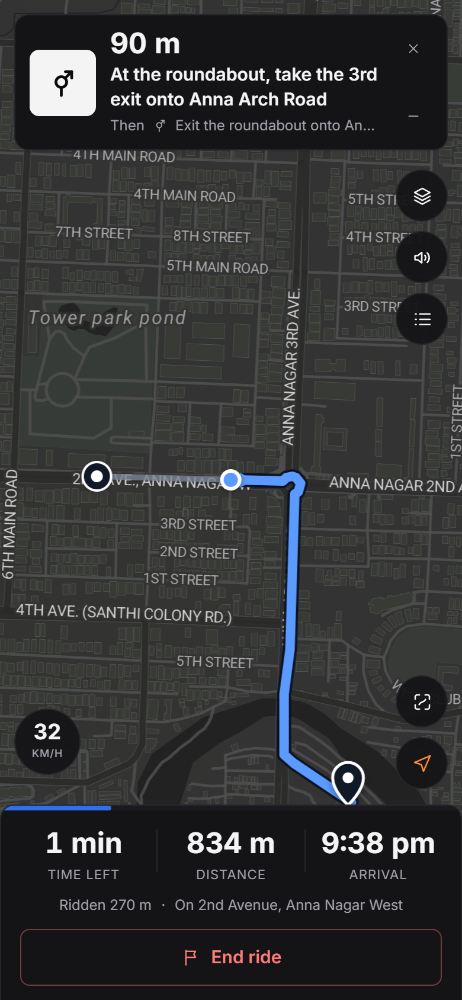

<h1 align="center">RideWise</h1>

<h2>Welcome to RideWise — every journey, connected.</h2>

<p>
  From a single rider to an entire fleet, RideWise brings navigation,
  live group coordination, and real-time vehicle tracking together in
  one open-source platform. Navigate solo with spoken directions,
  keep your group on course with live location sharing and intelligent
  rejoin paths, or follow campus and city transport as it moves.
  One platform, powered by open map infrastructure, keeping every
  journey connected.
</p>


<div align="center">
  
</div>


<p align="center">
  <a href="https://ride-wise.pages.dev">
    
  </a>
  <a href="docs/video/ridewise-promo.mp4">
    
  </a>
  <a href="LICENSE">
    
  </a>
  <a href="CONTRIBUTING.md">
    
  </a>
</p>

<p align="center">
  
  
  
  
  
  
  
  
</p>


<div align="center">

[**Quick Start**](#quick-start) · [**What RideWise Does**](#what-ridewise-does) · [**Screenshots & Demo**](#screenshots-and-demo) ·
[**Architecture**](#architecture-summary) · [**Repository Blueprint**](#repository-blueprint) · [**Testing**](#testing-and-production-builds) ·
[**API Reference**](docs/API.md) · [**Roadmap**](docs/ARCHITECTURE.md#roadmap) · [**Contributing**](#contributing) · [**License**](#license-and-fair-use)

</div>

---

## Bring Up the Full RideWise Stack - Quick Setup

 First go through the step-by-step **[Setup & Local Development Guide (docs/SETUP.md)](docs/SETUP.md)**. It clearly covers everything you need to clone 

If your tools are already installed, run the automatic dependency installer [`setup.py`](setup.py) (`python3 setup.py` or `py setup.py`), then launch the H2 test configuration and Vite dev server:

```bash
# Terminal 1 — backend on :8080 (in-memory H2 test configuration, no PostgreSQL needed)
cd backend/ridewise && ./mvnw spring-boot:test-run   # Windows: .\mvnw.cmd spring-boot:test-run

# Terminal 2 — frontend on :5173 (proxies /api/* and /ws/* to :8080)
cd frontend && npm run dev
```

### Prerequisites

| Tool | Required Version | Notes |
|---|---|---|
| **Java 21+ & IDE** | **Java 21+** | Spring Boot 3.4 backend — [**IntelliJ IDEA**](https://www.jetbrains.com/idea/download/) (recommended), [**Eclipse / STS**](https://spring.io/tools), or [**VS Code**](https://code.visualstudio.com/Download) (see [IDE setup in `docs/SETUP.md`](docs/SETUP.md#recommended-ide-setup-for-the-spring-boot-backend)) |
| **Node.js & npm** | **20.19+** or **22.12+** (**22 LTS recommended**) | Required by Vite 8 (`^20.19.0 \|\| >=22.12.0`) |
| **Python** | **3.8+** | For `setup.py` cross-platform bootstrapper |
| **PostgreSQL** | **15+** *(optional)* | Needed only for persistent storage; H2 test configuration works without it |
| **Git** | Any recent version | To clone the repository |

> [!TIP]
> **Just exploring?** Jump straight into the [live RideWise app](https://ride-wise.pages.dev) — no local setup required.


---

## What RideWise Does

Most GPS apps solve only one slice of the road—consumer turn-by-turn apps ignore fleets, and fleet tools lock you behind sales calls and per-vehicle fees. RideWise combines both behind **per-organization RBAC**: one account can navigate solo in the morning, lead a group ride at noon, drive a college bus in the afternoon, and manage a 20-vehicle transit fleet at night.

| Role | What you can do |
|---|---|
| **Solo riders** | Plan routes with alternatives, spoken turn-by-turn guidance, segment-projected off-route recovery, 6 map styles (`Auto`, `Standard`, `Dark`, `Satellite`, `Terrain`, `Cycling`), 4 UI themes (`Dark`, `Light`, `Warm`, `Midnight`), Screen Wake Lock, Add to Home Screen via web manifest *(no offline service worker cache yet)*, universal header search, and ride history. |
| **Group riders** | Invite friends over `/ws/rides` with opt-in location sharing, live **Off route** rider status, and a **purple rejoin path** ahead on the main route instead of awkward U-turns. |
| **Passengers & customers** | Browse public organizations or unlock private ones with an access code (e.g. `RW-ZU5NHC`), watch live vehicles with stop-by-stop ETAs and crowd badges (`Seats free`, `Filling up`, `Full`), set **"Tell me when it's near"** proximity alerts, and read announcements. |
| **Drivers** | Start trips in 3 taps with app-wide background tracking, speed alerts, crowd updates, and one-tap **SOS**. |
| **Organization admins** | 9-tab operations suite (**Overview**, **Live map**, **Vehicles**, **Routes**, **People**, **Trips** with GPS replay + CSV export, **Announce**, **Statistics**, **Settings**). |
| **Platform admins** | Platform-wide metrics, user management, active ride monitoring & bulk cleanup, org verification/suspension, and feedback with optional Gmail forwarding. |

---

## Screenshots and Demo

<p align="center">
  <video src="docs/video/ridewise-promo.mp4" poster="docs/screenshots/promo-city-transit.png" width="90%" autoplay loop muted playsinline controls>
    Your browser does not support the video tag.
  </video>
  <br/>
  <sub><b>▶ Watch the demo video</b> — <a href="docs/video/ridewise-promo.mp4">docs/video/ridewise-promo.mp4</a> (19 MB MP4 recorded directly from the running app)</sub>
</p>

<table>
  <tr>
    <td align="center" width="50%">
      
    </td>
    <td align="center" width="50%">
      
    </td>
  </tr>
  <tr>
    <td align="center"><sub><b>Solo turn-by-turn navigation</b><br/>Live maneuver card, speed, remaining distance, ETA &amp; voice toggle</sub></td>
    <td align="center"><sub><b>Group ride purple rejoin</b><br/>Off-route rider gets a dedicated rejoin path ahead on the shared route</sub></td>
  </tr>
  <tr>
    <td align="center" width="50%">
      
    </td>
    <td align="center" width="50%">
      
    </td>
  </tr>
  <tr>
    <td align="center"><sub><b>Passenger stop-by-stop ETA</b><br/>Passed stops, upcoming ETAs, crowd badge &amp; proximity alert</sub></td>
    <td align="center"><sub><b>Fleet operations dispatch</b><br/>Live multi-vehicle map, telemetry, active route &amp; passenger info</sub></td>
  </tr>
</table>

---

## Architecture Summary

RideWise pairs a **React 19 / Vite 8 / Leaflet** SPA with a **Spring Boot 3.4 / Java 21 / PostgreSQL** API and raw JSON WebSockets (`/ws/rides` and `/ws/fleet`), proxied in production via Cloudflare Pages Functions so `SESSION` cookies remain first-party.

**Four core design rules:**
1. **Pure navigation math** — [`frontend/src/services/navigation.js`](frontend/src/services/navigation.js) has zero React or Leaflet dependencies and powers solo rides, group rides, passenger ETAs, and unit tests.
2. **In-memory fan-out, throttled persistence** — WebSockets broadcast from memory (`FleetBroadcaster`, `RideLocationBroadcaster`); PostgreSQL persists state at most every **5 s** and stores thinned tracks (capped at 4,000 points/trip). Both `/ws/fleet` and `/ws/rides` send a **25 s heartbeat `ping`** to survive proxy idle timeouts.
3. **Server-enforced RBAC & atomic locking** — `OrgGuard` checks every organization call; nullable unique keys (`active_vehicle_key`, `active_driver_key`) make double-booked vehicles or drivers impossible at the database level.
4. **Browser-direct open geospatial stack** — Map tiles, Photon/Nominatim search, and OSRM routing run directly from the browser (`0 bytes` through the backend) with `1100 ms` polite rate queues, ~1 km search rounding, tile fallbacks, and sticky OSRM failover.

→ Deep dive: [**docs/ARCHITECTURE.md**](docs/ARCHITECTURE.md) · [**docs/MAPS_AND_LICENSING.md**](docs/MAPS_AND_LICENSING.md)

---

## Quick Start

### 1. Check Tools & Install Dependencies

```bash
git clone https://github.com/sGokulaKumaran/Ride-Wise.git
cd Ride-Wise
python3 setup.py      # Windows: py setup.py  (supports --check, --yes, --no-tools)
```

### 2. Run Locally

- **Option A — H2 Test Configuration (1 minute, no database setup):**
  Uses `backend/ridewise/src/test/resources/application.properties` on the test classpath (`MODE=PostgreSQL`):
  ```bash
  cd backend/ridewise && ./mvnw spring-boot:test-run   # Windows: .\mvnw.cmd spring-boot:test-run
  cd frontend && npm run dev
  ```
- **Option B — Persistent PostgreSQL 15+:**
  Create database `ridewise`, copy variables from [`.env.example`](.env.example), export `DATABASE_URL`, `DB_USERNAME`, `DB_PASSWORD`, and run:
  ```bash
  cd backend/ridewise && ./mvnw spring-boot:run        # Windows: .\mvnw.cmd spring-boot:run
  cd frontend && npm run dev
  ```

> [!WARNING]
> **Default admin credentials:** On first boot with an empty database, `DataInitializer` seeds `admin@ridewise.com` with password **`Admin@123`** unless `RIDEWISE_ADMIN_EMAIL` / `RIDEWISE_ADMIN_PASSWORD` are set. **Change this password immediately before exposing your server publicly.**

→ Full step-by-step screenshots, pgAdmin guide & **Troubleshooting** (including why mobile LAN IP testing over HTTP breaks GPS/Wake Lock): [**docs/SETUP.md**](docs/SETUP.md)

---

## Repository Blueprint

```text
RideWise/
├── backend/ridewise/                     # Spring Boot 3.4 · Java 21 REST + WebSocket API + Dockerfile
│   └── src/main/java/vehicle/ridewise/
│       ├── config/                       # Security, CORS, WebSocket, session & origin rules
│       ├── controller/                   # 8 REST controllers
│       ├── entity/                       # 20 JPA entities
│       ├── service/                      # Business logic, OrgGuard RBAC, telemetry & 6h cleanup
│       └── websocket/                    # /ws/rides and /ws/fleet handlers + broadcasters
├── frontend/                             # React 19 · Vite 8 · Tailwind · Leaflet SPA
│   ├── functions/                        # Cloudflare Pages proxy functions (/api/* & /ws/*)
│   ├── src/
│   │   ├── context/                      # AuthContext, OrgContext, DriverTripContext
│   │   ├── services/                     # Pure navigation.js, routingApi.js, WS & REST clients
│   │   └── pages/                        # Home, Ride, Riders, Settings, Admin, Organizations
│   └── tests/                            # Native node --test suites
├── docs/                                 # Setup, Architecture, Maps, API, Deployment & screenshots
├── .env.example                          # Environment variable template
├── setup.py                              # Cross-platform setup script (Python 3.8+)
├── CONTRIBUTING.md                       # Contribution guide & PR checklist
├── NOTICE / LICENSE                      # Third-party attributions & GNU AGPL-3.0
└── Full plan for the platform/           # Complete product & architecture blueprint
```

---

## Testing and Production Builds

```bash
# Backend — Spring integration & WebSocket tests (isolated H2 test configuration)
cd backend/ridewise && ./mvnw test        # Windows: .\mvnw.cmd test

# Frontend — pure logic tests (node --test tests/)
cd frontend && npm test

# Frontend — ESLint check (separate from npm test)
cd frontend && npm run lint

# Production builds
cd frontend && npm run build && npm run preview
cd backend/ridewise && ./mvnw package && java -jar target/ridewise-0.0.1-SNAPSHOT.jar
```

Docker support is included via [`backend/ridewise/Dockerfile`](backend/ridewise/Dockerfile) — see [**docs/DEPLOYMENT.md**](docs/DEPLOYMENT.md) for `docker build` / `docker run` and Cloudflare Pages / Render hosting instructions.

---

## Deep-Dive Documentation

| Guide | What's inside |
|---|---|
| [**docs/SETUP.md**](docs/SETUP.md) | Python / Java / Node 22 / PostgreSQL 15+ walkthrough, screenshots, `setup.py` flags, and Troubleshooting |
| [**docs/ARCHITECTURE.md**](docs/ARCHITECTURE.md) | Mermaid system diagram, design rules, engineering highlights, feature deep-dive, and roadmap |
| [**docs/MAPS_AND_LICENSING.md**](docs/MAPS_AND_LICENSING.md) | Map/routing provider table, rate queues, $0/mo live stack limits, and self-hosted scaling economics |
| [**docs/API.md**](docs/API.md) | 8 REST controller domains, `/ws/rides` & `/ws/fleet` messages, 22 DB tables, and env var scopes |
| [**docs/DEPLOYMENT.md**](docs/DEPLOYMENT.md) | Docker commands, JAR & static build steps, Cloudflare Pages Functions setup, and launch checklist |

---

## Contributing

Contributions are warmly welcome—whether fixing a doc typo, adding a test, squashing a bug, or tackling an item on the [roadmap](docs/ARCHITECTURE.md#roadmap). Read [**CONTRIBUTING.md**](CONTRIBUTING.md), run `./mvnw test`, `npm test`, and `npm run lint`, keep [`navigation.js`](frontend/src/services/navigation.js) pure and framework-free, and never commit secrets or build artifacts.

---

## License and Fair Use

RideWise is released under the **GNU Affero General Public License v3.0 (AGPL-3.0)**. See [LICENSE](LICENSE) and [NOTICE](NOTICE) for full legal details.

- **Use, study, modify, and self-host freely** for personal, campus, or community use.
- **Keep credit and copyright intact** (`Copyright (C) 2026 Gokula Kumaran S`), link back to this repository, and keep [`LICENSE`](LICENSE) and [`NOTICE`](NOTICE) intact.
- **Share back if you host a modified version** — AGPL-3.0 requires publishing modified source code if you run a modified version publicly as a network service.
- **Third-party map data & dependencies** follow their own respective licenses (credited in [`NOTICE`](NOTICE)).

<sub>Map data © OpenStreetMap contributors (ODbL) · © Stadia Maps · © OpenTopoMap (CC-BY-SA 3.0) · © CyclOSM · Satellite imagery © Esri, Maxar, Earthstar Geographics · Geocoding by Photon (Komoot) &amp; Nominatim · Routing by OSRM.</sub>

---

<p align="center">
  <sub>Built by <b>Gokula Kumaran S</b> · CSBS, Ramco Institute of Technology</sub><br/>
  <sub><a href="https://ride-wise.pages.dev">Live App</a> · <a href="docs/video/ridewise-promo.mp4">Demo Video</a> · <a href="https://github.com/sGokulaKumaran/Ride-Wise">Source Code</a></sub>
</p>
