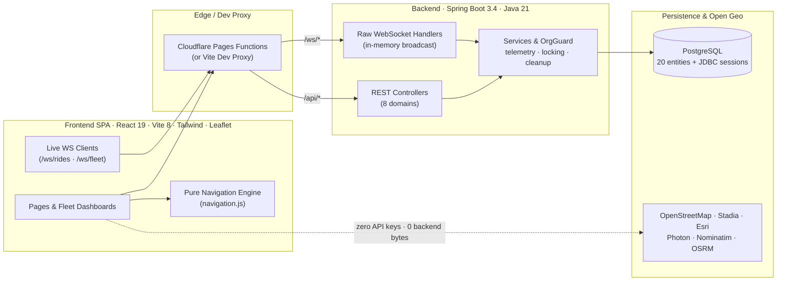

# RideWise Architecture & Design

This document explains how RideWise's frontend, backend, WebSocket layer, and pure navigation engine fit together.

---

## System Overview

---

## Four Core Design Rules

1. **Pure, framework-free navigation math** — All route projection, off-route detection, rejoin calculation, and ETA math lives in [`frontend/src/services/navigation.js`](../frontend/src/services/navigation.js). It has zero React or Leaflet imports and is shared across solo navigation, group rides, passenger fleet ETAs, and native `node --test` unit tests.
2. **In-memory WebSocket fan-out, throttled persistence** — Live telemetry broadcasts straight from memory (`FleetBroadcaster` and `RideLocationBroadcaster`). PostgreSQL receives throttled state updates (at most every **5 s** per active vehicle) and thinned breadcrumb trails, so 10 or 1,000 viewers add zero extra DB load.
3. **Server-enforced multi-tenant RBAC** — Every organization endpoint and WebSocket watch request checks permissions through `OrgGuard` on the backend. The UI only hides controls that the server would reject anyway.
4. **Browser-direct geospatial stack** — Map tiles, geocoding, and OSRM routing go straight from the browser to open providers with built-in request queues, coordinate rounding, and automatic fallbacks.

---

## Engineering Highlights

| Problem | How RideWise handles it |
|---|---|
| **Double-booked vehicles or drivers** | Nullable unique columns (`active_vehicle_key`, `active_driver_key` on `VehicleSession`) set only while a trip is active—concurrent starts fail atomically at the PostgreSQL level. |
| **10 or 1,000 people watching one bus** | Positions broadcast from memory over `/ws/fleet`; DB writes happen at most once every **5 s** per active vehicle regardless of viewer count. |
| **Tamper-proof fleet analytics** | Distance, top speed, and speeding events are computed server-side from accepted GPS fixes rather than trusting client-calculated summaries. |
| **Cheap passenger ETAs** | The browser feeds streamed vehicle fixes through `navigation.js`—zero extra routing API calls per passenger. |
| **Jittery off-route false alarms** | Segment projection with GPS-accuracy-scaled hysteresis instead of naive nearest-vertex distance. |
| **Continuous tracking across trips** | Viewers subscribe to a *vehicle* or *organization*, not a single trip ID, so tracking rolls over automatically when a driver starts the next shift. |
| **Sessions surviving free-tier sleep** | `spring-session-jdbc` persists 30-day sessions in PostgreSQL (`spring_session`, `spring_session_attributes`) so backend restarts or Render spin-downs keep users logged in. |
| **Proxy-safe WebSocket heartbeats** | Both `/ws/fleet` (`fleetSocket.js`) and `/ws/rides` (`rideSocket.js`) send a JSON `ping` every **25 s** (answered with `pong`) to prevent idle drops behind Cloudflare's 100 s timeout. |
| **Fast, isolated local tests** | Backend tests run on an isolated H2 test configuration (`MODE=PostgreSQL`); frontend tests run natively via `node --test`. |

---

## Feature Deep-Dive

### Solo Navigation & UI Customization
- **Segment projection & hysteresis** in `navigation.js` avoids false off-route flickers on long straight highways.
- **Voice guidance & full maneuver list** with completed, current, and upcoming turn indicators.
- **Screen Wake Lock & offline recovery** keeps the screen awake mid-ride and restores active rides across brief mobile data drops.
- **6 map styles** (`Automatic`, `Standard`, `Dark`, `Satellite`, `Terrain`, `Cycling`) and **4 UI themes** (`Dark`, `Light`, `Warm`, `Midnight`).
- **Add to Home Screen** via [`frontend/public/manifest.webmanifest`](../frontend/public/manifest.webmanifest) and app icons *(note: there is no offline service worker cache yet)*.
- **Accessibility & universal search** — font scaling, reduced motion, high contrast, voice commands, and header search across `All`, `Rides`, `Riders`, `Orgs`, and `Go`.

### Group Riding & Purple Rejoin
- Authenticated WebSocket (`/ws/rides`) reuses the first-party `SESSION` cookie and verifies ride membership on every subscribe/publish.
- **Opt-in location sharing** — the creator shares automatically while invited riders can toggle location sharing on/off; no stale or fake markers are drawn when GPS is off.
- **Purple rejoin line** — when a rider drifts off route, other riders see their pill flag **Off route**, and the stray rider receives a purple rejoin path ahead on the main route with turn instructions.

### Multi-Tenant Organizations & Fleet Operations
- Organizations can be **public** (discoverable by anyone) or **private** (unlocked with an org access code such as `RW-ZU5NHC`).
- **Driver Mode** — 3-tap trip start (vehicle → route/destination → start), background app-wide trip context (`DriverTripContext`), speed alerts, crowd reporting (`Seats free`, `Filling up`, `Full`), and one-tap **SOS**.
- **Passenger & Customer Tracking** — live bus/cab movement, stop-by-stop ETA drawer, and server-evaluated **"Tell me when it's near"** proximity alerts.
- **9-Tab Organization Admin Suite** ([`OrgAdmin.jsx`](../frontend/src/pages/org/OrgAdmin.jsx)):
  1. **Overview** — today's metrics, active emergencies, recent audit log
  2. **Live map** — all active vehicles on one map; force-end forgotten trips
  3. **Vehicles** — fleet roster and lifecycle (`Active`, `Servicing`, `Repair`, `Retired`)
  4. **Routes** — multi-stop saved routes for drivers
  5. **People** — admins, drivers, viewers, invitations, and access holders
  6. **Trips** — trip history with thinned GPS replay (capped at 4,000 points/trip) and CSV export
  7. **Announce** — organization-wide announcements
  8. **Statistics** — trips, distance, driving time, and speeding by day/driver/vehicle
  9. **Settings** — organization details, privacy, speed limit, access password, deletion
- **Automated Hygiene (`DataCleanupService`)** — scheduled every **6 hours** to prune old route JSON (>7 d), replay tracks (>90 d), old notifications, and audit logs (>180 d).

---

## Roadmap

The full design and expansion plan is documented in [`Full plan for the platform/RIDEWISE_COMPLETE_PLATFORM_PLAN.md`](../Full%20plan%20for%20the%20platform/RIDEWISE_COMPLETE_PLATFORM_PLAN.md).

| Capability | Status |
|---|---|
| Solo navigation, voice guidance, 6 map styles & off-route rejoin | Built |
| Real-time group rides with live off-route visibility | Built |
| Multi-tenant organizations & contextual RBAC (`OrgGuard`) | Built |
| Live fleet map, DB-locked trips, SOS, crowd levels, replay & CSV | Built |
| Server-measured analytics & server-evaluated proximity alerts | Built |
| Platform admin console, universal search & automatic ride retention | Built |
| Scheduled timetables ("expected at 7:40 AM") & stop-order optimization | Planned |
| Polygon geofencing alerts | Planned |
| Web Push notifications & native mobile wrapper with background GPS | Planned |
| Multi-instance scaling via Redis Pub/Sub for WebSocket state | Planned |
