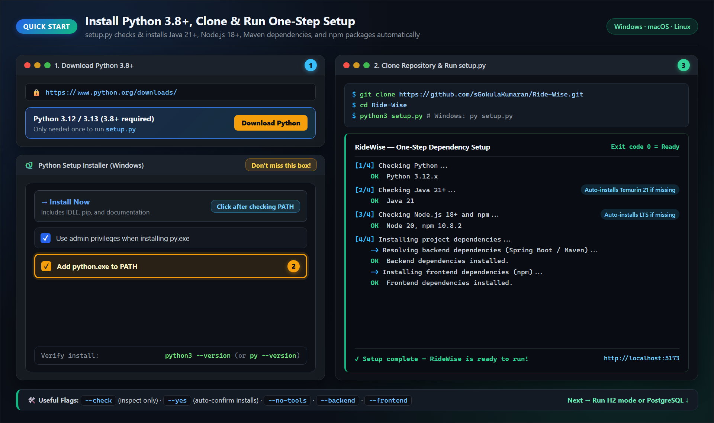
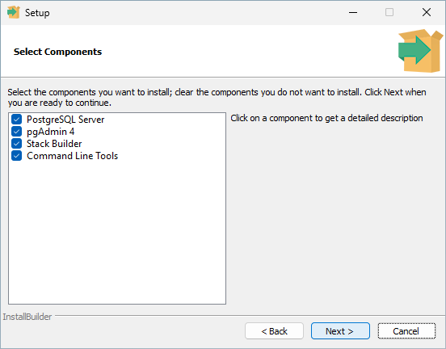
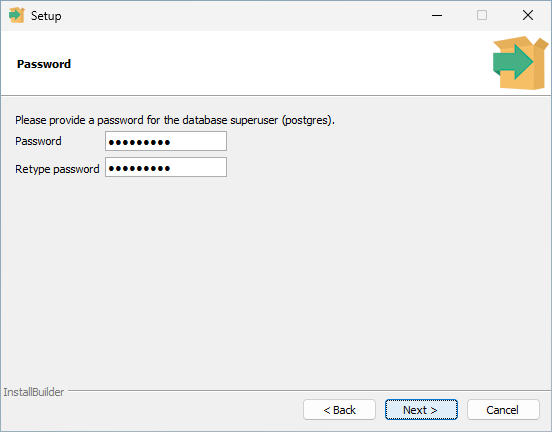
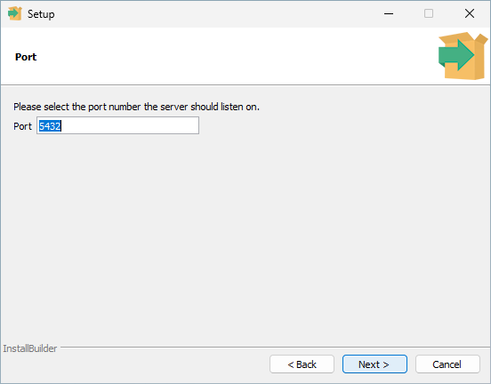
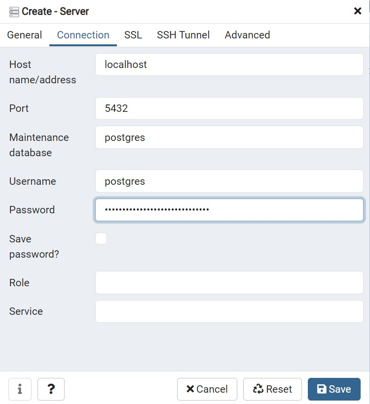
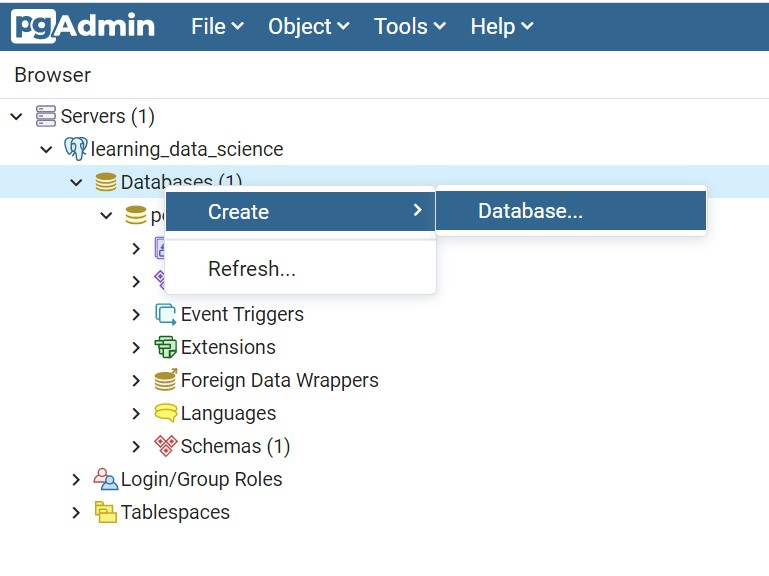
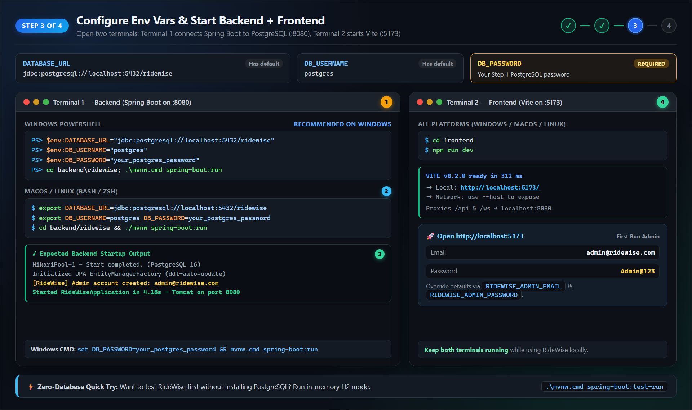
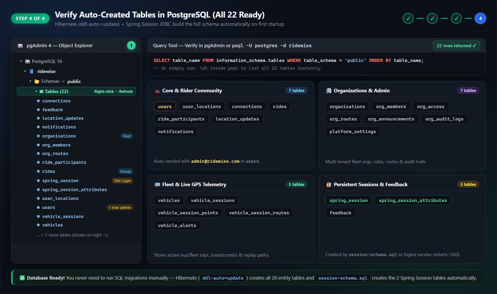

# RideWise Setup & Local Development Guide

This guide covers everything you need to run RideWise locally—from the 1-minute zero-database setup to full PostgreSQL 15+ persistence, production builds, tests, and troubleshooting.

---

## Prerequisites

| Tool | Required Version | Notes |
|---|---|---|
| **Java 21+ & IDE** | **21+** (21 LTS) | Required for the Spring Boot 3.4 backend. We recommend installing [**IntelliJ IDEA**](https://www.jetbrains.com/idea/download/) first (which can download JDK 21 for you automatically), or using [**Eclipse / Spring Tools 4**](https://spring.io/tools) or [**VS Code**](https://code.visualstudio.com/Download). |
| **Node.js & npm** | **20.19+** or **22.12+** (**22 LTS recommended**) | Required by Vite 8 (`^20.19.0 \|\| >=22.12.0`). *Node 18 will fail on `npm run dev`.* |
| **Python** | **3.8+** | Only needed to run the cross-platform `setup.py` helper |
| **PostgreSQL** | **15+** *(optional)* | Not needed for the H2 test configuration; required for persistent local data |
| **Git** | Any recent version | To clone the repository |

### Recommended IDE Setup for the Spring Boot Backend

We recommend installing **[IntelliJ IDEA](https://www.jetbrains.com/idea/download/)** first—it gives you the cleanest, fastest Spring Boot experience and can download JDK 21 automatically without manual setup. If you prefer another editor, you can also use **Eclipse / Spring Tools 4** or **Visual Studio Code**.

#### Option 1: IntelliJ IDEA (Recommended — Easiest Setup)
1. **Install:** Download and install [**IntelliJ IDEA**](https://www.jetbrains.com/idea/download/) (Community Edition is free and works out of the box; Ultimate also works).
2. **Open Backend:** Launch IntelliJ → click **Open** → select the **`backend/ridewise`** folder (where `pom.xml` lives) and trust the project.
3. **Download / Select Java 21 Inside IntelliJ:** Press `Ctrl+Alt+Shift+S` (or **File → Project Structure → Project**). Under **SDK**, if Java 21 is not listed, click **Add SDK → Download JDK...**, choose **Version 21**, and click **Download**.
4. **Load Maven Dependencies:** IntelliJ automatically reads `pom.xml` and downloads all Spring Boot dependencies (or click the **Maven (`m`)** icon on the right sidebar → **Reload All Maven Projects**).
5. **Configure & Run the Backend:**
   - Open `src/main/java/vehicle/ridewise/RideWiseApplication.java`.
   - **To run with PostgreSQL:** Click the green **Run (`▶`)** icon next to `RideWiseApplication` → **Modify Run Configuration...** → in **Environment variables**, add:
     `DATABASE_URL=jdbc:postgresql://localhost:5432/ridewise;DB_USERNAME=postgres;DB_PASSWORD=your_postgres_password`
     Then click **OK** and press **Run (`▶`)** — the backend starts on `http://localhost:8080`.
   - **To run with in-memory H2 (no database setup):** Open the integrated Terminal in IntelliJ and run `./mvnw spring-boot:test-run` (Windows: `.\mvnw.cmd spring-boot:test-run`).

#### Option 2: Visual Studio Code (Lightweight Full-Stack Editor)
1. **Install:** Download and install [**Visual Studio Code**](https://code.visualstudio.com/Download).
2. **Install Required Extensions & Packages:** Open the Extensions tab (`Ctrl+Shift+X`) and install:
   - [**Extension Pack for Java**](https://marketplace.visualstudio.com/items?itemName=vscjava.vscode-java-pack) *(Microsoft — includes Language Support, Debugger, Maven, and Test Runner)*
   - [**Spring Boot Extension Pack**](https://marketplace.visualstudio.com/items?itemName=vmware.vscode-boot-dev-pack) *(VMware — Spring Boot Dashboard & Initializr)*
   - *(Recommended for Frontend)* [**Tailwind CSS IntelliSense**](https://marketplace.visualstudio.com/items?itemName=bradlc.vscode-tailwindcss) and [**ESLint**](https://marketplace.visualstudio.com/items?itemName=dbaeumer.vscode-eslint)
3. **Install / Select JDK 21 in VS Code:** Press `Ctrl+Shift+P` → run **`Java: Install New JDK`**, download **JDK 21**, and reload the window.
4. **Run the Backend:** Open the project in VS Code, open the **Spring Boot Dashboard** on the left sidebar (or open `RideWiseApplication.java`), or run the backend from the integrated terminal (`Ctrl+\``) inside `backend/ridewise`.

#### Option 3: Eclipse IDE / Spring Tools 4 (STS)
1. **Install:** Download [**Spring Tools 4 for Eclipse**](https://spring.io/tools) or [**Eclipse IDE for Enterprise Java and Web Developers**](https://www.eclipse.org/downloads/packages/).
2. **Import Project:** Go to **File → Import... → Maven → Existing Maven Projects** → click **Browse...** and select the **`backend/ridewise`** folder → click **Finish**.
3. **Verify Java 21:** Go to **Window → Preferences → Java → Installed JREs** and ensure a **Java 21 JDK** is selected (Eclipse 2024+ bundles JDK 21 automatically).
4. **Configure & Run the Backend:** Right-click `RideWiseApplication.java` → **Run As → Run Configurations...** → open the **Environment** tab to add `DATABASE_URL`, `DB_USERNAME`, and `DB_PASSWORD`, then click **Run** (starts on `http://localhost:8080`).

---

## Step 1: Install Python 3.8+ (for `setup.py`)

RideWise ships with a single cross-platform setup script ([`setup.py`](../setup.py)) that checks your Java and Node.js versions, optionally installs missing runtimes, and resolves Maven and npm dependencies.

- **Download Python:** <https://www.python.org/downloads/>
- **Detailed Windows walkthrough:** [How to Install Python on Windows (freeCodeCamp)](https://www.freecodecamp.org/news/how-to-install-python-in-windows-operating-system/)
- **Windows tip:** On the first screen of the Python installer, check **`Add python.exe to PATH`** before clicking *Install Now*.
- **macOS / Linux:** Python 3 is usually pre-installed.

Verify in a terminal:

```bash
python3 --version     # macOS / Linux
py --version          # Windows
```

---

## Step 2: Clone & Run `setup.py`

```bash
git clone https://github.com/sGokulaKumaran/Ride-Wise.git
cd Ride-Wise
python3 setup.py      # Windows: py setup.py
```

`setup.py` automatically:
1. Checks for **Python 3.8+**, **Java 21+**, and **Node.js 20.19+ / 22.12+ (22 LTS recommended) + npm**.
2. Offers to install missing Java/Node runtimes via your system package manager (`winget`, `brew`, `apt-get`, `dnf`, `pacman`, or `zypper`).
3. Resolves Maven dependencies in `backend/ridewise`.
4. Runs `npm install` in `frontend`.

<p align="center">
  
  <br/>
  <sub><b>Steps 1 &amp; 2</b> — Install Python 3.8+ (checking <i>Add python.exe to PATH</i> on Windows), clone the repo, and run <code>setup.py</code></sub>
</p>

<details>
<summary><b>Useful <code>setup.py</code> flags</b></summary>

| Command | What it does |
|---|---|
| `python3 setup.py --check` | Check installed tool versions only; install nothing. |
| `python3 setup.py --yes` | Skip prompts and auto-confirm missing tool installs. |
| `python3 setup.py --no-tools` | Never install Java/Node automatically; print instructions instead. |
| `python3 setup.py --backend` | Resolve backend Maven dependencies only. |
| `python3 setup.py --frontend` | Install frontend npm packages only. |

*(`setup.sh` and `setup.ps1` are thin wrappers that invoke `setup.py`.)*

</details>

---

## Option A: Quick Try in 1 Minute (No Database Needed — H2 Test Configuration)

Want to try the full app immediately without installing PostgreSQL? `backend/ridewise/src/test/resources/application.properties` acts as an **H2 test configuration** (configured with `MODE=PostgreSQL`) that replaces the main properties file on the test classpath when launched via `spring-boot:test-run`:

```bash
# Terminal 1 — start backend on http://localhost:8080 (in-memory H2)
cd backend/ridewise
./mvnw spring-boot:test-run        # Windows: .\mvnw.cmd spring-boot:test-run

# Terminal 2 — start frontend on http://localhost:5173
cd frontend
npm run dev
```

Open **<http://localhost:5173>**. Vite proxies both `/api/*` and `/ws/*` to `http://localhost:8080`, so no CORS configuration is needed. *(Note: H2 data resets whenever you stop the backend.)*

> [!WARNING]
> **Default platform admin account:** On first boot with an empty database, `DataInitializer` creates `admin@ridewise.com` with password **`Admin@123`** unless `RIDEWISE_ADMIN_EMAIL` / `RIDEWISE_ADMIN_PASSWORD` are set. **Change this before exposing the server publicly.**

---

## Option B: Full Local Setup with PostgreSQL 15+ (Step-by-Step)

If you want real, persistent storage, follow these four steps—**you do not need to write or run any SQL migration scripts**.

### 1. Download & Install PostgreSQL 15+

1. Download the official installer for your OS from **<https://www.postgresql.org/download/>** (PostgreSQL 15 or newer).
   - Need a full click-by-click guide? See the **[Official PostgreSQL Installation Docs](https://www.postgresql.org/docs/current/tutorial-install.html)** or this **[Windows PostgreSQL Setup Guide](https://pleasanter.org/en/manual/setup/installation/install-database/install-postgresql-on-windows/)**.
2. During installation, check these three screens:
   - **Select Components:** Keep **PostgreSQL Server**, **pgAdmin 4**, and **Command Line Tools** checked.
   - **Password:** Set a password for the `postgres` superuser and remember it—you'll use it as `DB_PASSWORD` in Step 3.
   - **Port:** Leave the default port as **`5432`**.

<table>
  <tr>
    <td align="center" width="33%">
      
    </td>
    <td align="center" width="33%">
      
    </td>
    <td align="center" width="33%">
      
    </td>
  </tr>
  <tr>
    <td align="center"><sub><b>1. Select Components</b><br/>Keep <code>pgAdmin 4</code> &amp; CLI tools checked</sub></td>
    <td align="center"><sub><b>2. Superuser Password</b><br/>Remember this for <code>DB_PASSWORD</code></sub></td>
    <td align="center"><sub><b>3. Port</b><br/>Keep the default port <code>5432</code></sub></td>
  </tr>
</table>

### 2. Create the `ridewise` Database

- **Using pgAdmin 4 (GUI):** Open **pgAdmin 4**, connect to your local server (`localhost`, port `5432`, username `postgres`, and your password from Step 1), right-click **Databases → Create → Database...**, name it **`ridewise`**, and click **Save**.
  - Visual walkthrough: **[Creating a PostgreSQL Database in pgAdmin 4](https://elfinwoodecology.org/2020/12/09/creating-a-postgresql-database/)**.
- **Or using the terminal (`psql`):**
  ```bash
  psql -U postgres -c "CREATE DATABASE ridewise;"
  ```

<table>
  <tr>
    <td align="center" width="50%">
      
    </td>
    <td align="center" width="50%">
      
    </td>
  </tr>
  <tr>
    <td align="center"><sub><b>Connect in pgAdmin 4</b><br/>Host <code>localhost</code> · Port <code>5432</code> · User <code>postgres</code></sub></td>
    <td align="center"><sub><b>Create the database</b><br/>Right-click <b>Databases → Create → Database...</b> and name it <code>ridewise</code></sub></td>
  </tr>
</table>

### 3. Set Environment Variables & Start Both Servers

See [`.env.example`](../.env.example) for a complete template of supported environment variables.

Replace `your_postgres_password` with the password you chose in Step 1.

**Windows PowerShell (Terminal 1 — Backend):**
```powershell
cd backend\ridewise
$env:DATABASE_URL="jdbc:postgresql://localhost:5432/ridewise"
$env:DB_USERNAME="postgres"
$env:DB_PASSWORD="your_postgres_password"

# Recommended — override default platform admin (defaults: admin@ridewise.com / Admin@123)
$env:RIDEWISE_ADMIN_EMAIL="admin@ridewise.com"
$env:RIDEWISE_ADMIN_PASSWORD="YourStrongPassword123!"

.\mvnw.cmd spring-boot:run
```

**Windows Command Prompt / CMD (Terminal 1 — Backend):**
```cmd
cd backend\ridewise
set DATABASE_URL=jdbc:postgresql://localhost:5432/ridewise
set DB_USERNAME=postgres
set DB_PASSWORD=your_postgres_password
set RIDEWISE_ADMIN_EMAIL=admin@ridewise.com
set RIDEWISE_ADMIN_PASSWORD=YourStrongPassword123!
mvnw.cmd spring-boot:run
```

**macOS / Linux — Bash or Zsh (Terminal 1 — Backend):**
```bash
cd backend/ridewise
export DATABASE_URL="jdbc:postgresql://localhost:5432/ridewise"
export DB_USERNAME="postgres"
export DB_PASSWORD="your_postgres_password"

# Recommended — override default platform admin (defaults: admin@ridewise.com / Admin@123)
export RIDEWISE_ADMIN_EMAIL="admin@ridewise.com"
export RIDEWISE_ADMIN_PASSWORD="YourStrongPassword123!"

./mvnw spring-boot:run
```

**All Platforms (Terminal 2 — Frontend):**
```bash
cd frontend
npm run dev
```

Open **<http://localhost:5173>** in your browser!

<p align="center">
  
  <br/>
  <sub><b>PostgreSQL Step 3</b> — Export your DB credentials, launch Spring Boot on <code>:8080</code>, and launch Vite on <code>:5173</code></sub>
</p>

> [!CAUTION]
> **Security reminder:** On first boot with an empty database, `DataInitializer` creates an initial platform admin (`admin@ridewise.com` / `Admin@123` by default). **Always set a strong `RIDEWISE_ADMIN_PASSWORD` before exposing the server beyond `localhost`.**

### 4. Verify Auto-Created Tables

On first startup, Hibernate (`spring.jpa.hibernate.ddl-auto=update`) and Spring Session JDBC (`session-schema.sql`) automatically create all **22 tables** in the `public` schema: **20 JPA entity tables** + **`spring_session`** and **`spring_session_attributes`**.

To confirm, refresh **`ridewise → Schemas → public → Tables`** in pgAdmin 4 (`Tables (22)`), or run `\dt` in `psql`:

```bash
psql -U postgres -d ridewise -c "\dt"
```

<p align="center">
  
  <br/>
  <sub><b>PostgreSQL Step 4</b> — All 22 tables (20 JPA entities + 2 Spring Session tables) are created automatically on first boot</sub>
</p>

---

## Production Build & Run Commands

To build and test the production artifacts locally:

```bash
# Frontend — build production bundle and preview locally
cd frontend
npm run build
npm run preview

# Backend — package executable JAR and run it (requires PostgreSQL env vars)
cd backend/ridewise
./mvnw package         # Windows: .\mvnw.cmd package
java -jar target/ridewise-0.0.1-SNAPSHOT.jar
```

For Docker and Cloudflare Pages / Render deployment instructions, see [DEPLOYMENT.md](DEPLOYMENT.md).

---

## Running Tests & Linting

```bash
# Backend — Spring integration & WebSocket tests on isolated H2 test configuration
cd backend/ridewise
./mvnw test            # Windows: .\mvnw.cmd test

# Frontend — pure navigation, places & fleet logic tests (node --test tests/)
cd frontend
npm test

# Frontend — ESLint check (run separately from npm test)
npm run lint
```

---

## Troubleshooting

### 1. Vite fails to start with a Node.js version or syntax error
Vite 8 (`vite@^8.2.0`) requires **Node.js `^20.19.0 || >=22.12.0`**. Running on Node 18 (or Node 20 `<20.19.0` / Node 22 `<22.12.0`) will fail during `npm run dev`.
- Check your version with `node -v`.
- Upgrade to **Node 22 LTS** from <https://nodejs.org/> (or via `nvm` / `fnm`) and re-run `npm install` in `frontend/`.

### 2. Geolocation or Wake Lock silently fails when testing on a phone via LAN IP
Browsers restrict **`navigator.geolocation`** and the **Screen Wake Lock API** to **secure contexts** (`https://...` or `http://localhost`).
- If you open `http://192.168.x.x:5173` on your phone over local Wi-Fi, GPS tracking and Wake Lock will silently fail or be denied by the browser.
- **Fix:** Expose your local Vite server over HTTPS using a quick tunnel (e.g., `cloudflared tunnel --url http://localhost:5173`) — `frontend/vite.config.js` already has `allowedHosts: true` and `AllowedOrigins.java` already permits `https://*.trycloudflare.com` and `https://*.ngrok-free.app`.

### 3. Port `8080` or `5432` is already in use
- **Port `8080`:** Another Spring Boot instance or service is running on `:8080`. Stop it or launch Spring Boot with `-Dspring-boot.run.arguments="--server.port=8081"` (and set `VITE_API_URL=http://localhost:8081` when starting `npm run dev`).
- **Port `5432`:** Another PostgreSQL service is bound to `5432`. Check `services.msc` (Windows) or `lsof -i :5432` (macOS/Linux).

### 4. `DB_PASSWORD` / PostgreSQL authentication failure
`backend/ridewise/src/main/resources/application.properties` intentionally has **no default** for `DB_PASSWORD` (`${DB_PASSWORD}`).
- Ensure `DB_PASSWORD` is exported in the **same terminal session** where you run `./mvnw spring-boot:run`.
- Verify the `ridewise` database exists (`psql -U postgres -l`) and that your password matches the `postgres` role.
